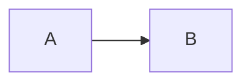

# Authoring conventions

For contributors. The public-facing document is [vedam.md](./vedam.md); this page is the contributor-only style guide and exists to keep the public chapters clean of meta-discussion.

---

## Source format

Markdown is the source of truth. HTML and PDF outputs are generated downstream when the project ships them:

- Static HTML site — mdBook, MkDocs Material, or Quarto.
- PDF yellow paper — pandoc through xelatex.

GitHub's web UI is treated as a first-class rendering target. Anything that does not render correctly on `github.com` is broken.

## File and folder layout

```
docs/
  README.md                Landing (full-bleed logo + "vedam" link).
  vedam.md                 Yellow-paper entry: cover, abstract, ToC, references.
  AUTHORING.md             This file.
  chapters/                Numbered chapter sources and appendices.
  figures/                 SVG assets and figure standards.
  vedam_requirements.xlsx  JIRA-friendly requirements spreadsheet (pending MD conversion).
```

Do not introduce new top-level files at `docs/` root without a plan entry that justifies it.

## Internal links

Use relative paths. Absolute GitHub URLs are reserved for cross-repository links.

| From | To | Pattern |
|------|----|---------|
| `vedam.md` | chapter | `./chapters/XX_name.md` |
| `vedam.md` | figure | `./figures/figXX_name.svg` |
| `chapters/XX.md` | peer chapter | `./YY_name.md` |
| `chapters/XX.md` | figure | `../figures/figXX_name.svg` |
| `chapters/XX.md` | root asset | `../vedam_requirements.xlsx` |
| `figures/README.md` | chapter | `../chapters/XX_name.md` |
| `figures/README.md` | `vedam.md` | `../vedam.md` |
| any | other repo | `https://github.com/ltbhappyness/<repo>/...` (absolute) |

Internal links to `.magic/`, `~`, or absolute filesystem paths must not appear in any public file in `docs/`. The repository memory at `.magic/memory.md` (in the workspace, not in this repo) is for internal context only.

## Voice and content

- Third person only. "Vedam does X", "The protocol does Y", "The substrate biases toward Z". No "we", "our", or first-person plural.
- No personal names in chapters. Project provenance is institutional (`ltbh.org`, `vedam.net`), not biographical.
- No anecdotes, no parenthetical asides about authors, no discussion notes. If a discussion belongs somewhere, it belongs in [chapters/decisions.md](./chapters/decisions.md) as a formal Decision entry with a date and rationale.
- High-level first. Detail follows. Each chapter begins with one sentence of intent.

## Math

KaTeX-compatible LaTeX:

- Inline: `$\varphi = (1+\sqrt{5})/2$`
- Display: `$$\sum_{i=1}^{n} x_i$$`

Do not use pandoc-only or amsmath-only extensions; what fails to render on GitHub is treated as broken.

## Diagrams

Prefer Mermaid inside fenced code blocks:

````

````

GitHub renders Mermaid natively. Author an SVG file in `figures/` only when Mermaid cannot express the layout (precise spatial topology, geometric constructions, layered architecture views).

Workspace mermaid syntax rules apply: no spaces in node identifiers, no explicit styles or colours, no `end` as a node ID, no HTML entities in labels, quote labels that contain parentheses or colons.

## Definitions, theorems, proofs

By convention rather than custom syntax:

- `### Definition 5.1 (Quorum).` — sentence-cased name in parentheses.
- `### Theorem 5.2 (Safety).` — followed immediately by the statement, then `*Proof.*` … `$\square$`.
- `### Lemma 5.3 (Stake-free liveness).` — same pattern.

Numbering uses `<chapter-number>.<entry-number>`. Maintain it manually; do not rely on auto-numbering.

## Citations and references

Two acceptable styles per chapter, pick one and stay consistent within the file:

- Footnote style: `... HotStuff[^hotstuff].` with `[^hotstuff]: Yin, Malkhi et al., *HotStuff*, PODC 2019.` at the end of the file.
- Numbered references: a final `## References` H2 with a numbered list, citations inline as `(Yin et al., 2019)` or `[3]`.

ArXiv and DOI links use full HTTPS URLs.

## Status banners

Every skeleton chapter begins with:

```markdown
> **Status:** skeleton — content migration pending.
```

Remove this banner when the chapter's content is in. Do not leave stale banners.

## Figures

See [figures/README.md](./figures/README.md) for the figure standards: SVG only, no hand-drawn, consistent palette, accessibility (alt text mandatory).

## Decision log

Substantive design changes — new modules, retired modules, license, governance — must land as an entry in [chapters/decisions.md](./chapters/decisions.md) with a `D-YYYY-MM-DD-NN` identifier, a one-line decision, a one-paragraph rationale, and a status. Entries are append-only; corrections appear as new entries that supersede.

## Pull request etiquette

- One concern per PR. Link the relevant Decision IDs and chapter sections.
- If the change touches the public corpus, run a quick visual sanity check on the rendered Markdown before requesting review.
- Do not commit `_site/`, `book/`, or any generator output. The `.gitignore` already excludes the common patterns.
