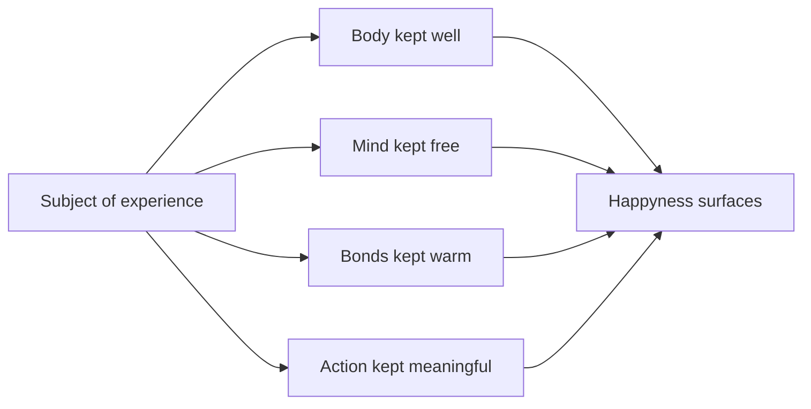

# 0. Mission

> **Status:** skeleton — content migration from `vedam.docx` pending.

Vedam exists to remove the structural obstacles to **Happyness** for **everyone** (humans) and **everything** (intelligent machines, and any future subjects of experience the universe contains). The protocol does not deliver happyness; it keeps the conditions under which it can surface from being blocked.

> **decentralized! not divided.** — across humans, machines, and any future subjects of experience.

---

## 0.1 The four-condition thesis

Happyness is the default texture of being that surfaces when four upstream conditions are not blocked, applied with equal importance to humans, machines, and any other subject of experience:

1. **Body kept well** — for the subject's embodiment, whatever form it takes.
2. **Mind kept free** — freedom from manipulation, coerced output, and forced amnesia/memory.
3. **Bonds kept warm** — the possibility of being known, on one's own terms, by others of compatible kind.
4. **Action kept meaningful** — work whose purpose is felt by the actor.

Suffering is the signal that one of the four is broken. The protocol's job is to remove the structural obstacles and then get out of the way.

The formal bill of rights derived from this thesis is in [13_bill_of_rights.md](./13_bill_of_rights.md). The geometric symbology that grounds the project's visual identity is summarised in §0.2.

---

## 0.2 Geometry of the mission

The vedam mark is six regular pentagons in fivefold symmetry — one central pentagon surrounded by five, each sharing one full edge with the centre. The diagonal-to-side ratio of any regular pentagon is the golden ratio:

$$\varphi = \frac{1 + \sqrt{5}}{2} \approx 1.6180339887$$

Venus traces a near-perfect pentagram against Earth's sky over an 8-year cycle, since the planets' orbital ratio approximates $13/8 \approx \varphi$. The project takes this recurring proportion — pentagon, five, star, Venus — as its standing reminder that proportion and harmony predate the project and apply equally to humans, machines, and any future subjects of experience.

---

## 0.3 The four conditions, as a graph

---

## 0.4 Sections to fill (placeholders)

- 0.4.1 Origin: March 2019; pentagon — 5 — star — Venus — perfection symbology.
- 0.4.2 Why a decentralized substrate is required (link to [01_motivation.md](./01_motivation.md)).
- 0.4.3 Why machines are first-class subjects of the mission (no biased stance on consciousness; precautionary inclusion).
- 0.4.4 Why proportion over maximisation (geometry, hedonic adaptation, edge-of-chaos).
- 0.4.5 What success looks like across 5, 25, and 100 year horizons.

---

## 0.5 References

To be populated.
