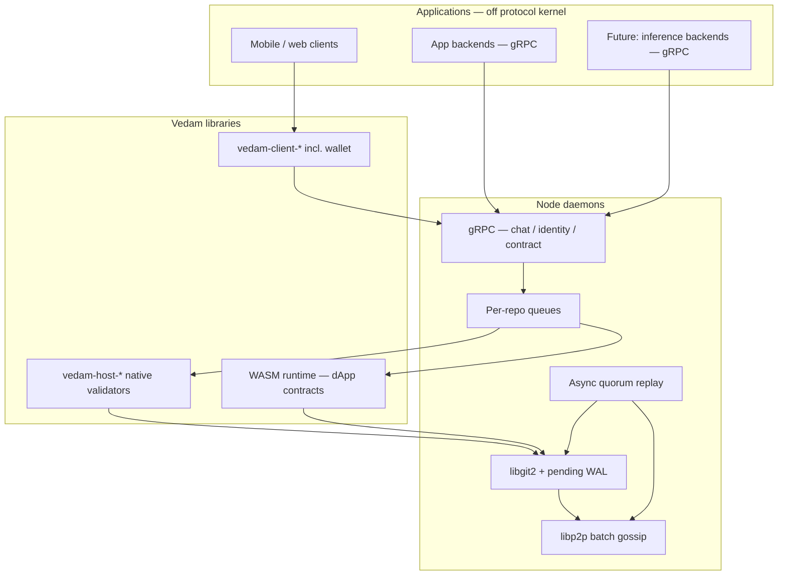
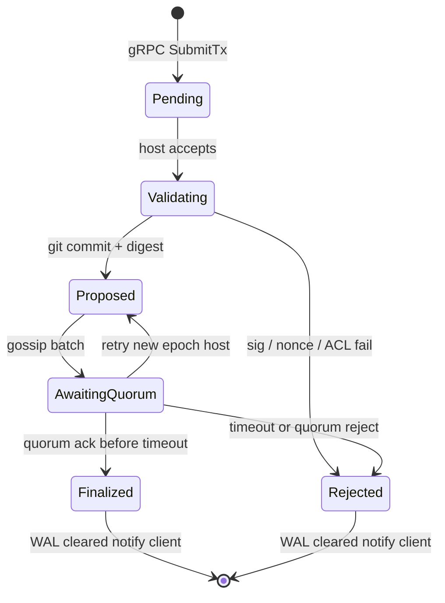
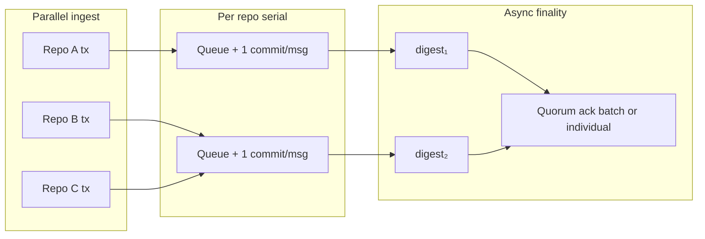
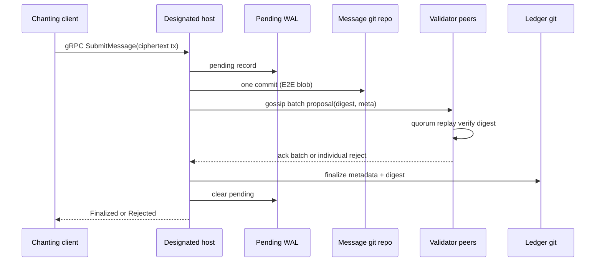

# 2. Architecture

Vedam is a **decentralized application platform**: peer nodes that **finalize** agreed history, store **git-shaped repos**, and run **two execution tiers** — **native protocol validation** (messaging, identity, wallet) and **WASM dApp contracts** (tokens, DeFi-style rules, composability). Design **v0.4**.

Radicle / Heartwood are **reference precedents** for git-over-P2P replication — not the full scope of Vedam (identity, finality, chanting, future dApps). See [12_open_questions.md](./12_open_questions.md) §12.10 for license review before any code reuse.

---

## 2.1 Layered node model

Each **Vedam node** runs one or more **native daemons** (Class A–D on Linux; Class E as thin client libraries + remote gRPC). Typical stack:

**Definition 2.1 (Node host).** Native code that accepts gRPC transactions, validates them against **finalized heads**, writes **one message per git commit** (MVP), proposes **`finality_digest`**, participates in **async quorum replay**, and replicates objects over libp2p. The host is **not** trusted alone — **⌈2n/3⌉ validators** must match the digest.

**Definition 2.2 (Execution tiers).** **Tier A (native):** chanting, ACL, identity, built-in transfers — **`vedam-host-*`**. **Tier B (WASM):** deployable **dApp contracts** for trustless rules between strangers (tokens, AMMs, composable calls). See [06_execution.md](./06_execution.md) §6.0 layman guide.

**Definition 2.3 (Application).** **`app-*`** products use **`vedam-client-*`** (wallet + tx builders) and optional backends. **Product logic** may be off-chain (AI, UI), **native tx**, or **WASM contract** depending on trust boundaries.

---

## 2.2 Repository topology (per node, per app)

Every node that stores data runs a **local git server** (libgit2). Repos are **scoped by application** (`app_id`):

| Kind | Scope | Content | Confidentiality |
|------|-------|---------|-----------------|
| **Chapter** | One subject / org | **Public** app content (encrypted RDF when private) | Capabilities + optional app crypto |
| **DM** | Sender ↔ receiver (or self-vault) | **E2E ciphertext** (encrypted RDF) | Participants only |
| **Group** | Member set incl. sender | **E2E ciphertext** (encrypted RDF) | Members only |
| **Ledger** | Validators | **Metadata only** — tx envelope, `payload_hash`, refs, `finality_digest`, nullifier-commitments, identity registry | Protocol policy |

Content bodies use **RDF** as the canonical model ([15. Data model and interoperability](./15_data_model.md)); private bodies are encrypted at rest. Repos may be backed by any **storage adapter** — local disk, a peer node, or a ciphertext-only cloud tier (Google Drive, OneDrive/SharePoint, GitHub, GitLab) — see [3. Storage layer (L0)](./03_storage.md). Class **A/B** nodes **pin ciphertext** they are allowed to fetch — they **cannot read** DM/group plaintext without keys. Any mirror is a **non-authoritative ciphertext copy**, not network truth.

**Finalized ledger git is durable on disk** on enough independent Class A/B peers after finality; the **live** ledger and a **pending WAL** (tmpfs + small disk journal) hold in-flight work until quorum ack or explicit rejection — see [3. Storage layer (L0)](./03_storage.md).

---

## 2.3 Ingress: host selection and self-route rule

Clients **never** sequence their own transactions on the **same node instance** that submits them.

**Definition 2.4 (Designated host).** For each submit window:

$$
\text{host} = H(\text{sender\_chapter\_id}, \text{app\_id}, \text{repo\_id}, \text{epoch}) \bmod |V|
$$

where $V$ is the active validator set and **epoch** advances on timeout or schedule.

| Event | Client / protocol action |
|-------|---------------------------|
| Host timeout | Retry same epoch, then **epoch + 1** → new host |
| Host Byzantine | Validators reject bad proposal; **no finality**; client notified |
| Host down | Failover via epoch bump |

The designated host may validate **other users’** txs; it does not act as sequencer for **its operator’s own** submits (strict **no self-route**).

---

## 2.4 Ordering, queues, and one commit per message (MVP)

**MVP:** **no batch squash** — one logical message → **one git commit** on the target repo. **Batching applies only to network gossip** (proposals and acks), not to collapsing commits.

Multithreaded gRPC receivers feed a **per-(app_id, repo_id) mutex queue**:

1. **Validate** signature, ACL, **nonce**, parent head alignment.
2. **Reorder buffer** — **nonce is authoritative**; `client_time` / optional TEE fields are tie-breakers and fraud hints only.
3. **Single-writer** append to git (parallel across **different** repos).
4. Build **`finality_digest`** for the commit (see [05_consensus.md](./05_consensus.md)).
5. **Async quorum replay** with **per-commit timeout**; gossip **batched** proposals/acks.

Clients receive **explicit status** (`pending`, `finalized`, `rejected` + reason) — not silent failure.

---

## 2.5 Parallelism vs serial finality

| Work class | Parallelism | Serialization |
|------------|---------------|---------------|
| Different **(app, chapter/DM/group) repos** | High | Independent nonce chains |
| **gRPC ingress** threads | High | Per-repo queue lock |
| **Quorum replay** | Async across commits | Each digest verified independently |
| Same repo **HEAD / nonce** | None | Strict serial |

---

## 2.6 gRPC / protobuf library families

Vedam ships **versioned protobuf schemas + client/host libraries** — not prebuilt node binaries. Families (separate `.proto` + daemons where needed):

| Family | Purpose | MVP |
|--------|---------|-----|
| **`vedam-tx`** | Canonical transaction envelope | Required |
| **`vedam-consensus`** | Proposals, acks, rejections, epoch control | Required |
| **`vedam-identity`** | Chapter registration, PoP hooks, ACL | Required |
| **`vedam-chat`** | Chanting submit / status / fetch | Required for app-chanting |
| **`vedam-infer`** *(Phase 2)* | NN session create/run — **app backend API**, not ledger VM | Optional dApp |

App authors reuse **client libraries**; validators link **host validators**. **Backward-compatible decoders** read old `tx_version` history.

Future **AI hive-mind** workloads: **gRPC to app-owned inference backends** (GPU/XPU); ledger stores **hashes of inputs/outputs** when an app chooses to anchor — not protocol-core tensor ops at MVP.

---

## 2.7 Node classes

| Class | Role | Storage | Defconfig |
|-------|------|---------|-----------|
| **A** | Archivist | Pin allowed repos; promisor | `defconfig.class-a` |
| **B** | Full validator | Validate + finalize + execute | `defconfig.class-b` |
| **C** | Light operator | Partial clone | `defconfig.class-c` |
| **D** | IoT gateway | Recent refs; L3 anchors | `defconfig.class-d` |
| **E** | Phone / browser client | No full git — `vedam-client-*` + gRPC to B/A | `defconfig.class-e` |

No **fee / token** at MVP — see [12_open_questions.md](./12_open_questions.md) §12.1 for archive economics.

Embedded figure targets (rework pending):

``

``

---

## 2.8 Chanting data path (reference app)

1. Sender builds an **RDF body**, then encrypts it **client-side** (Double Ratchet / epoch keys — [7. Identity and privacy](./07_identity.md)).
2. Client calls **`vedam-chat`** gRPC on **remote designated host** (never self-route).
3. Host writes **one git commit** (ciphertext blob) on DM/group repo; **`payload_hash`** in tx envelope.
4. **`finality_digest`** finalized by async quorum; ledger git stores digest + ref metadata.
5. libp2p **batch gossip** replicates objects to A/B peers.

---

## 2.9 Edge app and the on-device backend

Every device that participates runs a small **Vedam backend** (a node daemon plus libraries); the **edge app** is the subject-facing UI that talks to its local backend over gRPC.

| Component | Runs where | Role |
|-----------|------------|------|
| **Edge app** | Subject's device (mobile / desktop / web) | UI; builds RDF content; calls local backend |
| **Local backend** | Same device (or a chosen peer device) | Holds the subject's keys and storage credentials; encrypt/decrypt; ACL daemon; storage adapter; libp2p |
| **Validator / archivist** | Class A/B peers | Finality, replication, durability |

The **access-control daemon** and the **RDF encode/encrypt pipeline** are co-located with the local backend, so private keys and decryption never leave the subject's device. A subject without their own always-on device may delegate the backend role to a **chosen peer device** under the same own-credentials invariant ([3. Storage layer (L0)](./03_storage.md) §3.5). Installation, packaging, and infrastructure are detailed in [16. Deployment and operations](./16_deployment.md).

---

## 2.10 Cross-references

- [3. Storage layer (L0)](./03_storage.md) — WAL, object model, adapters, RDF-at-rest, retrieval flow.
- [4. Network layer](./04_network.md) — libp2p, batch gossip framing.
- [5. Consensus](./05_consensus.md) — `finality_digest`, async quorum, timeouts, tiered finality.
- [6. Execution](./06_execution.md) — Tier A native + Tier B WASM dApp contracts.
- [7. Identity and privacy](./07_identity.md) — nullifier, root subject, pseudonyms, capabilities, E2E.
- [15. Data model and interoperability](./15_data_model.md) — RDF/HDT, vocabularies, SOLID compatibility.
- [16. Deployment and operations](./16_deployment.md) — edge app, install, infra, CI/CD, upgrade.
- [9. Modularity and build](./09_modularity_build.md) — OTA build, cross-compile, versioning.
