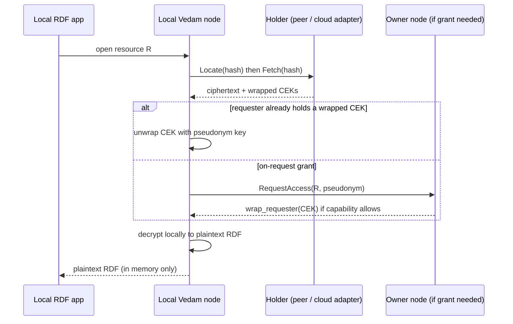
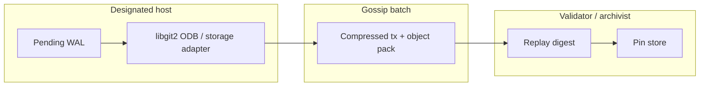

# 3. Storage layer (L0)

The storage layer is a **content-addressed Merkle log** via **libgit2** and **SHA-256**. Git provides **integrity**; **consensus** chooses which commits are **final**. Git alone does not order transactions or tolerate Byzantine writers.

Storage is **subject-owned and location-flexible**: a subject keeps data in any backend it chooses — local disk, a peer node, or a third-party drive — while the protocol guarantees integrity, finality, and confidentiality independent of where the bytes physically rest. Runtime data lives on **peer nodes and chosen backends**, never in the design-documentation tree (`ltbhappyness/docs`).

---

## 3.1 Two storage planes

| Plane | Git repos | Holds | After finality |
|-------|-----------|-------|----------------|
| **Message plane** | Chapter / DM / Group per `app_id` | App payloads — **encrypted RDF** (ciphertext) for DM/group | Durable on host + replicated to A/B |
| **Ledger plane** | Protocol ledger repo(s) | **`finality_digest`**, refs, tx metadata, nullifier-commitments, identity registry — **no message plaintext, no personal content** | Durable; authoritative for validators |

Optional **mirrors** (GitHub, GitLab, OneDrive, Google Drive, …): copies of **ciphertext objects only**; **never** source of truth or finality.

---

## 3.2 Object model

| Git object | Use |
|------------|-----|
| **Blob** | Ciphertext (encrypted RDF), public chapter bytes, protobuf tx bytes, plugin artifacts |
| **Tree** | Directory snapshot |
| **Commit** | **One message per commit (MVP)** on message plane; ledger commits anchor digests |
| **Tag** | Release / plugin version markers (optional) |

**Definition 3.1 (`finality_digest`).** Primary quorum value:

$$
d = \text{SHA-256}(\text{canonical\_bytes}(\text{round\_hint}, \text{parent\_ref}, \text{tx\_canonical}))
$$

Stored in **ledger commit metadata** (TLV in commit message or sidecar blob) for audit. Peers compare $d$ — not ad hoc local `git commit` timestamps.

**Definition 3.2 (Parent + nonce rule).** For a transaction with **nonce** $N$ on repo $R$, the **parent** must be the last **finalized** commit on $R$ whose applied tx had nonce $N-1$. Mismatch → **reject** before durable write.

---

## 3.3 Content model — RDF, with HDT for scale

Message and chapter payloads use **RDF** (triples) as the canonical content model, so data is **decoupled from any single app**: any application that understands the relevant vocabulary reads the same data.

| Payload shape | Encoding |
|---------------|----------|
| **Small / mutable** (a chat message, a profile field) | Turtle or RDF/CBOR |
| **Large / static** (an archive, a knowledge graph) | **HDT** (Header-Dictionary-Triples) binary RDF |
| **Large binaries** (image, video, model weights) | Content-addressed encrypted blob, **referenced from** RDF — not expressed as triples |

**Definition 3.3 (Canonical body).** The cleartext body of a resource is an **RDF graph**; its at-rest representation is the **encrypted** (optionally HDT-encoded) serialization. Apps generate content through a Vedam-provided **encode + encrypt pipeline** ([15. Data model and interoperability](./15_data_model.md)).

Cross-app **query** (SPARQL-style) operates only over the **decrypted, authorized** set held by an app at runtime — there is no global query over ciphertext. This is a deliberate trade: confidentiality over global queryability.

---

## 3.4 Encryption at rest and envelope key delivery

Any byte that may reach a third-party or public backend is **end-to-end encrypted**. Confidentiality does not depend on trusting the storage host.

**Definition 3.4 (Content-key envelope).** A resource is encrypted under a per-resource **content key (CEK)**. The CEK is **wrapped** (encrypted) once per authorized recipient, to that recipient's **app-scoped pseudonym public key** ([7. Identity and privacy](./07_identity.md)). Stored beside the ciphertext:

$$
\{\, \text{enc}_{\text{CEK}}(\text{RDF}),\; \text{wrap}_{P_1}(\text{CEK}),\; \ldots,\; \text{wrap}_{P_k}(\text{CEK}) \,\}
$$

A recipient unwraps the CEK with its own private key and decrypts locally. There is **no central key server**. DM and group sessions instead use the **Double Ratchet / epoch keys** for forward secrecy; per-resource files use envelopes.

---

## 3.5 Storage adapters

A **storage adapter** abstracts where objects physically live. The git object store and blob store can be backed by any adapter; integrity is guaranteed by content addressing regardless of backend trust.

| Adapter | Backend | Trust role |
|---------|---------|------------|
| **local** | On-device disk | Owner-trusted |
| **peer** | Another Vedam node (Class A/B) | Replication + durability |
| **cloud** | Google Drive (Drive API v3), OneDrive / SharePoint (Microsoft Graph), GitHub, GitLab | **Untrusted ciphertext tier** — convenience only |

**Definition 3.5 (Own-credentials invariant).** A node uses **only its own** storage credentials, for **only its own** subject's data. A request to read or write *on behalf of* another subject is satisfied by **that subject's own node** serving an authorized protocol request — never by lending or operating another subject's storage credentials.

Cloud adapters hold **ciphertext only**, so the provider cannot read content and any single provider is replaceable. A subject may spread encrypted objects across multiple backends, including peers who agree to host storage. Incentives for peer-donated storage without a token remain open — [12. Open questions](./12_open_questions.md) §12.1.

---

## 3.6 Retrieval and decryption flow

**Protocol primitives:** `Locate(hash)`, `Fetch(hash)`, `RequestAccess(resource, pseudonym) → wrapped_CEK`, and key-wrap-on-write. Integrity is verified by hash on fetch; plaintext is never persisted by intermediaries and is held only in the authorized app's memory.

---

## 3.7 Durability and the live ledger

**Definition 3.6 (Durable write trigger).** The ledger plane persists **after quorum ack**. The message plane may hold provisional objects until ack; refs are marked `pending/` until finalized.

- The **live ledger** (in-flight consensus state and the pending WAL) runs in **RAM / tmpfs**.
- **Finalized** ledger and message objects must land **durably on enough independent Class A/B peers** before they count as final.
- Mirrors (cloud or GitHub) are **encrypted convenience copies** and are **never** the durability or finality authority. A single host is never treated as truth.

This preserves cheap, ephemeral edge devices (phones, IoT) as compute and cache while keeping authority in the redundant peer set.

---

## 3.8 Pending WAL (crash + failure notification)

**Requirement:** Clients must learn **rejected** and **timed-out** txs — not only success by observation.

| State | Storage | Transition |
|-------|---------|------------|
| **pending** | WAL (tmpfs + disk journal) | Accept from gRPC |
| **proposed** | WAL + provisional git objects | Commit written locally |
| **finalized** | Durable git + ledger | Quorum ack |
| **rejected** | WAL record with reason | Validation / quorum fail |

After **finalized** or **rejected**, the WAL entry is **removed**. Crash recovery replays the WAL → re-propose or re-notify.

---

## 3.9 Replication among peers

Objects replicate via **libp2p** (batched gRPC-framed packs — [4. Network layer](./04_network.md)), not high-frequency `git push` per message.

Local **libgit2** persists to disk (write ODB on the same machine). Peers fetch missing objects from promisors (Class **A**).

---

## 3.10 Per-class retention (summary)

| Class | Local store | Role |
|-------|-------------|------|
| **A** | Broad pin | Promisor / archivist |
| **B** | Full validation set | Validator |
| **C** | Partial clone | Operator |
| **D** | Minimal + buffers | Gateway |
| **E** | Cache | Client via gRPC |

**Indexes:** git-native `refs/indexes/*` for MVP. Optional rebuildable SQLite on A/B — never authoritative.

**GC:** only beyond the **finality horizon**; legal / CRAB constraints — [12. Open questions](./12_open_questions.md) §12.8.

> **Deferred:** exact `VEDAM_DATA` paths — [12. Open questions](./12_open_questions.md) §12.14.

---

## 3.11 References

- libgit2 ODB backend API; Git SHA-256 object format; Git partial clone / promisor remotes.
- RDF 1.1 Concepts; HDT (Header-Dictionary-Triples) binary RDF.
- Google Drive API v3; Microsoft Graph (OneDrive / SharePoint `DriveItem`).
- Hybrid / envelope encryption patterns (age, Signal sender keys).
- Radicle / Heartwood (reference — license §12.10).

Embedded figure target:

``
