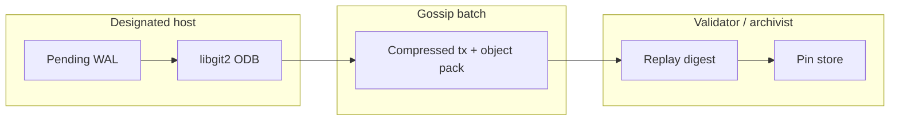

# 3. Storage layer (L0)

The storage layer is a **content-addressed Merkle log** via **libgit2** and **SHA-256**. Git provides **integrity**; **consensus** chooses which commits are **final**. Git alone does not order transactions or tolerate Byzantine writers.

Runtime data lives on **peer nodes** — not in the design-documentation tree (`ltbhappyness/docs`).

---

## 3.1 Two storage planes

| Plane | Git repos | Holds | After finality |
|-------|-----------|-------|----------------|
| **Message plane** | Chapter / DM / Group per `app_id` | App payloads — **E2E ciphertext** for DM/group | Durable on host + replicated to A/B |
| **Ledger plane** | Protocol ledger repo(s) | **`finality_digest`**, refs, tx metadata, nullifiers — **no message plaintext** | Durable; authoritative for validators |

Optional **GitHub mirror**: copy of objects only; **not** source of truth or finality.

---

## 3.2 Object model

| Git object | Use |
|------------|-----|
| **Blob** | Ciphertext, public chapter bytes, protobuf tx bytes, plugin artifacts |
| **Tree** | Directory snapshot |
| **Commit** | **One message per commit (MVP)** on message plane; ledger commits anchor digests |
| **Tag** | Release / plugin version markers (optional) |

**Definition 3.1 (`finality_digest`).** Primary quorum value:

$$
d = \text{SHA-256}(\text{canonical\_bytes}(\text{round\_hint}, \text{parent\_ref}, \text{tx\_canonical}))
$$

Stored in **ledger commit metadata** (TLV in commit message or sidecar blob) for audit. Peers compare $d$ — not ad hoc local `git commit` timestamps.

**Definition 3.2 (Parent + nonce rule).** For transaction with **nonce** $N$ on repo $R$, **parent** must be the last **finalized** commit on $R$ whose applied tx had nonce $N-1$. Mismatch → **reject** before durable write.

---

## 3.3 Canonical commit recipe (message plane)

Validators and hosts MUST build identical git inputs when reproducing a commit for audit. **Enforced in code** (`vedam-host-git`), not by operator habit.

| Field | Rule (MVP) |
|-------|------------|
| **Tree** | Single blob (or app-defined tree) — opaque payload; encrypt at sender |
| **Parent** | `refs/vedam/final/{app}/{repo}` head after nonce $N-1$ |
| **Author** | Mapped from **sender chapter identity** — stable name/email per registration window |
| **Committer** | Fixed: `vedam <vedam-protocol@ltbh.org>` |
| **Commit time** | From **tx envelope** (`client_time` or protocol slot) — **not** `time()` at each validator |
| **Message** | App-visible label or empty; **no required protocol prefix** on user content |

**Squash / amend compaction:** deferred — performance optimization only; not required for correctness.

---

## 3.4 Pending WAL (crash + failure notification)

**Requirement:** Clients must learn **rejected** and **timed-out** txs — not only success by observation.

| State | Storage | Transition |
|-------|---------|------------|
| **pending** | WAL (tmpfs + disk journal) | Accept from gRPC |
| **proposed** | WAL + provisional git objects | Commit written locally |
| **finalized** | Durable git + ledger | Quorum ack |
| **rejected** | WAL record with reason | Validation / quorum fail |

After **finalized** or **rejected**, WAL entry **removed**. Crash recovery replays WAL → re-propose or re-notify.

**Definition 3.3 (Durable write trigger).** Ledger plane persists **after quorum ack** (preferred). Message plane may hold provisional objects until ack; refs marked `pending/` until finalized.

---

## 3.5 Replication among peers

Objects replicate via **libp2p** (batched gRPC-framed packs — [04_network.md](./04_network.md)), not high-frequency **`git push` per message**.

Local **libgit2** persists to disk (`git push` semantics = **write ODB** on same machine). Peers fetch missing objects from promisors (Class **A**).

---

## 3.6 Per-class retention (summary)

| Class | Local store | Role |
|-------|-------------|------|
| **A** | Broad pin | Promisor / archivist |
| **B** | Full validation set | Validator |
| **C** | Partial clone | Operator |
| **D** | Minimal + buffers | Gateway |
| **E** | Cache | Client via gRPC |

**Indexes:** git-native `refs/indexes/*` for MVP. Optional rebuildable SQLite on A/B — never authoritative.

**GC:** only beyond **finality horizon**; legal/CRAB constraints — [12_open_questions.md](./12_open_questions.md) §12.8.

> **Deferred:** exact `VEDAM_DATA` paths — [12_open_questions.md](./12_open_questions.md) §12.14.

---

## 3.7 References

- libgit2 ODB backend API.
- Git SHA-256 object format.
- Git partial clone / promisor remotes.
- Radicle / Heartwood (reference — license §12.10).

Embedded figure target:

``
