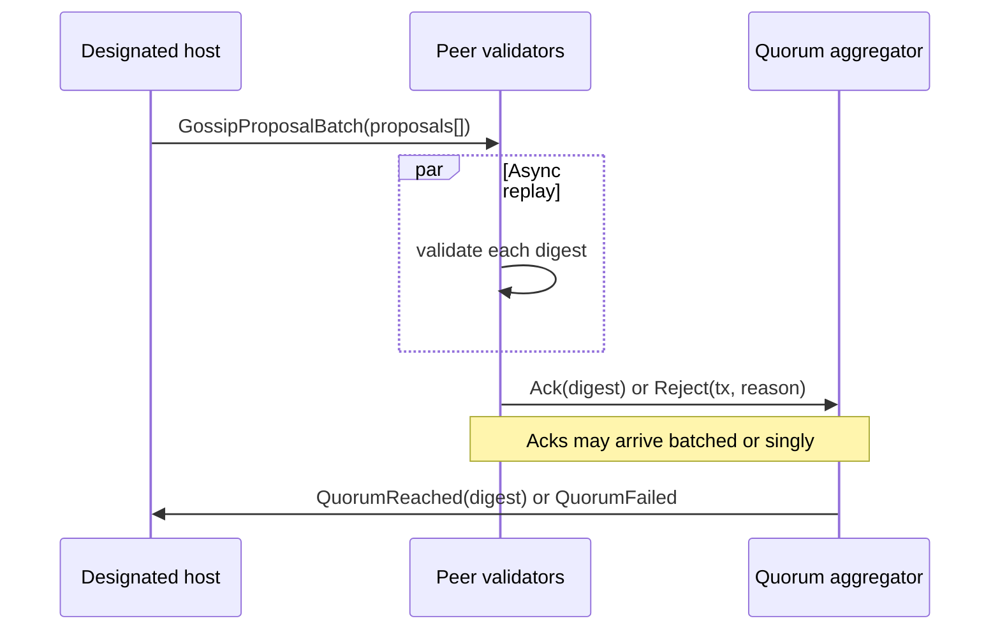

# 4. Network layer

**libp2p** provides transport (QUIC/TCP, Noise, DHT, **gossipsub**). **gRPC** carries application and **inter-validator** control traffic — framed over libp2p bidirectional streams and, between known peers, direct gRPC/QUIC where supported.

**libp2p moves bytes; it does not finalize history** — see [05_consensus.md](./05_consensus.md).

---

## 4.1 Transports and security

| Layer | Choice |
|-------|--------|
| Primary transport | QUIC |
| Fallback | TCP |
| Handshake | Noise (libp2p) |
| Application framing | gRPC over `/vedam/...` stream protocols |

---

## 4.2 Peer discovery and eclipse mitigation

- **Kademlia DHT** + bootstrap peers + capability gossip ([Architecture](./02_architecture.md) node classes).
- **Penrose / $\mathbb{Z}[\varphi]$ integer** neighbour tables with **epoch rotation** — no floats in peer selection ([12_open_questions.md](./12_open_questions.md) for binding choice §12.5).
- **Fibonacci backoff** for rate shaping under load.

Embedded figure target:

``

---

## 4.3 Batch gossip (MVP)

High-frequency **`git push` per message** is **not** used on the hot path.

| Message kind | Batching | Response |
|--------------|----------|----------|
| **Proposal batch** | Many `(tx, object refs, finality_digest)` per frame | Validators replay async |
| **Ack batch** | Many `(digest, vote)` | Quorum counter |
| **Reject** | Individual or batched | Error code + tx id |

Validators MAY send **individual rejects** immediately on malformed txs while still **batching acks** for valid digests.

---

## 4.4 gRPC service families

Separate protobuf packages (see [02_architecture.md](./02_architecture.md) §2.6):

- **`vedam-consensus`** — proposals, votes, epoch control (validator-to-validator).
- **`vedam-chat`** — client submit / status (client-to-host).
- **`vedam-identity`** — chapter lifecycle, ACL queries.
- **`vedam-infer`** *(Phase 2)* — app NN APIs; **not** consensus-critical.

Same host machine may expose multiple services on different Unix sockets or ports per defconfig.

---

## 4.5 NAT, relay, and Class E

- NAT traversal / hole-punching / relay nodes for mobile clients.
- **Class E** uses **vedam-client-*** libraries only — no full libp2p stack required on device if gRPC to B/A suffices (open: §12.7).

---

## 4.6 Open decisions

- libp2p binding: Rust FFI vs cpp — [12_open_questions.md](./12_open_questions.md) §12.5.
- Exact compression algorithm for batch packs (ZSTD direction).

---

## 4.7 References

- libp2p specifications.
- gossipsub protocol.
- Penrose tiling / Fibonacci backoff prior art.
