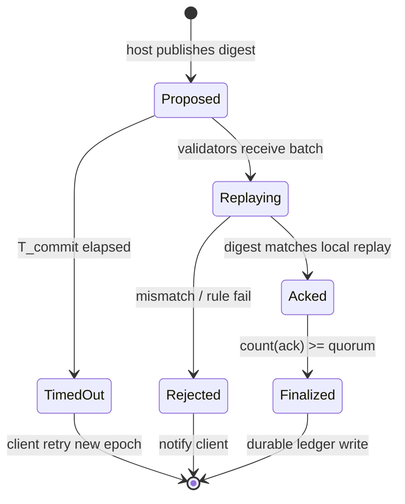

# 5. Consensus

Vedam requires **Byzantine fault-tolerant finality** — not probabilistic longest-chain proof-of-work. The agreed artifact is a **`finality_digest`** per commit (or per round hint), persisted in **ledger git** with metadata ([03_storage.md](./03_storage.md)).

Published BFT literature (Narwhal/Bullshark, HotStuff-class) informs the design; Vedam adds **git-native persistence** and **async per-commit quorum replay**.

---

## 5.1 Problem statement

**Definition 5.1 (Validator set).** $V = \{v_1,\ldots,v_n\}$, at most $f = \lfloor (n-1)/3 \rfloor$ Byzantine.

**Requirement 5.1 (Safety).** No two honest validators finalize conflicting digests for the same `(app_id, repo_id, nonce)$ slot.

**Requirement 5.2 (Liveness).** Under partial synchrony, honest txs eventually finalize or receive explicit **rejected** status within bounded time.

**Requirement 5.3 (Deterministic replay).** Given canonical tx bytes and parent ref, every honest validator computes the same **`finality_digest`** $d$. For **`contract_call`** txs, replay includes **WASM execution** and matching **contract state root** ([06_execution.md](./06_execution.md)).

**Requirement 5.4 (Client visibility).** Every submitted tx reaches **`finalized`** or **`rejected`** with reason — via gRPC status ([02_architecture.md](./02_architecture.md)).

---

## 5.2 Finality digest (primary quorum value)

$$
d = \text{SHA-256}(\text{canonical\_protobuf}(\text{tx\_envelope}, \text{parent\_ref}, \text{round\_hint}))
$$

| Field | Source |
|-------|--------|
| `tx_envelope` | `vedam-tx` — signature, nonce, payload_hash, app/repo ids |
| `parent_ref` | Last **finalized** commit on repo |
| `round_hint` | Epoch / slot from host selection ([02_architecture.md](./02_architecture.md) §2.3) |

Git stores $d$ in **ledger commit metadata** for human audit and tooling. **Quorum votes on $d$**, not on each validator’s local wall clock.

---

## 5.3 Async quorum replay (per commit)

Each git commit (one message, MVP) triggers an **independent finality round**:

**Definition 5.2 (Quorum).** $|Q| \ge \lceil 2n/3 \rceil$ acks for digest $d$.

**Definition 5.3 (Commit timeout).** $T_{\text{commit}}$ — per-commit watchdog. On timeout: tx **not finalized**; client may retry via **epoch + 1** host; WAL entry cleared or marked failed.

| Response mode | When |
|---------------|------|
| **Batch ack** | Happy path — many digests in one gossip frame |
| **Individual reject** | Malformed tx, bad nonce, digest mismatch |

Validators replay **concurrently** across different commits; **serial** per repo nonce chain.

---

## 5.4 Designated host + validator quorum

The **designated host** (sequencer) orders ingress for a repo window and publishes proposals. **Security comes from quorum**, not from trusting the host:

| Host behaviour | Network outcome |
|----------------|-----------------|
| Valid proposal | Quorum ack → finalize |
| Omit tx | Timeout → retry another host |
| Double nonce | Validators reject → no quorum |
| Fork digest | Conflicting acks impossible if honest majority replays same rules |

Host selection: [02_architecture.md](./02_architecture.md) §2.3. **No self-route.**

---

## 5.5 Narwhal / Bullshark relationship

For **high throughput**, validator-published **proposal batches** may be arranged in a **Narwhal DAG** with **Bullshark** (or HotStuff-class) ordering of batch metadata — while **per-commit async ack** remains the client-visible finality step.

| Layer | Role |
|-------|------|
| **DAG mempool** | Parallel ingest of batch frames |
| **BFT ordering** | Agreed sequence of batch metadata |
| **Per-commit replay** | Each tx in batch still needs digest quorum (MVP) |

Exact merge of DAG round order vs per-commit ack is **implementation detail** — safety requires honest validators never finalize $d$ without replay match.

---

## 5.6 Layered model (L0–L3)

| Layer | Role |
|-------|------|
| **L0** | Global Merkle-of-Merkles across ledger roots |
| **L1** | Shard / validator-set scoped logs |
| **L2** | Chapter / DM / group repos (message plane) |
| **L3** | IoT batched anchors |

Embedded figure target:

``

---

## 5.7 Validator selection (MVP)

**Capability + willingness + reputation + Proof-of-Personhood** — **not** stake. **No fee / token** at MVP.

Deterministic replay uses **`vedam-host-*` validators** at pinned **`protocol_version`** — not OS scheduling.

---

## 5.8 Formal sketch (placeholder)

> **Theorem 5.1 (Safety — placeholder).** Under $f < n/3$, if honest validators ack digest $d$ only after identical replay of canonical tx bytes, no two honest nodes finalize conflicting digests at the same nonce slot.
>
> *Proof sketch.* Standard BFT quorum intersection + deterministic replay function. Full proof pending. $\square$

---

## 5.9 References

- Yin et al. — *HotStuff*, PODC 2019.
- Danezis et al. — *Narwhal and Tusk* / Bullshark.
- Giridharan, Kokoris-Kogias — *DAG meets BFT*.
