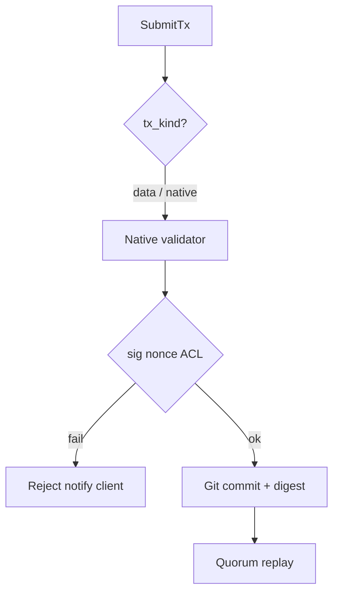
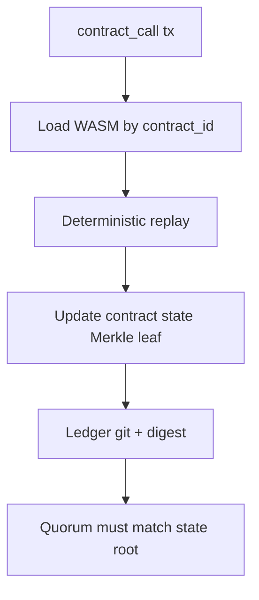
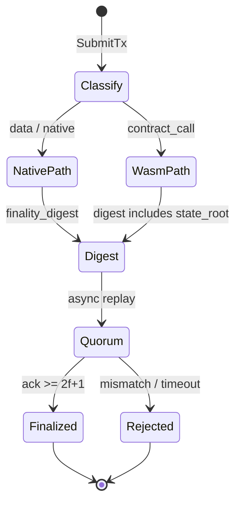

# 6. Execution — native protocol and WASM dApp contracts

Vedam uses **two execution tiers** (design **v0.4**). Both run under the same **`finality_digest`** quorum ([05_consensus.md](./05_consensus.md)); both persist results in **git-shaped storage** ([03_storage.md](./03_storage.md)).

| Tier | What runs | Typical use |
|------|-----------|-------------|
| **A — Native protocol** | **`vedam-host-*`** validators on **`vedam-tx`** bytes | Chanting, ACL, identity, refs, wallet transfers built into protocol |
| **B — WASM dApp contracts** | Sandboxed **`.wasm`** modules | Tokens, swaps, lending-style rules, **composable** logic between untrusted authors |

**Determinism = agreed order + identical replay** — native or WASM — not wall-clock time.

---

## 6.0 Why “on-chain code” exists — layman guide

Most of Vedam is **pure data**: encrypted messages, public chapter files, hashes on the ledger. Your **wallet** (keys, signing, balance display) lives in **`vedam-client-*`** — that does **not** require a smart contract.

**On-chain code** is needed only when **strangers must trust rules, not a company server**:

### Token

**Layman:** A numbered IOU on the shared ledger — “Alice holds 50 units of AppCoin.”

**Without code:** Possible if Vedam protocol has a built-in **Transfer** tx type (Tier A) — validators update balance tables from signed txs. **No WASM** if rules are fixed (send, receive, mint with ACL).

**With WASM:** An app author publishes a **custom token contract** (different mint rules, fees to a treasury, etc.) without changing the whole network binary.

### AMM (automated market maker)

**Layman:** A robot shop that always holds two piles (e.g. rupees + AppCoin) and swaps at a formula price — no human shopkeeper.

**Why not pure data:** Alice and Bob do not trust each other or your backend. The **swap rule** (“if pool has X and Y, you get Z”) must run **the same on every validator** when someone submits “swap 10 for Y.” That is **executable logic**, not a static file.

**Without WASM:** Vedam could ship one **native Swap** tx type (Tier A) — limited, protocol-defined.

**With WASM:** Each app can deploy its **own pool contract** (Uniswap-style) — Tier B.

### Lending

**Layman:** Lock collateral; borrow; if price moves, auto-liquidate — like a pawn shop with automatic expiry.

**Why not pure data:** Requires **multi-step rules** (collateral ratio, interest, liquidation triggers). Strangers will not trust your gRPC server to enforce fairly.

**Tier B WASM** (or many native tx types) — product-grade open finance needs **programmable** rules.

### Composable on-chain logic

**Layman:** One transaction runs **program A**, which **calls program B**, which **calls program C** — all succeed or all fail together (atomic).

**Example:** Swap tokens on AMM A, then stake result in pool B, in **one** tx — without trusting three different companies’ servers.

**Why it matters:** This is the **Ethereum-style superpower**. It **requires** a sandbox VM (WASM or EVM) with a defined **call interface** — not message blobs alone.

**Vedam Tier B** targets this via **WASM dApp contracts** + host imports — not necessarily EVM bytecode, but the **same trust model**.

---

## 6.1 What stays pure data (Tier A only)

| Use case | Mechanism |
|----------|-----------|
| **Chanting / DM / group** | E2E ciphertext (encrypted RDF) in message git; ledger = hash + ref |
| **Public chapter content** | Blob in repo; ACL via identity |
| **Wallet sign / verify** | **`vedam-client-crypto`** + **`vedam-host-crypto`** |
| **Simple transfers** | Native **`Transfer`** tx if protocol defines balances |
| **AI / search / hive mind** | **Off-chain gRPC backends**; optional hash anchor on ledger |
| **Proof of personhood** | Native identity adapter + ledger nullifier |

**Exchange money when “app data matches something”:** If both parties trust an app server, payment can stay **off-chain** (UPI, invoice). **Trustless** exchange between strangers on the **same ledger** needs **Tier A fixed rules or Tier B WASM** — not ciphertext alone.

---

## 6.2 Transaction envelope (`vedam-tx`)

Shared protobuf for Tier A and for **calling** Tier B contracts:

| Field | Role |
|-------|------|
| `tx_version` | Backward-compatible decoders |
| `tx_kind` | `data` \| `native` \| `contract_call` |
| `app_id`, `repo_kind`, `repo_id` | Routing |
| `sender_chapter_id`, `nonce`, `signature` | Identity + ordering |
| `payload_hash` | Data plane digest |
| `contract_id`, `method`, `args` | Tier B only — WASM entry |
| `client_time`, `tee_attestation` | Optional hints |

**Wallet:** **`vedam-client-wallet`** holds keys, builds txs, tracks finalized nonces — shipped in client library, not “on-chain.”

---

## 6.3 Tier A — native protocol validation

Built-in native ops (extensible via **reviewed plugins** — still Tier A, still native):

- `Transfer`, `Mint` (with ACL), `SetACL`, `AnchorRef`, `RegisterChapter`, …

---

## 6.4 Tier B — WASM dApp contracts

**Definition 6.1 (dApp contract).** Content-addressed **`.wasm`** blob in git; **`contract_id`** = hash; validators **replay** calls inside **Wasmtime/WAMR** with **metered gas** (DoS bound, **no fee market** at MVP).

**Host imports (illustrative):** `caller()`, `contract_storage_get/set`, `emit_event`, `native_transfer` (controlled bridge to Tier A balances), `gas_remaining()`.

**Forbidden in WASM:** raw filesystem, network, wall-clock without deterministic slot.

**Composable calls:** Tier B supports **`call(contract_id, method, args)`** within same tx — atomic revert on trap. Exact ABI — [12_open_questions.md](./12_open_questions.md) §12.20.

**Open-source expectation:** Contract **source** published; WASM hash pinned; community review — aligned with mission (no extractive black boxes).

---

## 6.5 Unified finality pipeline

Validators **async** replay; **batch gossip** for proposals/acks ([04_network.md](./04_network.md)); **per-commit timeout** ([05_consensus.md](./05_consensus.md)).

---

## 6.6 Product positioning vs Ethereum

| | **Ethereum-style** | **Vedam v0.4** |
|--|-------------------|----------------|
| Storage | Contract state trie | **Git objects** + contract state leaves |
| VM | EVM | **WASM** (Tier B) |
| Messaging | Off-chain | **First-class git repos** (Tier A data plane) |
| Core protocol | Minimal | **Rich native Tier A** (identity, chanting, ACL) |
| Mission fit | Neutral | **No engagement scoring**; DeFi possible as **apps**, not substrate defaults |

You do **not** need to clone Ethereum’s entire model to be “Web3.” You **do** need **Tier B WASM** for **trustless programmable exchange** between untrusted authors at product grade — unless every financial rule is frozen into native code forever.

---

## 6.7 Performance and ops

- **Tier A:** native speed — hot path for chanting.
- **Tier B:** WASM ~50–70% native on compute; batch contract calls where possible.
- **OTA:** node binaries + pinned **WASM module hashes** both versioned ([09_modularity_build.md](./09_modularity_build.md)).
- **Heavy ML:** off-chain **`vedam-infer`** gRPC; hash anchor optional.

---

## 6.8 References

- WebAssembly core spec; Wasmtime/WAMR.
- CosmWasm / Stylus — WASM on-chain precedent (comparison).
- [12_open_questions.md](./12_open_questions.md) §12.11, §12.20.

Embedded figure target:

``
