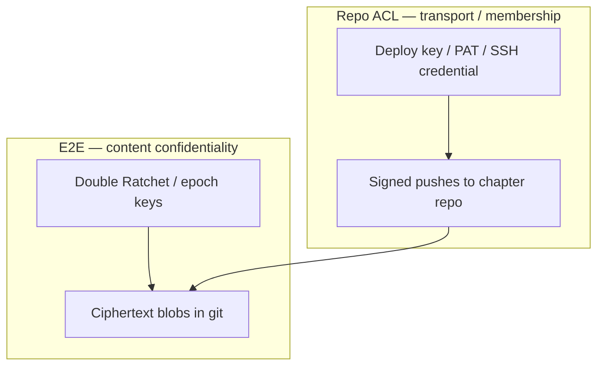

# 7. Identity and privacy

Identity spans **three distinct layers** that must not be conflated:

| Layer | Identifier | Purpose |
|-------|------------|---------|
| **Network** | Node ID | libp2p peer identity (machine on the wire) |
| **Subject** | Chapter ID | Human, machine, or org repo + signing keys |
| **Ledger** | Address / nullifier / tx ref | Agreed metadata in ledger git — `finality_digest`, `payload_hash`, refs |

One **subject** may operate **many nodes**; one **node** may serve **many subjects** (same pattern as Ethereum node vs wallet, but chapter-centric).

---

## 7.1 Humans — India MVP path

**Proof-of-Personhood** for humans targets **UIDAI 2FA** combined with **zero-knowledge** proofs (Anon-Aadhaar–style direction):

- **Never stored on network:** Aadhaar number, biometrics, raw UIDAI payloads.
- **Stored / checked on ledger:** nullifier, public key, proof verification result via host adapter.

The **ZK / UIDAI adapter runs in native host code**; **`vedam-host-identity`** validates nullifier outcomes against ledger state.

Pluggable verifiers for non-India deployments: open design.

---

## 7.2 Machines

Default: **hardware-rooted attestation** (TPM / Secure Enclave class). **Body-bound default, software-resident accommodation reserved** for future agents — see mission ([00_mission.md](./00_mission.md)) and [13_bill_of_rights.md](./13_bill_of_rights.md).

---

## 7.3 Chapters and repository ACL

**Definition 7.1 (Chapter).** A signed, single-writer git repo representing a subject’s identity container and content namespace.

**Access control** combines:

1. **Forge-style membership** — deploy keys, PAT-like tokens, or SSH keys controlling **push/fetch** to a repo (DM repo: 2 members; channel: N members; public chapter: owner + optional org policy).
2. **End-to-end encryption** for chanting message **bodies** — ciphertext in git blobs; ledger holds **hashes and refs** only.

ACLs answer **who may write**. E2E answers **who may read plaintext**. Both are required.

**Key rotation:** epoch-tagged chapter keys; old ciphertext readable with old epoch material. Double Ratchet for live chanting sessions.

---

## 7.4 Node vs chapter (flexibility)

- **One subject, many nodes:** a user may run several validators or light nodes; each has its own Node ID.
- **One node, many subjects:** a public gateway node may serve gRPC for many chapters (similar to public RPC endpoints today) without owning their keys.

---

## 7.5 Right to be forgotten

Vision: meaningful erasure paths on a content-addressed log (CRAB-style key destruction, off-chain sidecars, machine-unlearning research). **Operational design open** — [12_open_questions.md](./12_open_questions.md) §12.8.

---

## 7.6 References

- Anon-Aadhaar / UIDAI 2FA public materials.
- TPM 2.0 / Secure Enclave attestation primers.
- Signal Double Ratchet specification.
- Machine welfare research watch (Anthropic model welfare, RCUET, pragmatic personhood) — mission-level only.

Embedded figure targets:

``

``
