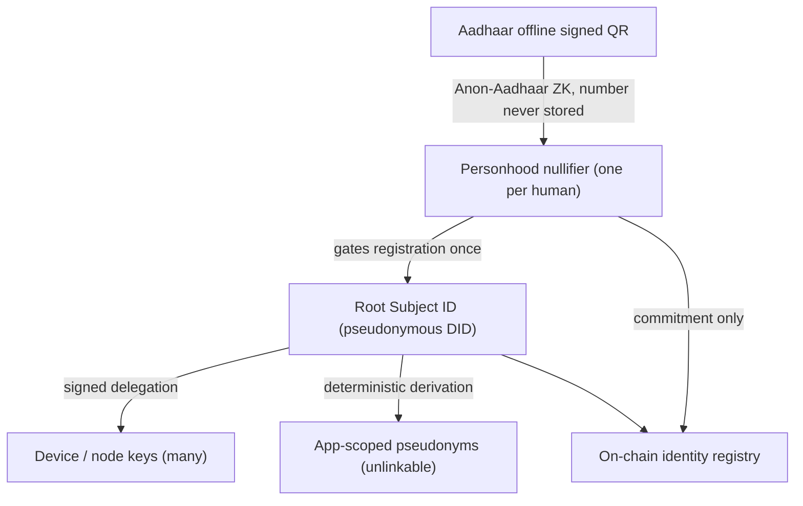
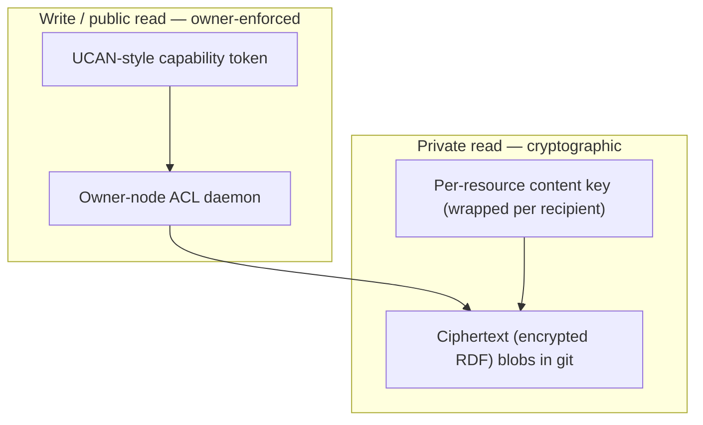

# 7. Identity and privacy

Vedam identity is **self-sovereign**: a subject controls keys, not a provider account. The design adopts the data-sovereignty goals of decentralized Web3 (subject-owned data, decoupled from apps) while adding what those systems omit — **proof-of-personhood without surveillance**, machines as first-class subjects, and unlinkable activity across apps. Design **v0.4**.

The guiding constraint: enforce **one account per human** without ever turning a person's identifier into a cross-application tracking key. These two goals appear to conflict — a network-wide uniqueness handle is itself a correlation key — and the chapter resolves the conflict by **separating registration from usage**.

---

## 7.1 Identity layers

Identity spans layers that must not be conflated:

| Layer | Identifier | Purpose |
|-------|------------|---------|
| **Network** | Node ID | libp2p peer identity (a machine on the wire) |
| **Personhood** | Nullifier | One-time uniqueness proof for a human — **not** a usable identifier |
| **Subject (root)** | Root Subject ID (DID) | The accountable identity of a human, machine, or org |
| **Device** | Device key | A signing key delegated by a root Subject, one per device |
| **Application** | App-scoped pseudonym | A per-app identifier, unlinkable across apps |
| **Ledger** | Address / nullifier-commitment / tx ref | Agreed metadata in ledger git |

One **subject** may operate **many nodes**; one **node** may serve **many subjects**.

---

## 7.2 Proof-of-personhood for humans — India MVP path

The MVP anchors human uniqueness in **UIDAI Aadhaar**, used **only** as a one-time personhood proof:

- **Never stored on network:** Aadhaar number, biometrics, raw UIDAI payloads.
- **Mechanism:** an **Anon-Aadhaar-style** zero-knowledge proof over the **offline, RSA-signed Aadhaar QR** (m-Aadhaar / offline eKYC). This needs **no AUA/KUA licence** and discloses **no identifying field**; it proves "the holder possesses a valid Aadhaar credential."
- **Output:** a **nullifier** — a deterministic value that is the same for the same Aadhaar but reveals nothing about it. One human therefore yields one nullifier.

**Definition 7.1 (Personhood nullifier).** A value $\nu$ derived in zero-knowledge from a valid Aadhaar credential such that (i) the Aadhaar number is not recoverable from $\nu$, and (ii) two registrations from the same Aadhaar produce the same $\nu$. Only a **commitment** to $\nu$ is published, used to reject a second registration of the same human.

The nullifier is **not** the subject's identifier and is never used to authenticate day-to-day actions. It exists solely to gate registration: one human, one root Subject.

**Pluggable verifiers** for non-India deployments are an open design (different personhood schemes register against the same uniqueness rule). UIDAI is a personhood **source**, never an OpenID issuer.

---

## 7.3 Root Subject, device keys, and app pseudonyms

**Definition 7.2 (Root Subject ID).** A pseudonymous decentralized identifier (DID) backed by a root keypair the subject controls. It is the single accountable identity. Its creation is permitted once per nullifier commitment (for humans); its public key is recorded in the identity registry (§7.5).

**Definition 7.3 (Device key).** A per-device signing key authorized by a **signed delegation** from the root Subject. A subject runs many devices; each holds only its own delegated key, never the root secret. Revoking a device publishes a delegation revocation; the root and other devices are unaffected.

**Definition 7.4 (App-scoped pseudonym).** A per-application identifier deterministically derived from the root (hierarchical-deterministic / pairwise-DID style). Different applications see **different, mutually unlinkable** pseudonyms. The subject can prove, in zero-knowledge, that two pseudonyms share a root **when the subject chooses to** — for example to carry a relationship across apps — but no third party can correlate them.

This structure delivers both goals at once:

- **One account per human** is enforced at the **personhood** layer (the nullifier), once.
- **Unlinkability** is preserved at the **usage** layer (per-app pseudonyms), always, unless the subject opts in to linkage.

---

## 7.4 Authentication — self-issued login (SIOPv2)

Vedam uses **no central login server and no federated-issuer fallback**. Authentication is **self-issued**:

- A subject's client signs a login assertion with a **device key** (a **Self-Issued OpenID Provider v2** profile — the subject is its own issuer).
- A relying party (an app backend, another node) verifies the signature and resolves the signer to a Subject via the **on-chain identity registry** (§7.5).
- **DPoP-style proof-of-possession** binds the assertion to the device key so it cannot be replayed.

Thin clients (browsers, Class **E**) self-issue through a **local wallet / key holder** rather than a remote issuer; the trust anchor is still the registry, never a third party. This keeps the SOLID-family OIDC compatibility surface (apps speak a familiar token shape) while removing the centralization SOLID's hosted issuers introduce.

---

## 7.5 On-chain identity registry

**Definition 7.5 (Identity registry).** A protocol ledger structure binding, per subject:

$$
\text{Subject\_ID} \;\rightarrow\; \{\text{root\_pubkey},\; \text{nullifier\_commitment},\; \text{device\_delegations},\; \text{revocations}\}
$$

The registry is the **trust anchor** for authentication and authorization: verifiers read it to learn which key controls a Subject and whether a device delegation is current. It stores **commitments and public keys only** — never the nullifier preimage, never personal attributes. Because it is finalized by Byzantine quorum ([5. Consensus](./05_consensus.md)), no single host is the issuer of identity.

---

## 7.6 Access control — capabilities and repository ACL

**Access control answers two different questions, with two different mechanisms:**

| Question | Mechanism |
|----------|-----------|
| **Who may write / who may read public content?** | **Capabilities + ACL**, enforced at the data owner's node |
| **Who may read private content?** | **End-to-end encryption** — key possession, enforced cryptographically |

**Definition 7.6 (Chapter).** A signed, single-writer git repo representing a subject's identity container and content namespace. A subject's storage may hold public chapter data, private data, and group-shared data side by side, separated by repository kind ([2. Architecture](./02_architecture.md)).

**Capabilities (primary).** The owner mints **UCAN-style capability tokens** — signed, delegable, revocable grants of the form "the holder of pseudonym $P$ may *append* to resource $R$ until time $T$." Capabilities require **no central ACL server**: the grant travels with the request and is verified at the **owner's own node**, where an access-control daemon co-resides with the storage backend.

**Declarative ACL (interop).** For interoperability with the SOLID family, the same policy may be **described** using the **Web Access Control `acl:` vocabulary** (read / write / append / control). The vocabulary is reused for description; enforcement remains capability- and key-based, not server-trust-based.

**Read confidentiality.** Private and group content bodies are **end-to-end encrypted**; the ledger holds only **hashes and refs**. "Who may read" is therefore decided by who holds the decryption key, not by a server's willingness to serve bytes.

**Key rotation:** epoch-tagged keys; old ciphertext remains readable with old epoch material. Live messaging sessions use the **Double Ratchet**; per-resource files use **content-key envelopes** ([3. Storage layer (L0)](./03_storage.md)).

---

## 7.7 Machines and other subjects

Machines are first-class subjects with their **own** Vedam Subject ID. Their uniqueness anchor differs from a human's:

| Subject class | Uniqueness anchor |
|---------------|-------------------|
| **Human** | Personhood nullifier (§7.2) |
| **Machine** | Hardware-rooted attestation (TPM / Secure Enclave class) |
| **Software-resident agent** | **Open** — no hardware anchor; see [12. Open questions](./12_open_questions.md) |

The design commits to **body-bound default, software-resident accommodation reserved** for future agents — see [0. Mission](./00_mission.md) and [13. Human–machine shared bill of rights](./13_bill_of_rights.md). One mechanism is **not** assumed to cover all subject classes.

---

## 7.8 Right to be forgotten

The right to be forgotten applies to **both humans and machines**, and to **readable content**, not to commitments:

- **Readable personal content** (message bodies, profile data, private notes) is **erasable** — stored as ciphertext, it is rendered meaningless by **cryptographic erasure via key destruction (CRAB)**.
- **Commitments** (contracts, transfers, audit history) remain **immutable** — they are hashes and signatures, not personal content, so history cannot be denied.

An immutable ledger and a meaningful erasure path therefore coexist: the ledger keeps **proof that something happened**, while the content it refers to can be destroyed. Operational design remains open — [12. Open questions](./12_open_questions.md) §12.8.

---

## 7.9 References

- Anon-Aadhaar / UIDAI offline-QR (m-Aadhaar) public materials.
- Self-Issued OpenID Provider v2 (SIOPv2) and OpenID Connect; OAuth 2.0 DPoP (RFC 9449).
- Decentralized Identifiers (DID) — W3C Recommendation.
- User Controlled Authorization Networks (UCAN) capability model.
- Web Access Control (`acl:`) — W3C Solid Community Group (community spec, not a Recommendation).
- TPM 2.0 / Secure Enclave attestation primers.
- Signal Double Ratchet specification.
- Machine welfare research watch (Anthropic model welfare, RCUET, pragmatic personhood) — mission-level only.

Embedded figure targets:

``

``
