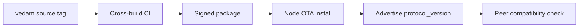

# 9. Modularity and build

The implementation monorepo ([github.com/ltbhappyness/vedam](https://github.com/ltbhappyness/vedam)) uses **CMake + per-class defconfig**, **protobuf/gRPC**, and **Nix flakes** for reproducibility. Design **v0.4**: Vedam **does not ship prebuilt node binaries** — it ships **source, schemas, and build recipes**; operators and devices **build or cross-compile** installable packages with **OTA update** support.

---

## 9.1 Repository layout

```
vedam/
  proto/
    vedam-tx/
    vedam-consensus/
    vedam-identity/       # registration, nullifier commitment, registry, capabilities
    vedam-storage/        # Locate / Fetch / RequestAccess (wrapped CEK), object packs
    vedam-chat/
    vedam-infer/          # Phase 2 — app NN API, not consensus core
  lib/
    vedam-client-*        # linked by mobile/web/apps
    vedam-host-*          # linked by validator daemons
    vedam-data-*          # RDF/HDT encode + content-key envelope pipeline
  plugins/                # open-source protocol extensions
  modules/
    app-*                 # app-chanting, etc.
  daemons/
    vedam-noded           # configurable node daemon: storage + consensus + identity + chat
  config/
    defconfig.class-a … class-e
  tools/
    cross/                # cross-compile toolchains per target
```

The configurable node daemon is **`vedam-noded`** (earlier drafts named it `vedam-hostd`); a single binary, profiled per class.

| Tree | Contents |
|------|----------|
| **`lib/vedam-host-*`** | Deterministic validators + git recipe |
| **`lib/vedam-client-*`** | Tx builders, signers, status clients |
| **`plugins/`** | Reviewed native extensions (new tx types) |
| **`modules/app-*`** | Product verticals + optional backends |
| **`daemons/`** | Long-running node processes |

---

## 9.2 Node class defconfig

| File | Class | Enabled daemons (typical) |
|------|-------|---------------------------|
| `defconfig.class-a` | A | noded (archive) + p2p |
| `defconfig.class-b` | B | noded (full validator) |
| `defconfig.class-c` | C | light noded |
| `defconfig.class-d` | D | gateway profile (optional SOLID/LDP gateway) |
| `defconfig.class-e` | E | **client libs only** — no full noded |

`VEDAM_NODE_CLASS=A…E` gates CMake targets. Parser stub — §12.6.

---

## 9.3 IPC and API surface

| Path | Mechanism |
|------|-----------|
| Same machine | gRPC over **Unix domain socket** |
| Remote | gRPC over **libp2p streams** or QUIC |
| Apps | **`vedam-client-*`** + app-specific protos |

Separate protobuf families per concern ([02_architecture.md](./02_architecture.md) §2.6) — not one mega-API.

---

## 9.4 Build, cross-compile, and OTA

**Definition 9.1 (Builder capability).** Every node repo includes recipes to produce **target packages** (deb, tarball, mobile SDK artifact) via cross-compilation.

| Stage | Output |
|-------|--------|
| **Configure** | `protocol_version`, enabled plugins, class profile |
| **Build** | `vedam-noded`, libraries, app bundles |
| **Sign** | Operator / NPO signing key (policy TBD) |
| **OTA** | Download + verify + restart daemons |

**No central binary store required** — mirrors may cache build artifacts. **Same `protocol_version`** must be advertised on the wire; validators reject peers on incompatible major versions (configurable overlap window).

**Problems to manage (open):**

- **Skew** during rolling upgrade — dual decoders for `tx_version` N and N−1.
- **Cross-compiler drift** — Nix/CMake lockfiles; CI builds reference vectors.
- **Malicious OTA** — signature verification mandatory.
- **WASM path (if revived):** bytecode alone insufficient — host runtime + adapters still need OTA; v0.4 native path same operational reality.



---

## 9.5 Upgrade without full network pause

| Mechanism | Purpose |
|-----------|---------|
| **`protocol_version`** in handshake | Refuse incompatible peers |
| **`tx_version` in envelope** | Read old history forever |
| **Plugin flags in defconfig** | Enable new tx types gradually |
| **Quorum governance tx** *(future)* | Activate plugin at block height |

Similar **spirit** to WASM module hash upgrades — but v0.4 uses **native library versions + protobuf versions**. Hard forks possible; soft forks via dual validation paths during overlap.

---

## 9.6 Provenance and community plugins

- **Nix flakes** / locked deps for reproducible builds.
- **Plugins:** merge via open PR; community expands **`vedam-host`** — not closed vendor drops.
- **App versioning:** semver per `app-*`; independent of `protocol_version`.

Embedded figure targets:

``

``

---

## 9.7 References

CMake, Nix flakes, protobuf/gRPC, OTA signing patterns (TUF-inspired direction — open).
