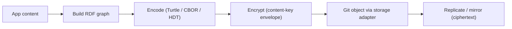

# 15. Data model and interoperability

Vedam treats data as **subject-owned and app-independent**. Content is expressed in **RDF** so that any application understanding a shared vocabulary can read the same data, and the substrate ships the tooling to produce, encrypt, and exchange it. This chapter defines the content model and the interoperability surface with the SOLID family of decentralized-Web standards. Design **v0.4**.

---

## 15.1 Why RDF

Decoupling data from applications requires a model where meaning travels with the data, not with one vendor's schema. **RDF (Resource Description Framework)** represents everything as **triples** — `(subject, predicate, object)` — where subjects and predicates are IRIs and objects are IRIs or literals. A set of triples is a **graph**. Shared **vocabularies** (ontologies) give predicates agreed meaning, so an app written years later can still interpret a subject's data without migration.

This is the data-sovereignty position of decentralized Web3 (as distinct from blockchain-as-identity): the subject owns a portable graph; apps are interchangeable readers and writers over it.

---

## 15.2 Encodings — when and why

| Payload | Encoding | Rationale |
|---------|----------|-----------|
| Small, mutable (a message, a field edit) | **Turtle** or **RDF/CBOR** | Low overhead; cheap to append |
| Large, static (archive, knowledge graph) | **HDT** (binary RDF) | Compact, indexed, read-optimized |
| Large binary (image, video, weights) | Content-addressed encrypted **blob**, referenced from RDF | Triples are unsuitable for opaque bulk bytes |

**Definition 15.1 (Encoding selection).** The pipeline selects the encoding from payload size and mutability: append-heavy small graphs stay textual/CBOR; large or sealed graphs are compacted to HDT; bulk binaries are stored as blobs and **linked** by IRI rather than inlined as triples.

---

## 15.3 The encode + encrypt pipeline

Vedam provides a library/daemon pipeline so apps do not hand-roll serialization or crypto:

The reverse path — fetch, decrypt locally, decode — yields a plaintext RDF graph held **only in the authorized app's memory** ([3. Storage layer (L0)](./03_storage.md) §3.6). Keys never leave the subject's device.

---

## 15.4 Vocabularies

Interoperability depends on shared vocabularies. Vedam reuses established ones where they fit and defines project vocabularies where none exist:

| Concern | Vocabulary |
|---------|------------|
| People / agents | FOAF, vCard, schema.org |
| Messaging | ActivityStreams 2.0 + a Vedam **`chant:`** vocabulary |
| Access policy (description) | Web Access Control `acl:` |
| Identity profile | DID / WebID-compatible profile terms |

**Definition 15.2 (`chant:` vocabulary).** A small ontology for app-chanting messages (sender, recipient, thread, timestamp, body reference) so that a message written by one client is readable by any other `chant:`-aware client.

---

## 15.5 Query within the authorized boundary

RDF normally promises global queryability (SPARQL across the open web). Vedam **scopes query to the decrypted, authorized set**: an app may run graph queries over the data it currently holds keys for, but there is **no global query over ciphertext** and no central index of subjects' content. This is a deliberate trade — **confidentiality over global queryability**. Public chapter data that a subject chooses to publish unencrypted may be queried by anyone permitted to fetch it.

---

## 15.6 SOLID compatibility — citizen, not clone

Vedam adopts the **mandatory ideas** of the SOLID family while differing in mechanism:

| SOLID idea | Vedam realization |
|------------|-------------------|
| Own your data (Pod) | Subject-owned git repos over chosen storage adapters |
| Data decoupled from apps | RDF content model with shared vocabularies |
| Control access | Capabilities + `acl:` description, owner-enforced ([7. Identity and privacy](./07_identity.md)) |
| Self-sovereign identity | Root Subject DID; SIOPv2 self-issued login |
| Apps interchangeable | Falls out of RDF + vocabularies |

**Not adopted as-is:** the WebID **URL** mechanism, hosted/federated OIDC issuers, and server-trust read enforcement (Web Access Control assumes a trusted server reads the ACL and serves bytes; Vedam enforces read by **key possession**). A **WebID-compatible profile view** and an LDP/SOLID **gateway profile** (a Class **D** role) may be exposed so existing SOLID apps can interoperate with a Vedam node, without making Vedam depend on SOLID's centralizing pieces.

Both Web Access Control and Access Control Policy are **W3C Solid Community Group** specifications, **not** ratified W3C Recommendations; RDF, Turtle, SPARQL, LDP, OpenID Connect, OAuth 2.0, and DPoP **are** standards, and Vedam tracks those.

---

## 15.7 Immutability and forgetting at the data layer

Data divides by whether it must be provable later:

- **Personal / private content** — encrypted RDF off the agreed ledger; **erasable** by cryptographic key destruction (CRAB).
- **Commitments** (contracts, transfers, knowledge-base claims that must not be deniable) — recorded on the ledger as **hashes and signatures**, immutable, while the **content** they reference stays in the erasable layer.

A "knowledge base that needs proof later" therefore stores **immutable commitments to claims**, not immutable readable personal content. See [7. Identity and privacy](./07_identity.md) §7.8 and [12. Open questions](./12_open_questions.md) §12.8.

---

## 15.8 References

- RDF 1.1 Concepts and Abstract Syntax; Turtle; JSON-LD 1.1; SPARQL 1.1 — W3C.
- HDT (Header-Dictionary-Triples) binary RDF.
- FOAF, vCard, schema.org, ActivityStreams 2.0 vocabularies.
- Solid Protocol; Web Access Control; Access Control Policy — W3C Solid Community Group (community specs).
- Decentralized Identifiers (DID) — W3C Recommendation.
