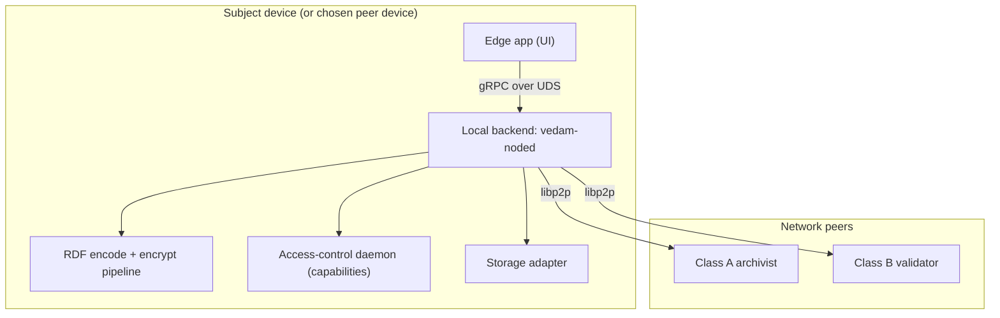

# 16. Deployment and operations

This chapter is the operational blueprint: what software a Vedam participant installs, how nodes and the edge app are built and packaged, the protocol and library surface, third-party software choices, the upgrade strategy, and continuous integration. It is written so an implementer can begin building the system from a known starting point. Design **v0.4**; choices marked *open* defer to [12. Open questions](./12_open_questions.md).

---

## 16.1 Component map



| Component | Package | Notes |
|-----------|---------|-------|
| **Edge app** | `app-*` (per product, e.g. `app-chanting`) | Any language; links `vedam-client-*` |
| **Local backend** | `vedam-noded` (configurable daemon) | Class-profiled; holds keys + storage creds |
| **Validator / archivist** | `vedam-noded` with `defconfig.class-a/b` | Durable, always-on |
| **Client libraries** | `vedam-client-*` | Tx builders, signers, status, wallet |
| **Host libraries** | `vedam-host-*` | Validation, canonical git recipe, digests |

---

## 16.2 Technology choices (v0.4)

| Layer | Choice | Status |
|-------|--------|--------|
| **Core language** | **C** for protocol core (`vedam-host-*`, `vedam-client-*`, daemon) | Settled direction |
| **App language** | Any — apps talk gRPC; backends in any language | Settled |
| **Storage** | **libgit2** over SHA-256; storage adapters (local / cloud / peer) | Settled |
| **Networking** | **libp2p** (binding choice C-ABI vs Rust — §12.5) | Open binding |
| **RPC / schema** | **gRPC + protobuf**, versioned families | Settled |
| **Crypto** | **libsodium** + **Noise**; post-quantum via **liboqs** later (§12.4) | Settled + open cutover |
| **Identity ZK** | Anon-Aadhaar-style offline-QR verifier; DID; SIOPv2; UCAN | Provisional |
| **Data model** | **RDF**; **HDT** for large/static (§[15](./15_data_model.md)) | Provisional |
| **Tier B VM** | **WASM** (Wasmtime / WAMR — §12.11) | Optional, open |
| **Build** | **CMake + per-class defconfig**; **Nix flakes** for reproducibility | Settled |
| **Packaging** | Source + schemas + recipes; no prebuilt node binaries shipped | Settled |

---

## 16.3 Installation by node class

Vedam ships **source, schemas, and build recipes**; participants **build or cross-compile** their package.

| Class | Typical host | Install profile |
|-------|--------------|-----------------|
| **A** archivist | Server / VPS | `defconfig.class-a`: `vedam-noded` (archive) + libp2p; broad pin; durable disk |
| **B** validator | Server | `defconfig.class-b`: full validator; durable disk; always-on |
| **C** light | Laptop / desktop | `defconfig.class-c`: light `vedam-noded`; partial clone |
| **D** gateway | Edge / IoT hub | `defconfig.class-d`: gateway profile; recent refs; optional SOLID/LDP gateway |
| **E** client | Phone / browser | `defconfig.class-e`: **client libs only**; gRPC to a B/A peer |

**Reference flow (Class B):**

```bash
# reproducible toolchain
nix develop
# configure node class + protocol version + plugins
cmake -B build -DVEDAM_NODE_CLASS=B -DVEDAM_PROTOCOL_VERSION=4
cmake --build build
# run the daemon (keys + storage credentials provisioned locally)
./build/vedam-noded --config /etc/vedam/node.toml
```

Class **E** devices install only the **edge app** plus `vedam-client-*`; the app connects to a chosen B/A peer over libp2p/QUIC and never runs a full git store.

---

## 16.4 Protocol and library surface

Versioned protobuf families (separate `.proto` + daemons where needed):

| Family | Purpose | MVP |
|--------|---------|-----|
| **`vedam-tx`** | Canonical transaction envelope | Required |
| **`vedam-consensus`** | Proposals, acks, rejections, epoch control | Required |
| **`vedam-identity`** | Subject registration, nullifier commitment, registry, capabilities | Required |
| **`vedam-storage`** | `Locate`, `Fetch`, `RequestAccess` (wrapped CEK), object packs | Required |
| **`vedam-chat`** | Chanting submit / status / fetch | Required for app-chanting |
| **`vedam-infer`** *(Phase 2)* | NN session create/run — app backend API, not ledger core | Optional |

IPC: gRPC over **Unix domain socket** on the same machine; gRPC over **libp2p streams or QUIC** remotely ([9. Modularity and build](./09_modularity_build.md) §9.3).

---

## 16.5 Build, package, and deploy

| Stage | Output |
|-------|--------|
| **Configure** | `protocol_version`, enabled plugins, class profile |
| **Build** | `vedam-noded`, libraries, app bundles |
| **Sign** | Operator / NPO signing key (policy *open*) |
| **Package** | deb / tarball / mobile SDK artifact via cross-compilation |
| **Deploy / OTA** | Download → verify signature → restart daemons |

No central binary store is required; mirrors may cache build artifacts. The same `protocol_version` must be advertised on the wire; validators reject peers on incompatible major versions within a configurable overlap window. Full build mechanics live in [9. Modularity and build](./09_modularity_build.md).

---

## 16.6 Upgrade strategy

| Mechanism | Purpose |
|-----------|---------|
| **`protocol_version` in handshake** | Refuse incompatible peers |
| **`tx_version` in envelope** | Read old history forever (dual decoders during overlap) |
| **Plugin flags in defconfig** | Enable new native tx types gradually |
| **Quorum governance tx** *(future)* | Activate a plugin at an agreed height |

Rolling upgrades use dual validation paths during the overlap window; hard forks are possible but avoided. OTA payloads are signature-verified before install.

---

## 16.7 Continuous integration

| CI concern | Approach |
|------------|----------|
| **Reproducible builds** | Nix flakes + locked dependencies |
| **Cross-compilation** | Per-target toolchains in `tools/cross/`; CI builds all class profiles |
| **Determinism vectors** | CI replays reference txs and asserts identical `finality_digest` |
| **Schema compatibility** | Reject PRs that break `tx_version` backward decoding |
| **Crypto / consensus** | Library-policy gate; formal-verification scope is *open* (§12.3) |
| **Render check (docs)** | Markdown renders on GitHub before merge |

---

## 16.8 Operational invariants

- **Own-credentials invariant** — a node uses only its own storage credentials for its own subject's data ([3. Storage layer (L0)](./03_storage.md) §3.5).
- **No self-route** — a client never sequences its own tx on the same node instance ([2. Architecture](./02_architecture.md) §2.3).
- **Durability in peers, not mirrors** — finalized state lives on redundant Class A/B peers; clouds/GitHub are ciphertext convenience copies only.
- **Keys never leave the device** — encrypt/decrypt and the ACL daemon are co-located with the local backend.

---

## 16.9 References

- CMake; Nix flakes; protobuf / gRPC; QUIC.
- libgit2; libp2p; libsodium; Noise Protocol Framework; liboqs.
- Wasmtime; WAMR (Tier B, optional).
- TUF-inspired OTA signing direction (open).
