# 2. Design

This chapter is the specification of one running node. A node is the Vedam libraries inside one process after `vedam_init`. The text is written the way a kernel locking document is written: each structure is named, the order of operations is fixed, and the cases that are refused are listed. It does not name a vertical. A vertical is a row in a table. What a row is for is not decided here, and no row owns the others. Rows that exist only so the generator and the lock can be exercised are listed as placeholders in [Interfaces](../interfaces/interfaces.md).

The [Mission](../foundations/mission.md) remains the authority on purpose. This chapter does not add a score, a fee, or a feed.

The lock rule is Wait-Die, the die half of the wound-wait design used by the Linux kernel.[^ww-mutex] Wound-Wait itself is not implemented.

## 2.1 What this chapter decides

This part says what the chapter is for, which choices were refused, and the invariants a later section is not free to break.

### 2.1.1 How to read this chapter

Read section 2.1 before the rest. It fixes the problem, the refusals, and the invariants. Section 2.2 is names and folders. Section 2.3 is the one message. Section 2.4 is the call. Section 2.5 is start, stop, and where the libraries run. Section 2.6 is the three links. The byte layouts in that section are fillings compiled today, not the names of the links. Section 2.7 is the lock. Section 2.8 collects the figures and the subjects this chapter leaves out.

A diagram shows control or data. A table is normative when the surrounding sentence says the implementation matches it. A formula is an invariant, not a performance claim.

### 2.1.2 The problem

An application thread and a peer must read and write objects of every row through one shape. The node is entered from many threads. One call may name several attributes. A library body may need another row before it returns. Bytes on an inter-process or remote link must not be written while those locks are held, or a slow peer stalls every other caller.

The design therefore has four obligations.

1. One message for every row, so a link does not grow a decoder per row.
2. The behaviour of a row lives in one function, the library body. Every layer above it checks or carries.
3. The lock is an attribute, not the process, so a writer of one value does not stop a reader of a different value.
4. The author of a body does not publish a global lock order. Two attempts that overlap still finish.

### 2.1.3 Choices that were rejected

**A private message per row.** The filling would switch on the row, and a peer would ship a new decoder whenever a row was added. `vi_msg_t` keeps the in-process path and the byte path on the same fields.

**One mutex for the node.** Any call would exclude every other call. A read of one attribute would block a read of a different row. That is correct and too coarse.

**One lock per row and no finer lock.** Two writers of different attributes on the same object would exclude each other even though their bytes do not overlap.

**Locks ordered by the caller.** Each body would have to take locks in one global sequence. A body that calls another row cannot know that sequence. Wait-Die deletes the requirement. The younger attempt releases and starts again. The older attempt waits.

**Wound-Wait.** The older attempt would abort the younger one. Vedam does not do that. Only the younger attempt restarts. That is Wait-Die, not the full wound-wait pair.[^ww-mutex]

**A transport chosen from the environment at start.** The same binary could then listen on different slots on two machines. The slots are fixed when the binary is built. A slot that is off is neither compiled nor listened on, and it is not replaced by the local slot.

**Holding locks across a network wait.** The attempt would pin attributes for a round trip. A non-local send while the attempt holds locks returns a failed precondition. The local hop is different: it re-enters on the same thread and joins the attempt, so it does not block in the kernel on a socket.

**Executing the libraries on the machine that only stores the page.** That machine returns bytes. The browser that received the bytes runs the WebAssembly build, or the page calls a node process that is already up.

**Naming a link after one byte format.** The inter-process link would be frozen as whichever queue or socket is compiled today, and the remote link would be frozen as whichever framing is compiled today. Replacing the bytes would look like a new architecture. The link is the operations table. The bytes are a filling the build may later leave unused.

### 2.1.4 Viewpoint

A person linking the libraries needs the message, the status rule, and the lock rules. A person operating a node needs the start sequence and which slots the build turned on. A person reviewing the platform needs the invariants and the refusal cases. This chapter answers those three and no others.

### 2.1.5 Invariants

1. There is at most one published node in the process. Only `vedam_init` publishes it. Only `vedam_deinit` clears it.
2. A call with no published node returns uninitialised and does not create a node.
3. Every row is invoked with `vi_msg_t`. The overall status is success only when every per-attribute status is success. Otherwise the overall status is the first status that is not success.
4. The caller owns every buffer the message points at. A local call passes the pointer. A filling of a link encodes once and decodes once into that memory.
5. An outermost entry on a thread is one attempt. A nested entry on that thread joins it. A nested entry on another thread is another attempt.
6. A non-local send during an attempt is refused.
7. Holds taken by an attempt are released before `vedam_lock_invoke` returns to dispatch. A restart inside that call keeps the contended lock held until the attempt finishes.
8. Attribute locks for one call are taken in ascending id order, after duplicate ids have been removed.
9. The hot path after init does not allocate the node, does not copy a configuration structure, and does not hold a lock across a wait in the kernel on a link.

$$
\mathrm{ok}(m) \iff \forall\, i < m.\mathrm{count}:\ m.\mathrm{status}[i] = 0
$$

## 2.2 Names and the tree

Names, folders, and the rule for which folder may include which header. A reader uses this part to find a symbol and to see why a layer cannot call upward.

### 2.2.1 Terminology

| Word | Meaning |
|------|---------|
| Node | The libraries after `vedam_init`, in one process. The C type is `vedam_t`. |
| vedamd | The C program that calls `vedam_init` when no application owns the process. |
| Vertical | One row of the class table. |
| Attribute | One value on a row, selected by `v_attr_id_t`. |
| Key | Bytes that select one object inside a row. Length 0 is the singleton. |
| Verb | One of create, get, set, delete, subscribe, unsubscribe, notify. |
| `vi_msg_t` | The public message. |
| `vii_msg_t` | The internal call: row, origin, verb, version line, and a pointer to `vi_msg_t`. |
| Northbound | The application side of the node. |
| Library body | `vii_body_fn` for one verb of one row. The symbol prefix on the definition is `vlib_`. |
| Link | Index 0 local, 1 inter-process, 2 remote. The index is stable. The bytes behind it are not. |
| Hook | One operations table, `vti_ops_t`: close, listen, accept, connect, call. A filling is one compiled table. |
| Attempt | Outermost `vedam_lock_invoke` on a thread, plus joins. |
| wwlock | The Wait-Die primitive under `vedam_lock_acquire`. |
| Existence lock | The lock on the object `(class id, key)`, not on an attribute. |
| Filling | The operations table compiled into a link. The link stays when the table is replaced. |

### 2.2.2 Names

Names are prefixes so a reader can tell which layer a symbol belongs to without opening the file.

| Prefix | Layer | Example of the kind of symbol |
|--------|--------|-------------------------------|
| `vi_` / `VI_` | Public types and calls an application may use. | `vi_msg_t` |
| `vii_` / `VII_` | Internal call, class table, dispatch. | `vii_msg_t`, `vii_dispatch` |
| `vti_` / `VTI_` | Transport descriptor and hooks. | `vti_desc_t`, `vti_open` |
| `vlib_` | Library body of one verb. | The function the class table stores. |
| `vplatform_` | Operating-system helper. libc stays under `src/platform`. | `vplatform_calloc` |
| `vattr_` | Attribute list helpers: collapse, put text, put list. | `vattr_collapse_last` |
| `v_` / `V_` | Status, verb, origin, class id, integer widths. | `v_status_t` |
| `vedam_` | The node object and its lifetime. | `vedam_init`, `vedam_node_call` |

A type, enumeration, or macro that belongs to one row carries that row in the name. Types shared by every row live in the model and in `include/vi/types.h` or `include/vii/types.h`. A name in the public include tree does not start with `va_`, `via_`, or `vta_`. Those prefixes are private to one implementation file.

Files are lowercase with underscores. C++ that stays inside the transport layer ends in `.cc`. A name that crosses `extern "C"` stays a C name.

### 2.2.3 Tree

The repository is arranged by layer. A folder does not reach upward.

```text
vedam/
  .config                     committed selection for a normal configure
  config/
    config.schema.yaml        legal options
    defconfig.class-a … e     samples used only by tests, via a bypass
  include/
    vi/                       application-facing types and calls
    vii/                      internal call, class table, dispatch declaration
    vti/                      transport hooks; generated protobuf headers live under vti/vedam
    core/node.h               the one hub: vedam_t, vedam_node, vedam_node_call
    platform/                 vplatform_* declarations
    lib/                      declarations of library bodies
    lock/                     lock map declarations
    util/                     attribute helpers, log, trace
  src/
    platform/posix/           calloc, threads, futex, queue, environ, process
    ds/                       list, stack, queue, hash, singleton index
    util/                     attr, log, trace
    lock/                     wwlock wrapper and the object map
    lib/                      one body file per row, generated call shape, hand-written behaviour
    via/                      dispatch, verb, attribute check, generated class table
    va/                       northbound adapter, one file per row
    vta/                      link fillings: local, and the present inter-process and remote tables
    core/                     vedam_init, vedam_deinit, the process-wide pointer
    vedamd/                   daemon, built only when the selection asks for it
  cmake/                      codegen, the module helper, the WebAssembly product
  tools/codegen/              YAML to headers and published messages
  tools/config/               .config to vedam_config.h
  model/                      rows, attributes, verbs
  proto/                      submodule of the published messages
  third_party/wwlock/         Wait-Die sources, MIT, compiled by the lock module
  tests/                      GoogleTest, plus one page that instantiates the WebAssembly build
```

`include/vi` is what an application includes. `include/vti/vedam` in the install tree is the generated protobuf headers for a peer. The transport C headers stay in the source tree because they include the internal call.

Layering is enforced by a test that reads includes.

| Folder | May include |
|--------|-------------|
| `src/platform` | `platform/` |
| `src/ds`, `src/util` | its own headers, `platform/`, `vi/types.h` |
| `src/lock` | `lock/`, `ds/`, `util/`, `platform/`, `vii/types.h`, `vii/meta.h`, `core/node.h` |
| `src/lib` | `lib/`, `util/`, `platform/`, `vi/types.h`, `vi/class/*`, `vii/types.h`, `core/node.h` |
| `src/via` | `vii/`, `lib/`, `lock/store.h`, `util/`, `platform/`, `core/node.h` |
| `src/va` | `vi/class/*`, `vii/` |
| `src/vta` | `vti/`, `vii/`, `lock/store.h`, `ds/`, `util/`, `platform/`, `core/node.h`, protobuf |
| `src/core` | anything under `include/` |

`via` does not include `vi/` or `vti/` directly. It sees the public types through `vii/` and the transport through `core/node.h`. `va`, `lock`, `lib`, and `include/lib` do not include `vti/`. The only call through `ops->call` outside the transport implementation is `vedam_node_call` in `include/core/node.h`.

### 2.2.4 What the platform layer is

`vplatform_*` is the only spelling the rest of the tree uses for the operating system. The bodies are POSIX and live under `src/platform/posix/`. Callers do not include `<pthread.h>` or `<mqueue.h>`.

| Helper | Duty |
|--------|------|
| memory | `calloc`, `free`, `memset`, `memcpy`. A product that overflows is rejected before the allocate. |
| string | Bounded copy. |
| thread | Create and join. Used by fillings that have a receive pool. |
| sleep | Block when a restart must wait for a lock to be busy, instead of spinning. |
| futex | Sleep and wake on one integer. This is what wwlock's park callbacks call on a host build. |
| mq | POSIX message queue open, receive, send, close. Compiled only when the present datagram filling of the inter-process link is on. |
| env | `getenv`. Not used to choose a transport. |
| process | Become a daemon. Used by **vedamd** when that program is built. |

Sockets for the present remote filling live next to that filling, under `src/vta/grpc`, until the remote filling that replaces this stand-in takes their place. They are not `vplatform_*` yet.

Allocation outside `src/platform` goes through `vplatform_calloc` and `vplatform_free`. The lock map and the fillings use that rule.

### 2.2.5 Layer rules, stated as refusals

These are the include rules from the tree, written as what a file must not do.

| Layer | Must not |
|-------|----------|
| Platform | Include a Vedam call header. It does not know verbs. |
| Containers and util | Include transport or lock headers. |
| Lock | Include a transport header, or call `vti_call`. |
| Library body | Include a transport header. It sends only through `vedam_node_call`. |
| Dispatch | Include the public `vi/` headers directly, or a transport header. It sees `vi_msg_t` through the internal call. |
| Northbound | Lock, encode, or switch on an attribute id. |
| Transport | Decide the meaning of a row. It maps bytes onto `vii_msg_t` and calls dispatch. |

The one header that calls a transport hook outside the transport tree is `include/core/node.h`, and the function is `vedam_node_call`. That is the hub. Putting the call in the library header would let a body include the transport. Putting it in the transport header would make the library depend on a filling. The node header is the edge both already include.

### 2.2.6 Folder to library

| Path | Static library | Enters the call at |
|------|----------------|--------------------|
| `src/platform` | `vedam_platform` | Not a call step. Memory, wait, queue, process. |
| `src/ds` | `vedam_ds` | Not a call step. Hash and list used by the map. |
| `src/util` | `vedam_util` | Collapse, put, log, trace. |
| `src/lock` | `vedam_lock` | `vedam_lock_invoke`, or the empty map. |
| `src/lib` | `vedam_lib` | `vii_body_fn`. |
| `src/via` | `vedam_via` | `vii_dispatch`, `vii_verb`. |
| `src/va` | `vedam_va` | The public function the application called. |
| `src/vta` | `vedam_vta` | `vti_open` and the five hooks. |
| `src/core` | `vedam_core` | `vedam_init`, `vedam_deinit`. |
| `src/vedamd` | the `vedamd` binary | `main`. |
| `third_party/wwlock` | `wwlock` | Inside `vedam_lock_acquire`. |

A test binary links the umbrella or the modules it needs and is not installed as a product. The examples tree is the same: built on a host configure, not part of the browser product.

### 2.2.7 Platform calls the rest of the tree is allowed to make

Every allocation, copy, thread, wait, queue, and process change goes through `vplatform_*`. The bodies are POSIX. They compile when `__linux__` is defined or when the build forces `VEDAM_OS_LINUX`. The browser link passes that define, because the compiler's preprocessor does not set `__linux__` in the way a native compiler does, and the memory and string files must still compile.

| Call | Contract |
|------|----------|
| `vplatform_calloc(count, size)` | The libc allocate-and-zero. Returns null on failure. Callers treat null as no memory. |
| `vplatform_free` | Frees a block from that allocate. Null is a no-op. |
| `vplatform_memset`, `vplatform_memcpy` | Fill and copy. The caller has already decided the length. |
| `vplatform_strlcpy` | Copy into a buffer of a known size, including the terminator. A name that does not fit is the caller's check of the return, where the caller checks it. Init checks the formatted address with `snprintf` before this helper is involved. |
| `vplatform_thread_create` | Start a thread at a function and an argument. The queue pool and the HTTP pool use it. A body does not. |
| `vplatform_thread_join` | Wait until that thread returns. Stop joins every worker it started. |
| `vplatform_thread_detach` | Detach, for a thread the caller will not join. The listen pools join, so they do not detach the workers. |
| `vplatform_sleep_idle` | Sleep for a number of milliseconds. A restart does not use this to wait for a lock. The Wait-Die sleep is the futex. |
| `vplatform_futex_wait(word, expect)` | Sleep while `word` still equals `expect`. A store that happens before the sleep is not lost. A spurious wake is allowed. The return is 0. |
| `vplatform_futex_wake(word, n)` | Wake up to `n` waiters on that word. The return is 0. |
| `vplatform_pid` | The process id, used in the listen names. |
| `vplatform_daemonize(foreground)` | Become a daemon when `foreground` is 0. Return 0 on success. `vedamd` prints `daemon` and exits 1 on any other return. |

The futex word belongs to wwlock. Vedam's wrapper does not call the futex. The park callbacks filled at `vedam_lock_group_open` do. The browser selection does not compile `futex.c` or `thread.c`, and it does not open a lock group.

There is no `vplatform` helper for sockets. TCP and the Unix-domain path call the socket functions beside the HTTP filling. Moving those calls into the platform layer is a later edit. Until then, a file outside `src/vta/grpc` and `src/vta/grpc_uds` does not open a socket.

## 2.3 The message

One message for every row. These sections are the public fields, the status rule, the verb rule, and the checks that run before a library body.

### 2.3.1 Data structures under the node

`vedam_t` is the process object.

| Field | Index or role |
|-------|----------------|
| `rx[3]` | Listening descriptor for each slot. Stays open for the life of the node. |
| `ops[3]` | Operations table for each slot. `vti_open` copies this pointer into a new descriptor. A null entry means the slot is off. |
| `locks` | The lock map. Null on a build that has no wwlock. |
| `uuid_map` | Hash from 16-byte row id to class index, major, and minor. |
| `service_map` | Hash from the remote service name to the same triple. |
| `classes` | Pointer to `vii_classes`, indexed by class id. Slot 0 is unused. |

The published pointer is `g_vedam_node`. `vedam_node()` returns it. No other function writes it.

`vti_desc_t` is one endpoint.

| Field | Role |
|-------|------|
| `ops` | The five hooks. |
| `ctx` | Filling-private state. The transport owns it. |
| `link` | 0, 1, or 2. `vedam_node_call` uses this to decide whether a send may proceed during an attempt. |

`vii_class` is one row of the generated table.

| Field | Role |
|-------|------|
| `attr_by_id` | `attr_by_id[id]` is the attribute row plus one, or 0 when the id is unknown. Lookup is an index, not a scan. |
| `attrs` | The attribute metadata rows. |
| `attr_id_max` | Largest id the index covers. |
| `external_verbs` | One bit per verb an external origin may call. |
| `body[7]` | Library function per verb. |
| `attr_count` | Number of metadata rows. |
| `singleton` | Non-zero when the row has one object and the key must be empty. |

`vii_attr_meta` is the rule for one attribute: id, flag bits, kind, whether an external origin may name it, optional integer range, optional enumeration, text limit, list limit, and the size of a struct value.

Flag bits:

| Bit | Meaning |
|-----|---------|
| mandatory on create | Create must name this id. |
| create only | Only create may write it. |
| create and set | Create and set may write it. |
| read only | A write of a new value is refused. |
| set only | Set may write it. |
| key | This id is also the object key. The message key must carry the same bytes. |
| subscribable | Subscribe and unsubscribe may name it. |

Kinds are boolean, signed 32-bit, unsigned 32-bit, unsigned 64-bit, version pair, text, struct, and list. Every enumeration in the model is signed 32-bit. A list names the kind of one item.

### 2.3.2 Status codes

| Code | Value | When it is returned |
|------|-------|---------------------|
| Success | 0 | The call finished and successful attribute outputs are valid. |
| Failure | −1 | No more specific code applies. Discard outputs. |
| Not supported | −2 | This build or this origin does not support the verb or attribute. |
| No memory | −3 | An allocation failed. |
| Invalid parameter | −4 | A pointer, count, or length is unusable. |
| Already exists | −5 | Create found the object. |
| Not found | −6 | Read, set, or delete named an object that is absent. |
| Buffer overflow | −7 | The caller's buffer is short. The length field holds the needed size. Nothing was copied. |
| Mandatory attribute missing | −8 | Create omitted an id the row marks mandatory. |
| Uninitialised | −9 | `vedam_init` has not completed, or `vedam_deinit` has already run. |
| Not implemented | −10 | The verb exists in the header but this slice must not run it. |
| Failed precondition | −11 | The object exists but this verb is illegal in its state, or a non-local send was attempted while locks are held, or a lockless build was re-entered. |
| Capability denied | −12 | The caller may not use this verb or attribute. |
| Offline | −13 | A peer or network the path needs is absent. |
| Thermal shed | −14 | The device is too hot or too busy. |
| Object in use | −15 | Delete or set cannot proceed while another attempt holds the object. |
| Invalid attribute value | −100 minus the index | The value fails range, enum, or length. Add the zero-based index. |
| Attribute not implemented | −200 minus the index | The id is known and not implemented. |
| Unknown attribute | −300 minus the index | The id is not on this row. |
| Attribute not supported | −400 minus the index | This origin may not use this id on this verb. |
| Invalid attribute id | −500 minus the index | The id is outside the row's index. |

The subtraction of the index lets one code name which list entry failed without a second out-parameter. The checker writes every `status_list` entry and returns the first failure as the overall status.

### 2.3.3 Verbs

| Verb | Index | List checked | Repeated ids collapsed | Caller sends values | Attribute lock | Existence lock |
|------|-------|--------------|-------------------------|---------------------|----------------|----------------|
| Create | 0 | yes | yes | yes | none | exclusive |
| Get | 1 | yes | yes | no | shared | shared |
| Set | 2 | yes | yes | yes | exclusive | shared |
| Delete | 3 | yes | yes | no | exclusive, every existing attribute | exclusive |
| Subscribe | 4 | yes | yes | no | shared | shared |
| Unsubscribe | 5 | yes | yes | no | shared | shared |
| Notify | 6 | no | no | no | shared | shared |

Notify is the later stream. It is not a second structure. Subscribe returns when the watch is recorded. Notify is how a later change is pushed. The public adapter for subscribe returns once. The stream is separate and is not fully delivered in the present slice. The verb is still in the set that takes locks: existence shared, then each named attribute shared. The checker does not walk the list for it, because its rule has checks turned off. The index in the class array stays stable either way.

`vii_verb_rules` is indexed by the verb. Collapse keeps the last value when the same id appears twice, then shrinks `attr_count`. Checks run only when `checks_list` is set. Range, enumeration, and length apply only when `writes_values` is set, so a get does not treat the caller's empty buffer as an illegal write.

### 2.3.4 Public types

Widths are typedefs of the C fixed-width integers, so a structure has the same layout on every host the C compiler targets. `vbool_t` is an 8-bit unsigned value. `V_TRUE` is 1. `V_FALSE` is 0.

`v_version_t` is two unsigned 32-bit fields, major then minor.

`v_text_t` is a length and a pointer to bytes. The length is the room on the way in and the amount written on the way out.

`v_list_t` is a count and a pointer to items of the kind the attribute names. The count follows the same room-then-written rule.

`v_attr_value_t` is a union. The attribute's kind selects the member. The other members are not meaningful.

`v_attr_t` is an id plus that union.

`vi_msg_t` is the key pointer, the key length, the count, the attribute pointer, and the status pointer.

```text
vi_msg_t
  key --------+---- bytes of length key_len, or NULL when key_len is 0
  key_len     |
  attr_count  |
  attr_list --+---- [0 .. count) of { id, value }
  status_list ---- [0 .. count) of v_status_t
```

The namespace used for Vedam's own row identifiers is 16 constant bytes in `vi_types.h`, themselves a version-5 UUID of the DNS name `vedam.net`. A row id is the version-5 UUID of the text `vertical/major/minor/commit` under that namespace. The commit in that text is the full 40 hexadecimal digits that opened the line, stored in the model. The generator does not run git to fill it.

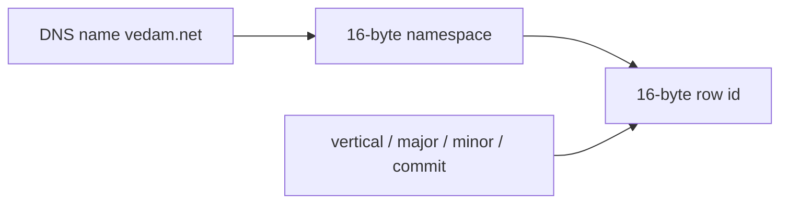

### 2.3.5 Code generation

The model is YAML. `tools/codegen/generate.py` reads it and writes headers, the class table, the thin northbound files, the UUID maps, and the protobuf files. A hand edit of a generated file is lost on the next run. Behaviour stays in the hand-written library bodies and in dispatch.

`tools/config/gen_config.py` reads `config/config.schema.yaml` and the selected `.config`, and writes `vedam_config.h` plus a small CMake fragment. A line `# KEY is not set` is the value 0. It is not a comment that falls through to the schema default. The header is forced into every translation unit of a module so `#if` can drop a filling. The generator runs from `cmake/VedamCodegen.cmake`, which already owns regeneration of the model outputs. The root build file does not call either program and does not name a compiler path.

The schema is the menu of legal options. `.config` is the selection. Sample files under `config/` exist so a test can pass a bypass. The root build file does not name those samples.

### 2.3.6 The published message

The inter-process link and the remote link publish one protobuf message, `vedam.v1.Message`, on whichever byte filling the build compiled. The request and the reply are that one message. There is no second reply type. The local link, the inter-process link, and the remote link are each the five hooks in section 2.6. The queue frame and the hand-written length prefix are present fillings a build may leave unused. gRPC is a remote procedure call that writes a length in front of the message. Connect carries the same service and method on an ordinary web request. Those two forms are the direction for the remote link.

| Field | Number | Contents |
|-------|--------|----------|
| `key` | 1 | Object key bytes. Empty when the row has one object. |
| `attrs` | 2 | Repeated attribute. Order is the list order after collapse on the sender that collapsed. |
| `status` | 3 | Overall status. |

One attribute:

| Field | Number | Contents |
|-------|--------|----------|
| `id` | 1 | Attribute id. |
| `value` | 2 | The value, present when this direction carries values. |
| `status` | 3 | Per-attribute status. |

The value is a `oneof`. Field 7 is reserved and the name `blob` is reserved, so a future field will not reuse that number for an untyped bag.

| Kind | Field | Wire type |
|------|-------|-----------|
| Boolean | 1 | bool |
| Signed 32-bit | 2 | int32 |
| Unsigned 32-bit | 3 | uint32 |
| Unsigned 64-bit | 4 | uint64 |
| Version | 5 | two uint32 fields, major then minor |
| Text | 6 | bytes |
| Struct | 8 | `google.protobuf.Any` |
| List | 9 | `ListValue`, a repeated value of the item kind |

A status on the wire has three fields. `code` is the coarse enumeration. `message` is unused by the present encoder. `vedam_status` is the signed 32-bit library code, including the index subtraction for an attribute failure. A peer that understands only the coarse code still sees a family. A peer that copies `vedam_status` sees the index.

The file options carry the 16-byte namespace. A service option can carry a row id and a minor. Those options are how the generator ties a service to a row. The call path does not re-read the file options on each request. It uses the hash built at init.

### 2.3.7 Two numbers for one status

The library code and the coarse code are not the same integer. Success is 0 in the library and `STATUS_OK` (1) on the wire. Unspecified (0) on the wire is not success. The encoder writes both. The decoder prefers `vedam_status` when it is present, and falls back to the coarse code when `vedam_status` says success but the coarse code says otherwise.

| Library | Coarse wire name | Coarse number |
|---------|------------------|---------------|
| 0 success | STATUS_OK | 1 |
| −1 failure | STATUS_FAILURE | 2 |
| −2 not supported | STATUS_NOT_SUPPORTED | 3 |
| −3 no memory | STATUS_NO_MEMORY | 4 |
| −4 invalid parameter | STATUS_INVALID_PARAMETER | 5 |
| −5 already exists | STATUS_ITEM_ALREADY_EXISTS | 6 |
| −6 not found | STATUS_ITEM_NOT_FOUND | 7 |
| −7 buffer overflow | STATUS_BUFFER_OVERFLOW | 8 |
| −8 mandatory missing | STATUS_MANDATORY_ATTR_MISSING | 9 |
| −9 uninitialised | STATUS_UNINITIALIZED | 10 |
| −10 not implemented | STATUS_NOT_IMPLEMENTED | 11 |
| −11 failed precondition | STATUS_FAILED_PRECONDITION | 12 |
| −12 capability denied | STATUS_CAPABILITY_DENIED | 13 |
| −13 offline | STATUS_OFFLINE | 14 |
| −14 thermal shed | STATUS_THERMAL_SHED | 15 |
| −15 object in use | STATUS_OBJECT_IN_USE | 16 |
| −100 minus index | STATUS_INVALID_ATTR_VALUE | 17 |
| −200 minus index | STATUS_ATTR_NOT_IMPLEMENTED | 18 |
| −300 minus index | STATUS_UNKNOWN_ATTRIBUTE | 19 |
| −400 minus index | STATUS_ATTR_NOT_SUPPORTED | 20 |
| −500 minus index | STATUS_INVALID_ATTR_ID | 21 |

An indexed library code maps to the family if it lies in a window of 1000 below the family's base, inclusive of the base. A code that matches no row becomes failure on the way out.

The HTTP digit string is a third, still coarser, number. It is what a stock client reads as the gRPC status. Success is `"0"`. Not implemented is `"12"`. Every other library code is `"2"`. The precise code remains in `vedam_status` inside the body. A client that only checks the digit cannot tell not-found from no-memory. A Vedam client decodes the body.

### 2.3.8 What a request carries

`fill_message` clears the protobuf message, then:

1. If the key pointer is non-null and the length is positive, set the key bytes.
2. Set the overall status to the code passed in. A client encode of a request passes success. The server has not run yet.
3. For each attribute, append one wire attribute. The metadata row is looked up by class id and attribute id. A request sends the value only when the verb writes values (create and set). A reply sends the value only when the verb does not write values, and only for an attribute whose status is success.

A reply of a get that did not go through `vattr_put_text` or `vattr_put_list` is sent as length 0 for that text or list. The caller's own length is not overwritten on the way out. The caller still needs that length as the room for the next decode. The zero on the wire is a copy in a temporary attribute, not a store into the caller's struct.

The write watch is how the encoder knows the body wrote. The server arms the watch on the codec's attribute array before dispatch, and drops it after the reply encode. A put that accepts the attribute, including a zero-length write and including a put that returns overflow, marks the bit. A get whose body never called put therefore encodes as empty, which is the signal that there was nothing to return, as distinct from a put of a real empty value only when the mark is the difference the encoder consults. The encoder checks the mark and, when the mark is clear, forces length 0. A marked empty value and an unmarked value both travel as length 0. The mark's other job is to keep the caller's room length intact: the forced zero is applied to the temporary, so a marked value's length is what the put stored (the needed length, which on success is the amount written).

### 2.3.9 What a receiver copies

`drain_message` is the inverse, with a different rule for who owns the bytes.

The number of wire attributes must be between 0 and the count the caller prepared. More than the prepared count is buffer overflow. A positive count with a null list or a null status list is invalid parameter.

On a server, the key is copied into the codec key buffer, 256 bytes. A longer key is buffer overflow. The message key pointer is then aimed at that buffer, not at the protobuf bytes, so the protobuf arena can be reused on the next call.

Each attribute id is stored into the prepared slot. The value is taken only when this side wants values. A server takes values only for a verb that writes them. A client takes values only for a verb that does not. The other direction leaves the local value alone and still records status.

A server ignores statuses in the request. Each attribute becomes success, or buffer overflow when the value does not fit the scratch slot, and the overall status is the first such failure. Dispatch runs only when that overall status is success. A client keeps the peer's per-attribute status, and replaces it with buffer overflow when the value does not fit the buffer the client supplied.

Scratch for attribute `i` is `scratch[i]`, 256 bytes. That array is the room a server gives a text, a list, or a struct. The body writes into it through the put helpers. The reply encode then reads it.

### 2.3.10 Text and list, with numbers

The caller of a get sets the length to the room. The body calls put with the real length. Put copies only when the real length fits. In every case the length field becomes the real length, so an overflow tells the caller how much to allocate next time. Nothing is copied on overflow. The status of that attribute is buffer overflow.

Example. The caller passes a text with `len` 4 and a four-byte buffer. The body has 4 bytes. Put copies them and leaves `len` 4. The status is success.

Example. The caller passes `len` 4. The body has 7 bytes. Put copies nothing, sets `len` to 7, and returns overflow. The overall status is that overflow if it is the first failure.

Example. A list of structs. `count` is the room in items, not in bytes. `elem_size` is the bytes of one item. Put multiplies only after checking the count against the room, so a huge count does not wrap the copy length into a small write.

A create or a set sends the caller's bytes as the value. The room rule is for the direction that returns a value. A write that exceeds `max_len` or `max_count` in the metadata fails in the verb check, before the body, with invalid-attribute-value minus the index. That is a different failure from buffer overflow. The first is "the value is illegal". The second is "the value is legal and the caller's buffer is short".

### 2.3.11 Collapse, with a list

Collapse keeps the last entry of a repeated id and compacts the list in place. Status entries are not compacted by a separate pass inside collapse. The verb check collapses before the attribute check, and the check writes `status_list` at the indexes of the compacted list. A caller that placed a status buffer of the original count still has room. Indexes after the new count are not written by the check.

Example. The list is id 3, id 9, id 3. After collapse the list is id 9, then the second id 3. The count is 2. The lock take sorts to 3 then 9 and takes each once. The duplicate never becomes two locks.

Id 0 survives collapse as an id. The lock take then skips it. The attribute check still sees it and applies the unknown-id rule if 0 is not in the class table.

### 2.3.12 The write watch

The watch is a thread-local stack of four frames. Each frame records a base pointer, a count, and a bitset of 32 attributes. `vattr_write_watch` pushes. `vattr_write_unwatch` pops. A fifth push past the depth does not create a fifth frame.

`vattr_put_text` and `vattr_put_list` mark the bit when the attribute pointer lies in the current base range, after the call is accepted, including overflow and including a zero length. `vattr_was_written` reads the bit. The reply encoder uses it to decide whether a text or list was produced by the body.

A nested local call on the Wait-Die build pushes its own watch and pops it before the outer encode. The outer bits stay. On the lockless build the nested call does not reach a body, so it does not push a watch either.

### 2.3.13 Index arithmetic

An attribute failure names the list slot by subtraction, so one integer is both the family and the position.

| List index | Unknown attribute | Invalid value | Not supported |
|------------|-------------------|---------------|---------------|
| 0 | −300 | −100 | −400 |
| 1 | −301 | −101 | −401 |
| 2 | −302 | −102 | −402 |

The checker writes that integer into `status_list[i]` and, if it is the first failure, returns it as the overall status. Later entries are still written. A caller that only reads the overall status knows which slot failed and which family it was. A caller that reads the whole list knows the rest.

The wire coarse code drops the index. Family 19 is unknown attribute, whatever the slot. `vedam_status` keeps −301. A client that copies `vedam_status` restores the slot. A client that only looks at the coarse code knows the family and must read the attribute order to guess the slot. The Vedam decoder uses `vedam_status`.

The window on the way back out to a coarse code is 1000 below the base, including the base. Index 0 through 999 of a family still map to that family. The list maximum is 32, so a real call never approaches 1000. The window exists so a hand-built code in that range does not become a generic failure.

Mandatory-attribute-missing is the exception. It is −8, with no index, and it is returned only after every present attribute has status success. A create that has one illegal value and one missing mandatory id reports the illegal value. The missing id is checked only when the present ids are clean.

### 2.3.14 Checking one attribute

`vii_attr_check` walks every list entry, writes every `status_list` slot, and remembers the first failure. It does not return on the first bad entry. The caller sees a status on each attribute it sent. The function's return value is that first failure, or success when every entry succeeded.

For one entry, `check_one` applies these tests in order. The first match is the status.

1. No metadata row for the id: unknown-attribute minus the index.
2. Origin external and the row is not public: attribute-not-supported minus the index.
3. Origin external, verb create or set, and the read-only flag: attribute-not-supported minus the index.
4. Verb set and the create-only flag: attribute-not-supported minus the index.
5. Verb create and the set-only flag: attribute-not-supported minus the index.
6. Verb subscribe, unsubscribe, or notify, and the subscribable flag is clear: attribute-not-supported minus the index.
7. Otherwise `check_value`.

`check_value` checks the shape on every verb. A text must be a text, a list must be a list, an integer must be the integer kind. A get does not then apply range, enumeration, or length. Those apply only when `writes_values` is set, which is create and set. A get whose text length is the caller's room is not an illegal value because the room is large. A create whose text is longer than `max_len` is invalid-attribute-value minus the index.

A list write checks `max_count` first. Then each item is checked against the item kind's range and enumeration. One bad item fails the attribute. The index in the status is the attribute's index in the call, not the item's index inside the list.

When every entry succeeded and the verb is create, `check_mandatory` walks the class's attribute rows. Each row with the mandatory-on-create flag must appear somewhere in the list. The first missing one returns mandatory-attribute-missing. That code has no index. The per-attribute statuses are all success, and the overall status carries the missing-attribute result. A create that named every mandatory id, with legal values, reaches the body.

An internal origin skips the public-bit test and the external read-only test. It does not skip create-only, set-only, subscribable, shape, limits, or mandatory. A worker that has overwritten the origin to external gets the public-bit test. Section 2.3.16 is that overwrite.

### 2.3.15 Shape, range, and enumeration

Shape is the kind. A boolean is not a text. A version is two unsigned 32-bit fields. A struct is a pointer and a size from the metadata. A list is a pointer and a count, and the item kind is a second shape check per item.

Range applies when `has_range` is set. The integer must lie between `min` and `max`, inclusive. The comparison uses a signed 64-bit bound so an unsigned 64-bit value still has a place to put the limit the model wrote. An enumeration is a list of signed 32-bit values. A value not in that list fails even when it sits inside a range. Both can be set. Both must pass.

`max_len` of 0 on a text means the check does not cap the length. The buffer the caller or the scratch provides is still a cap, enforced later by put or by the codec slot. `max_count` on a list is the check's cap. A list with no positive max fails the comparison when the count is greater than that max. A model that wants a list must set a max the check can honour.

These tests do not allocate. They do not take a lock. The attempt, when there is one, already holds the locks before `vii_verb` runs. A failure here still releases those locks, because the release is in the attempt wrapper, not in the checker.

### 2.3.16 The origin bit

`external_verbs` is a bit per verb. `vii_verb` returns not implemented when the bit for this verb is clear and the origin is external. An internal origin skips that test. The body pointer is still required. A null body is not implemented for both origins.

Init's create uses the internal origin so it can run a verb the external bit does not offer, and so it can pass an empty attribute list on a row that would reject an external create missing a mandatory attribute only if the body and the check allow an empty list. The check still runs. An internal create is not a back door around mandatory attributes. It is a back door around the external-verb bit.

Every byte filling's worker overwrites the origin to external before dispatch, in the same way the length-prefixed filling already does. The frame may still carry the word the sender wrote. That word is the sender's claim. The verb check sees the origin the worker wrote, which is external. The internal origin is for code linked into the process. A peer does not get to claim it by writing the frame. The local filling never crosses a process, so the caller's origin is the process's own.

### 2.3.17 Names on the wire and names in C

The method segment is the English verb with a capital initial: `Get`, not `V_VERB_GET`. The C enumeration is the index. The codec table is the only place that maps one to the other. A new verb is a row in that table, a bit in the class, a function pointer, and a lock rule. Adding a string compare at a call site is the shape this tree refuses.

The service segment is a generated name, package plus service. The hash key is that string. The call site does not assemble it with a format in the application. The application names a class id and a major. The map returns the string, or null when that major was not generated.

Attribute ids on the wire are the same integers as `v_attr_id_t`. They are not the protobuf field numbers of `AttrValue`. Field 2 of `AttrValue` is "a signed 32-bit value", for every attribute that has that kind. Which attribute it is lives in `Attr.id`.

## 2.4 The call

The path from an application call to a library body, and the rule for a body that calls another row.

### 2.4.1 The layers, one picture

A call moves down this stack and, on a local send, may re-enter it. A byte link enters at dispatch. It does not enter at the northbound adapter.

```text
application
    |
    v
northbound adapter          src/va          builds vii_msg_t, origin external
    |
    v
dispatch                    src/via         null checks, then the lock or the depth counter
    |
    v
lock map                    src/lock        pin, existence, attributes, Wait-Die
    |
    v
verb check                  src/via         origin bit, collapse, attribute rules
    |
    v
library body                src/lib         the only place a row changes its values
    |
    +---- vedam_node_call --+
    |                       |
    v                       v
local link               inter-process or remote link
re-enters dispatch       encodes, waits, decodes
joins the attempt        refused while an attempt is held
when Wait-Die is on      (depth counter refuses the
                         re-entry when Wait-Die is off)
```

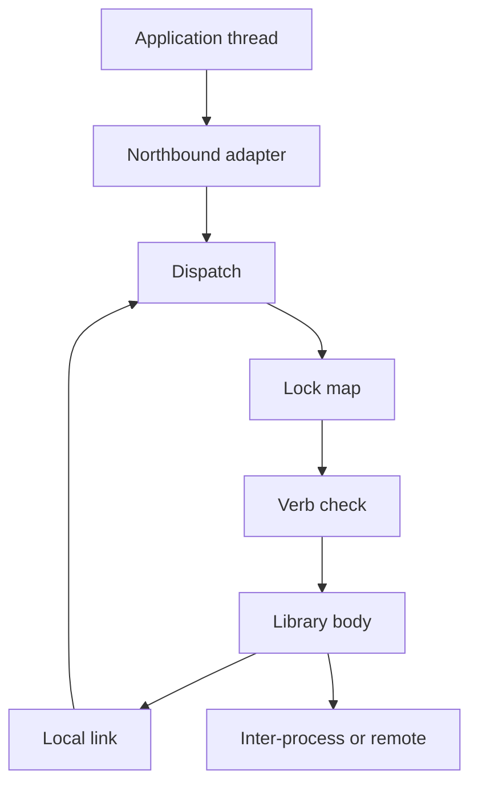

The platform layer and the containers sit under every box that allocates or waits. They are not a step in the call. A body does not call them to mean "send". A body calls `vedam_node_call`.

### 2.4.2 Northbound adapter

`src/va` is one file per row. Each public function the application calls builds a `vii_msg_t` with origin external, the latest major and minor, the verb, and the caller's `vi_msg_t`, then calls `vii_dispatch`. It does not lock. It does not encode. It does not switch on the attribute id.

That split exists so the same dispatch serves a local application and a filling. If the adapter locked, a filling would have to lock as well or skip the adapter and risk a second policy.

### 2.4.3 Dispatch

`vii_dispatch` is the door.

On a build with wwlock:

1. If the node is null, return uninitialised.
2. If the call or its `vi_msg_t` is null, return invalid parameter.
3. Call `vedam_lock_invoke` with the class id, the key, the verb, the origin, the attribute list, and a function that runs the verb.

On a build without wwlock:

1. The same two checks.
2. If `dispatch_depth` is already non-zero, return failed precondition.
3. Increment depth, run the verb, decrement depth.

The verb runner (`dispatch_body`) rejects a class id of 0 or above the table, and a verb at or above the verb count, with not implemented. Otherwise it calls `vii_verb` on `node->classes[class_id]`.

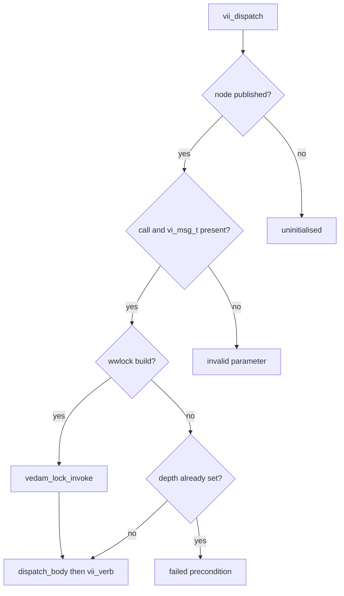

### 2.4.4 Verb check

`vii_verb` reads `vii_verb_rules[verb]`.

If the rule checks the list and the count is non-zero, both pointers must be non-null. If the rule collapses, `vattr_collapse_last` rewrites the list so each id remains once, as its last value. `vii_attr_check` then walks every remaining attribute and writes `status_list[i]`.

For each attribute the check is an index through `attr_by_id`, not a loop over all attributes of the row. Unknown id, id the origin may not use, value outside range, value outside the enumeration, text longer than `max_len`, list longer than `max_count`: the matching negative code minus the index. On create, after every present attribute succeeds, each attribute flagged mandatory must have appeared. A missing one returns mandatory-attribute-missing.

Only then is `body[verb]` called. A null body is not implemented.

The body receives major, minor, and the `vi_msg_t`. It writes values into `attr_list` and statuses into `status_list`. Text and list values leave the body only through `vattr_put_text` and `vattr_put_list`, which implement the room-then-written rule and set the overflow status themselves.

### 2.4.5 Sending from a body

`vedam_node_call(desc, msg)` is the only send.

1. A null descriptor, a null operations table, a null call hook, or a null message returns invalid parameter.
2. If `desc->link` is not local and `vedam_lock_in_attempt()` is non-zero, return failed precondition.
3. Otherwise call `desc->ops->call`.

The local operations table's call hook calls `vii_dispatch` again. On a Wait-Die build the nested call joins the attempt already running on this thread. On a build without that lock, dispatch's depth counter is already set, so the nested call returns failed precondition and the inner body does not run. The depth counter refuses a local re-entry. It does not refuse a non-local hook. On the build without a lock map, `vedam_lock_in_attempt` is always zero, so step 2 does not refuse a non-local hook. The present browser selection does not compile those hooks. A queue or a socket hook writes bytes and waits for a reply. That wait is legal on a Wait-Die build only because step 2 has already required the locks to be down.

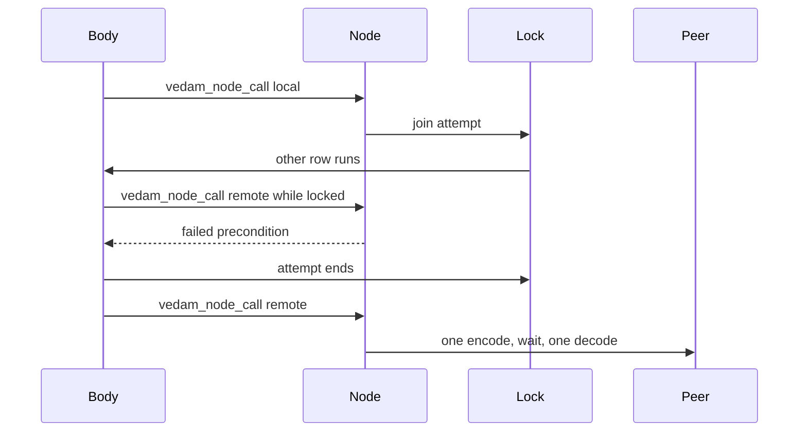

### 2.4.6 What a body may do

A body receives the major, the minor, and the public message. It may read the key. It may write values and statuses. It may call `vedam_node_call`.

On a Wait-Die build it may call the local slot, and that call joins the attempt and may take more locks. It must be correct if the outer attempt runs the body again from the start after a die. It must not send on a queue or a socket while the attempt is held. That send returns failed precondition.

On a lockless build it must not call back into dispatch. The depth counter returns failed precondition. A body on that build finishes without a nested verb.

A body does not take a Wait-Die lock itself. The attempt already holds the locks the verb requires. A body that needs a lock on an attribute it did not name does not have that lock, unless it reaches it through a nested call that names it.

A body does not free the caller's buffers. A body does not free the codec scratch. A body does not call `vedam_init` or `vedam_deinit`.

### 2.4.7 Where one call's memory lives

| Bytes | Owner | Lifetime |
|-------|--------|----------|
| `vi_msg_t` and the attribute array on a local call | The application | The call. The node does not copy them. |
| Key bytes on a local call | The application | The call. The lock map copies them into the object if the object is new. |
| Codec scratch and key buffer | The worker or the client context | The connection. |
| Protobuf arena | The workspace | The connection. Cleared per encode. |
| HTTP read buffer, 65536 | The worker slot | The connection. |
| Queue `rx` and `enc` | The worker or the connector context | The connection. |
| Lock object and its key copy | The map | Until the last pin drops and close destroys the map. |
| Hold records | The attempt thread | Until release. |
| `vedam_t` | The process | Init to deinit. |

The hot path after init does not allocate `vedam_t`. It may allocate a lock object the first time a key is seen, and an attribute lock the first time an id is seen, and a hold record each time a take adds a hold. Those are the allocations the lock sections name. A repeated get of a warm key and a warm attribute allocates a hold record and frees it before returning. A join allocates nothing for that lock.

### 2.4.8 Thread-local state

| Name | Set by | Meaning |
|------|--------|---------|
| Lock depth | The attempt | Non-zero while this thread is inside `vedam_lock_invoke` on a Wait-Die build. `vedam_lock_in_attempt` reads it. |
| Pin list | Pin and unpin | Objects this attempt is keeping alive. |
| Hold list | Acquire and release | Locks this attempt must unlock. |
| Dispatch depth | The lockless dispatch | Non-zero while a verb runs on that build. A second entry fails. |
| Write-watch stack | Put helpers | Which attributes the body wrote. Depth at most 4. |

None of these is in `vedam_t`. Two threads in one process do not share them. That is why two attempts can run together, and why a die on one thread does not restart the other.

### 2.4.9 Call timeline, local get

1. The application fills `vi_msg_t` with a key and one attribute id. The value buffer's length is the room.
2. The northbound adapter sets origin external, verb get, latest major and minor, and calls dispatch.
3. Dispatch enters `vedam_lock_invoke`.
4. The object is pinned. Existence is taken shared. The attribute id is sorted (one id), the attribute lock is taken shared.
5. The verb check collapses nothing if the id is unique, looks up the attribute, and calls the body.
6. The body writes into the caller's text or list through the put helper.
7. Holds are released. Pins drop. The status returns to the application.

No byte is encoded. The message pointer at step 1 is the pointer at step 6.

### 2.4.10 A local call that fails

| Observation | Status | Locks |
|-------------|--------|-------|
| Node null | Uninitialised | None |
| Message null | Invalid parameter | None |
| Second entry, lockless build | Failed precondition | None |
| Class or verb out of range | Not implemented | Released if the attempt took them |
| External verb bit clear | Not implemented | Released |
| Unknown attribute | Unknown-attribute minus the index | Existence released, attribute locks not taken |
| Dead object, not create | Not found | Released, body not called |
| Dead object, create | Object in use | Released, body not called |
| Nested socket send | Failed precondition | Still held. The body sees the status. |
| Body success | Success | Released. Delete has set dead. |

### 2.4.11 A create, step by step

This is the external create of a keyed object, on a Wait-Die build, from the application thread.

1. The application sets the key pointer and length, and one attribute list that includes every mandatory id. Lengths on text values are the number of bytes being written, not a room, because create sends values.
2. The northbound adapter fills `vii_msg_t` with origin external, verb create, and the latest major and minor. It calls dispatch.
3. Dispatch sees a live node and a non-null message and calls `vedam_lock_invoke`.
4. Depth is 0, so this is an outermost attempt. The take pins the object, creating it on a miss, and acquires existence exclusive.
5. If the object is dead and this hold is new, the take follows section 2.7.14 and may return object-in-use without the body.
6. Create takes no attribute lock. The take returns 0.
7. The body runner calls `vii_verb`. The external bit must allow create. Collapse runs. The checker writes a status per attribute and, if all succeed, checks mandatory ids.
8. The body runs. It may refuse with already-exists if its own table says the key is present. The lock map does not know whether the library has stored the object. The lock object existing only means some attempt has pinned this key before. A pin is not a successful create.
9. The body returns. Dead is not set, because the verb is not delete. Holds are released. Pins drop. If the ref and the hash still keep the lock object, it remains for the next call. If nothing keeps it, it can be destroyed. The hash entry keeps a keyed object that was inserted, so a keyed lock object stays after the pin drops, until the map is closed.
10. The adapter returns the status to the application.

The distinction in step 8 is easy to miss. The lock map allocates on first pin so two creates of the same key exclude each other. The library body decides whether the key is already stored. Both can say no: the lock object is new, and the body still returns already-exists if a previous create stored the key and the lock object was kept. Both can say yes to "new" only when the body says the key is free. The lock does not store the attribute values.

### 2.4.12 A delete, step by step

1. The application names the key. The attribute list may be empty. Delete does not lock only the named attributes. It locks every attribute lock that already exists on the object.
2. Existence is exclusive.
3. The snapshot copies those locks and the take acquires each exclusive, in id order.
4. The checker runs if the list is non-empty. An empty list skips the per-attribute loop and does not fail mandatory, because mandatory is a create rule.
5. The body runs. On success the attempt sets `dead` before it releases.
6. A later get pins the same object, takes existence shared as a new hold, sees `dead`, releases, and returns not found without the body.
7. A later create does the same observation and returns object-in-use, as section 2.7.14 says.

Delete of a key that was never pinned still pins, creating the lock object, then the body is the one that returns not found if the library has nothing stored. The dead bit is set only after success. A body that returns not found does not mark the object dead. A following create can still take existence exclusive on that lock object and run.

### 2.4.13 Subscribe

Subscribe takes existence shared and each named attribute shared, after the same sort and duplicate skip as get. The checker requires the subscribable flag. The body copies what it needs before it returns. The caller's list remains the caller's. The comment in `vii_verb` is the rule: the body copies, the caller keeps the list.

The public function returns when that copy is done. It does not block until a later notify. Notify is a separate verb, with its own attempt, existence shared, and the named attributes shared. The present slice does not deliver a stream inside the subscribe call. A peer that wants a stream needs a later path that calls notify. That path is not a second message type. It is the same `vi_msg_t` with the notify verb.

Unsubscribe takes the named attribute locks shared and takes existence shared. Set keeps its attribute locks exclusive. Delete keeps every existing attribute lock exclusive and keeps existence exclusive. A get or a subscribe of the same ids can hold those attribute locks at the same time as unsubscribe. A get of a different attribute on the same object can hold existence at the same time. Delete waits, because delete needs existence exclusive.

## 2.5 Lifetime of a node

How a process publishes one node, which threads that start creates, and where the same libraries run.

### 2.5.1 Init, step by step

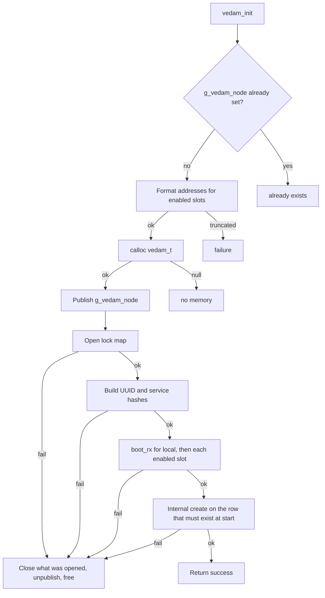

The order is deliberate. The pointer is published before the lock map opens because the lock map and the class table read `vedam_node()`. If a later step fails, the pointer is cleared before the function returns, so a racer either sees a node that is fully up or sees null. A call that observes the pointer during a failing init can still lose the race. The init path is not itself parallel. Callers do not invoke `vedam_init` from two threads.

`boot_rx` allocates a descriptor with `vti_open`, then `vti_listen`. On listen failure it closes the descriptor and returns the listen status. The rollback walks slots downward from the one that failed and closes them, then finishes the UUID map, closes the lock map, clears the pointer, and frees the node.

The internal create uses a zeroed `vi_msg_t` (empty key, no attributes), origin internal, verb create, and the major and minor of the row the build marks as present at start. If that create fails, the same rollback runs.

### 2.5.2 Deinit, step by step

1. If the pointer is null, return uninitialised.
2. Run an internal delete on that same start row. The status is ignored so a failing delete cannot leak the process object.
3. Close `rx[2]`, then `rx[1]`, then `rx[0]`, skipping nulls inside `vti_close`.
4. Finish the UUID map.
5. Close the lock map.
6. Clear the pointer and free the node.
7. Return success.

After step 6, `vedam_node()` is null. In-flight calls that already passed the null check are the caller's bug if they race deinit. Deinit is not concurrent with init.

### 2.5.3 Failure along init

| Step that fails | What is already true | What rollback does |
|-----------------|----------------------|--------------------|
| Address truncated | Nothing allocated | Return failure |
| `calloc` fails | Nothing published | Return no memory |
| Lock map fails | Pointer published | Clear pointer, free node |
| UUID map fails | Lock map open | Close locks, clear, free |
| A listen fails | Some `rx[]` filled | Close those descriptors, finish UUID map, close locks, clear, free |
| Internal create fails | Listeners up | Same as listen failure |

The function does not return success with a half-open node.

### 2.5.4 What init logs

After the listeners are up and before the internal create, init logs one line with two integers: whether slot 1 has an operations table, and whether slot 2 has one. The line is `ipc=` and `remote=` with 0 or 1. It does not print the address. A browser run of the present selection logs `ipc=0 remote=0`.

A TCP listen logs the bound address on its own line when listen succeeds. A Unix-domain listen logs the path. Those lines are from the filling, not from init. A failure logs the listen status and rolls back, so a process that returns from init with success has already passed the create as well. A log line from listen is not, by itself, the success of init.

### 2.5.5 Threads the node starts

| Thread | Started by | Blocks in | Exits when |
|--------|------------|-----------|------------|
| Application, or `vedamd`'s main | The process | `pause` in the daemon, or the application's own loop | Signal, then deinit |
| Queue worker, four of them | Queue listen | `poll` on the wake pipe and the queue | Stop flag, or a poll or receive error that is not a retry |
| HTTP listen thread | Pool start | `poll` on the wake pipe, and on the listen socket when a slot is free | Stop flag, or a poll error that is not `EINTR` |
| HTTP worker, four of them | Pool start | `poll` on its kick pipe, then `handle_client` which reads the socket | Stop, after the current client loop ends |

Init runs on the thread that called it. It starts the filling threads inside listen, before it returns. A caller of `vedam_init` that then does other work is concurrent with those threads. The class table and the UUID map are not mutated after init returns. The lock map is. The fillings' contexts are.

Deinit runs on the thread that calls it. It closes descriptors, and close stops and joins the pools. A call in progress on a worker can still be inside dispatch while deinit begins. The present deinit does not take a generation lock against that call. Operators stop traffic, then signal the daemon. The signal handler only sets a flag. `vedam_deinit` runs on the main thread after `pause` returns, not inside the signal handler.

### 2.5.6 Placements

| Placement | Process | Lock | Slots that can be on | Who executes |
|-----------|---------|------|----------------------|--------------|
| Application | The application's process | wwlock | as the `.config` says | That process |
| vedamd | A daemon process | wwlock | as the `.config` says | That process |
| Browser | The visitor's tab | none | local only in the present WebAssembly list | The browser engine |
| File host | None | none | none | Nobody |

The WebAssembly link does not include `thread.c` or `futex.c`. It exports `vedam_init`. It does not pass a thread flag and does not request a standalone module, because a standalone module is not what `WebAssembly.instantiate` loads. The test page under `tests/wasm` fetches the module, supplies the two imports the compiler's runtime asks for (`fd_write` and heap growth), runs constructors if they were exported, and calls `vedam_init`. That page is a proof of the call. It is not a product site. The compiler itself is not in this repository. Configure finds `emcc` on `PATH` or uses the path given as `-DVEDAM_EMCC`. If neither exists, class E configure fails and names `emcc`.

### 2.5.7 Placements of the same libraries

| Placement | Who calls `vedam_init` | Lock | Fillings | Who executes |
|-----------|------------------------|------|----------|--------------|
| Linked application | The application | wwlock if the build says so | slots the build enabled | That process |
| vedamd | `main` of the daemon | same | same | That process |
| Browser | The page, on the exported function | depth counter only | local, in the present link list | The visitor's WebAssembly engine |
| File host | Nobody | none | none | Nobody |

The file host is a cache of bytes. Fetching `libvedam.wasm` does not start a node on that host.

### 2.5.8 The daemon

`vedamd` is a small process around the libraries. It accepts `-f` to stay in the foreground and `-h` to print `usage: vedamd [-f]`. Any other argument is ignored by the present loop, which only looks for those two.

Without `-f` it becomes a daemon through the platform helper. It then installs handlers for `SIGTERM` and `SIGINT` that set a flag. It calls `vedam_init`. On failure it prints the status and exits 1. On success it `pause`s until the flag is set, then calls `vedam_deinit` and exits 0.

The daemon does not open a control socket of its own. The listeners are the ones init opened. Stopping the process is the signal. There is no second shutdown verb on the command line.

### 2.5.9 The browser module

The compiler is `emcc` on `PATH`, or the path given as `VEDAM_EMCC`. Configure fails if that program does not exist. The repository does not carry a compiler, and it does not name a machine path.

The link line is optimisation level 2, the Linux platform define, the include root, the generated header forced in, an export of `vedam_init`, and `--no-entry`. It does not pass a thread flag. The output file named on the compiler command is the JavaScript glue. The compiler writes `libvedam.wasm` beside that glue. Naming the wasm file as the output would ask for a standalone module, which a page does not instantiate.

The sources are the platform files for memory, string, sleep, environ, and process. Thread and futex are not in that list. The containers, the attribute helper, the library bodies, dispatch, the northbound adapters, the descriptor helpers, the UUID map, the local filling, and the node are in the list. A filling file is appended only when its flag is on. The Wait-Die sources, including the futex park, are appended only when that flag is on. The browser selection turns the filling flags off and turns Wait-Die off, so the module gets the empty lock map and the depth counter.

The page that proves the link lives under the tests. It fetches the module, supplies the two imports the compiler runtime asks for, runs constructors if they were exported, and calls `vedam_init`. That page is not a product site. The machine that served the file does not call `vedam_init`.

### 2.5.10 Products the build installs

A host build, any class letter other than the browser letter, installs:

| File | What it is |
|------|------------|
| `lib/libvedam.so` | The shared library. It contains the wwlock symbols when Wait-Die is on. |
| `lib/libvedam.a` | The static archive of the Vedam modules. It does not contain the wwlock archive. |
| `lib/libwwlock.a` | The Wait-Die archive, installed when Wait-Die is on. The shared wwlock library is not installed. |
| `bin/vedamd` | The daemon, when that flag is on. It links the shared library. |
| `include/vi/` | The public headers. |
| `include/vti/vedam/` | The generated protobuf headers. |

`libvedam.so` is linked to the shared protobuf library. A dynamic listing of it names protobuf. It does not name wwlock, because those objects were absorbed at link time. An application that links `libvedam.a` also links `libwwlock.a` when Wait-Die is on, and it links the pthread and realtime libraries the platform needs, and it links protobuf.

The daemon's run path looks for the shared library beside the install, in `../lib` relative to the binary. A copy of the binary without that library does not start.

A browser build does not install those host archives. It installs `lib/libvedam.wasm`. The host module targets are excluded from the default build so the compiler that produces the wasm is not asked to mix them into a native link.

### 2.5.11 The selection file

`.config` at the root of the tree is the selection a normal configure reads. The schema lists every legal key. A key that is not in the schema is rejected. A missing selection file fails configure. A bypass path, passed as a CMake variable, reads a different file and does not copy it over `.config`.

A bool that is on is `KEY=y`. A bool that is off is a line of the form `# KEY is not set`. That line is the value 0. It is not a comment that falls through to the schema default. This matters because several defaults are on. An omitted line would turn them on. The explicit unset line turns them off.

The generated header is forced into every translation unit of a module. A filling `.c` file is added to the module only when its flag is 1, and the file itself is wrapped so a stray compile still sees an empty translation unit when the flag is 0. The HTTP helpers are compiled when either TCP or the Unix-domain flag is on, because both call them. The TCP operations file is compiled only when TCP is on.

The node-class letter is an enumeration in the same file. It is recorded in the header as a number and as a letter macro. It does not, by itself, turn flags on. The flags in the same file do that. The sample files under `config/` are the letters written out so a test can pass one as a bypass. The root build file does not name them.

One integer in the schema is an instruction ceiling. The default is one million. The legal range is 1 through one billion. The header stores it. No digest includes it. Nothing in the present bodies reads it to run a program. A bool that would turn an in-process engine on is rejected at configure. The engine is not in the tree.

### 2.5.12 How the libraries are linked

Configure generates the header and the model outputs, then builds one static library per layer, in an order that matches the include rule: platform, containers, util, lock, library bodies, dispatch, northbound, transport, core. The umbrella `libvedam` links those libraries. The shared umbrella links the same list and, when Wait-Die is on, links the wwlock archive as a private dependency so the symbols land in the `.so` and not as a dynamic `NEEDED` entry.

The lock module's own build either compiles the wrapper and the map and links wwlock, or compiles the empty map. It does not compile both. The browser link repeats that choice from the same flag.

```text
libvedam.so
  platform  memory, string, thread, sleep, futex, mq if on, env, process
  ds        list, stack, queue, hash, index, singleton
  util      attr, log, trace
  lock      map and wrapper, or the empty map
  lib       one body per row the selection compiled
  via       class table, verb check, dispatch
  va        northbound adapters
  vta       inproc, plus each filling the flags compiled
  core      init and deinit
  wwlock    inside the .so when Wait-Die is on
```

### 2.5.13 The five sample selections

The committed `.config` is letter C. The other letters exist as sample files so a test can pass a bypass. They do not change which slot index means local, inter-process, or remote. They change which tables are compiled.

| Letter | Queue | TCP | Unix-domain | Second remote hook | Wait-Die | Daemon |
|--------|-------|-----|-------------|--------------------|----------|--------|
| A | on | on | on | off | on | on |
| B | on | on | on | off | on | on |
| C | on | on | on | off | on | on |
| D | off | off | off | off | on | on |
| E | off | off | off | off | off | off |

A and B match C on every filling and on the lock. They differ in which optional rows the compiler includes. Those rows are named in [Interfaces](../interfaces/interfaces.md), not here. D keeps the lock and the daemon and compiles no byte filling, so init opens only the local listener and the log line is `ipc=0 remote=0`. E compiles no byte filling, no Wait-Die, and no daemon. Its product is the wasm module, and dispatch uses the depth counter.

On A, B, and C the queue flag and the Unix-domain flag are both on. Slot 1 still has one table. Init assigns the queue first, and the Unix-domain table is not installed in that slot. The HTTP helpers are compiled, because either flag turns them on, and the TCP operations table is installed in slot 2. A process built from letter C therefore listens on a POSIX queue and on `127.0.0.1:0`. It does not also listen on `/tmp/vedamd.<pid>.sock`. That path is what slot 1 uses only when the queue flag is off and the Unix-domain flag is on. Compiling a filling and listening with it are two different facts. The table above is the flags. Section 2.6.3 is which flag wins the slot.

On every letter the second remote hook is off, and the engine switch is off. Configure rejects a selection that turns the engine switch on. The instruction-ceiling integer keeps its default unless a selection sets it. None of these samples set it, so the header stores one million.

A bypass that points at letter E does not overwrite `.config`. The next plain configure, with no bypass, reads letter C again. One build directory is reused. The previous compile products are regenerated for the new flags. There is no directory per letter.

### 2.5.14 Log and trace

`vlog_info` and `vlog_error` are the process log. Init uses info for the slot flags. Listen uses info for the address. Listen failure uses error with the status integer. The log is not a row and it is not locked. A call does not consult the log to decide a status.

`vtrace_enter` and `vtrace_exit` bracket a filling function so a debug build can see the nesting. They do not change the status. They are not a lock. A body does not need to call them.

Neither facility is a link. A deployment that wants the lines captures the process's standard error. The libraries do not open a log file of their own in the present sources.

### 2.5.15 Tests and the example

Tests are not part of the installed product. They link the libraries and run under one build directory. A class sample is a reconfigure of that same directory with a bypass file, not a second build tree. The layering test reads include lines and fails when a folder includes a header the table in section 2.2.3 does not allow. The lock tests take shared and exclusive holds and force a younger attempt to restart. The codec tests round-trip a message through the protobuf encode and the five-byte prefix. The filling tests open a queue or a TCP socket in-process and check the status that comes back. The attribute tests check collapse, the room rule, and the write watch. The container tests check the hash, the list, the stack, and the queue. The configuration test reads a sample selection, including the line that turns a flag off, and checks the generated header. The browser page fetches the wasm module, supplies the two runtime imports, and calls `vedam_init`.

The examples directory holds one small program that includes the public headers and calls a verb. It is built on a host configure. It is not linked into `libvedam.so`, and it is not part of the wasm module.

A test that needs a node calls `vedam_init` or links a stub that publishes a node pointer. The stub is for tests of a single layer. It is not a second implementation of the node. Production code has one `vedam_init`.

## 2.6 Three links

A node has three links, and no fourth. They are local, inter-process, and remote. Each link is the five hooks: close, listen, accept, connect, and call.

Link 0 stays inside the process. The caller's thread is the connection. The message is not copied onto a socket.

Link 1 is inter-process. The other side is another process on the same machine. The link does not name the bytes. A queue is one present filling. A local socket is another. A later filling replaces the operations table and keeps the index. A build may leave a present filling unused.

Link 2 is remote. The other side is a procedure call: the caller names a service and a method and sends one message. Two public forms of that call are the direction for this link. gRPC is a remote procedure call in which the message is preceded by its length, and a stock client already knows the service and the method. Connect is the same service and method carried on an ordinary web request, so a client that is not a gRPC library can still call. Vedam takes that shape for the remote link. It does not take a vendor library, a fee, or a token from those projects. The hand-written length-prefixed framing in the tree, and the Connect table whose hooks still return not implemented, are fillings that let the hook be exercised. They are not the deployment choice. A build can leave them unused when a gRPC or Connect filling occupies the same link.

Every link uses one operations table: close, listen, accept, connect, and call. `vedam_node_call` is the only send. A non-local send while a Wait-Die attempt holds locks returns failed precondition. The message on every link is `vi_msg_t`. A filling encodes it and decodes it. It does not invent a second message for one row.

The subsections that follow name the fillings compiled today, including their bytes, so a reader can see what the hook does in this tree. Those bytes are not a promise that a later filling will use a queue or the hand-written framing.

### 2.6.1 Opening a descriptor

`vti_open(link)` reads `vedam_node()`. If the node is missing, or the link is not 0, 1, or 2, or `ops[link]` is null, it returns null. Otherwise it allocates a zeroed descriptor, stores the table and the link, and returns it. Listen, connect, and call are then indirect through that table. `vti_close` calls the table's close hook and frees the descriptor. The opener is the closer. A subscribe registration does not store the descriptor on the node.

### 2.6.2 The five hooks, for each present filling

`vti_listen`, `vti_accept`, `vti_connect`, and `vti_call` are thin. Each rejects a null descriptor or a null function pointer with invalid parameter, then calls the table. `vti_call` is `vedam_node_call`, so the attempt check happens before the filling runs. `vti_close` ignores a null descriptor, calls close when the pointer is set, and always frees the descriptor.

| Hook | Local | Inter-process, datagram | Remote, length-prefixed | Inter-process, local socket | Remote, Connect |
|------|-------|-------|-----|-------------|--------------------|
| close | Free the context | Stop workers, close and unlink the queues | Stop the pool, close the socket | Stop the pool, close the socket, unlink the path | Success, no socket |
| listen | Allocate a context, set the listening flag, ignore the address | Create the queue, start four workers | Bind, start the pool, allocate four codec workspaces | Bind, start the pool | Not implemented |
| accept | Not implemented | Not implemented | Not implemented. The pool accepts. | Not implemented. The pool accepts. | Not implemented |
| connect | Allocate a context. The address is ignored. | Open the peer send-only and a private reply queue | Parse `host:port`, one TCP connect | Not implemented in this slice | Not implemented |
| call | `vii_dispatch` on this thread | Pack, send, poll the reply for 5000 ms | Encode, HTTP exchange, decode, keep the socket | Not implemented in this slice | Not implemented |

Local listen logs `inproc listen stays on the caller thread`. There is no second thread to forget. Local accept is not implemented because there is nobody to accept. A sender and the node share the process. Connect on the local slot still allocates a context so a descriptor from `vti_connect` has a non-null `ctx` and a matching close. Call does not read that context. It dispatches the message it was given.

The listening descriptors in `vedam_t.rx` are the ones init opened. They stay open until deinit. A sender descriptor is not stored there. The caller that connected it closes it. A subscribe registration does not hang a descriptor on the node. If a body needs a peer again, it opens or keeps a descriptor of its own, and it does not send on it while an attempt is held.

`vti_open` does not listen and does not connect. A descriptor fresh from open has a table and a link and a null context. Listen or connect fills the context. Call on a descriptor that was never connected is the filling's problem: the queue call rejects a null context, and the TCP call rejects a socket that is not connected. The local call ignores the context and dispatches anyway. A local descriptor that was opened and never connected still delivers the verb. That is safe because the local filling has no peer to be unready for. It is also why tests can call the local slot without a connect. A queue or TCP test cannot.

Deinit closes `rx` from slot 2 down to slot 0. A null slot is skipped inside `vti_close`. Closing the local listener frees its context and does not stop a thread. Closing the queue listener sets the stop flag, writes the wake pipe, joins the four workers, and unlinks the name. Closing the TCP listener stops the pool and closes the listen socket. Workers that are inside `handle_client` return when the peer closes or the read fails. Stop wakes the listen thread so it stops accepting. A worker already in a request finishes that request.

The operations tables are process-lifetime constants. `vti_inproc_ops` and the other `vti_*_ops` objects are not allocated. Init stores their addresses. `vti_open` copies the address into the descriptor. Two descriptors on the same slot share one table and do not share a context.

The local-socket column is a listen door only. Its connect and call hooks return not implemented and do not open a client socket. A sender on the inter-process link uses whichever filling that link actually has. The listen side of this filling still accepts, and its worker still runs the temporary framing. The missing codec workspace in section 2.6.16 is why that worker answers with digit 12 and an empty body: the length-prefixed listen on the remote link allocates a workspace per worker, and this listen does not.

`vti_open` fails closed. A null node, a link outside 0, 1, and 2, or a null operations pointer returns a null descriptor. The caller does not get a descriptor that would crash on the first hook. `vti_listen` on a descriptor whose table has a null listen pointer returns invalid parameter rather than skipping the call. The same is true of accept, connect, and the call hook inside `vedam_node_call`. A table that is present and whose hook returns not implemented is a different outcome: the descriptor was valid, and this slice has not filled that direction.

Init never calls accept or connect. It calls listen on each slot whose table is non-null. A sender is a later `vti_open` plus `vti_connect` by the application or by a body that has already dropped its locks. The node does not keep a pool of sender descriptors. There is no cache of "the" remote peer. Each sender is explicit.

A descriptor's link field is copied from the slot index at open and is not changed by connect. That field is what `vedam_node_call` tests. A local descriptor is link 0 even if someone passed a network address to a hook that ignores the address. A descriptor opened on the inter-process link is link 1 even when its present filling is a queue on the same machine. The test is the slot, not the bytes of the address. Putting that queue name on a remote descriptor does not make the send legal during an attempt. The link says remote, and the attempt check refuses it.

Close is the owner's job. The listen descriptors are owned by the node, and deinit closes them. A descriptor returned to an application is owned by that application. Closing a descriptor twice is a free of memory the first close already freed. The functions do not detect that. One open, one close.

### 2.6.3 Which filling is attached at init

The conditions below name the fillings this tree can compile today. They are not the only fillings the links allow. Link 1 is the inter-process link. Link 2 is the remote link. A later filling replaces the operations table and keeps the index.

`vedam_init` computes no address until the slot that needs it is enabled.

| Condition today | Inter-process table today | Address today |
|-----------------|---------------------------|----------------|
| Datagram filling on | POSIX message queue | `/vedam.` plus the process id |
| Datagram filling off, local-socket filling on | Local socket, temporary framing | `/tmp/vedamd.` plus the process id plus `.sock` |
| Both off | none | none |

| Condition today | Remote table today | Address today |
|-----------------|--------------------|---------------|
| Length-prefixed filling on | Hand-written length prefix | `127.0.0.1:0` (port chosen by the bind) |
| That filling off, Connect filling on | Connect table | empty address |
| Both off | none | none |

Slot 0 is always the in-process table, with a null address.

The formatted addresses are checked against the size of the stack buffer. A truncation is failure, before the node is allocated.

### 2.6.4 How a build chooses a filling

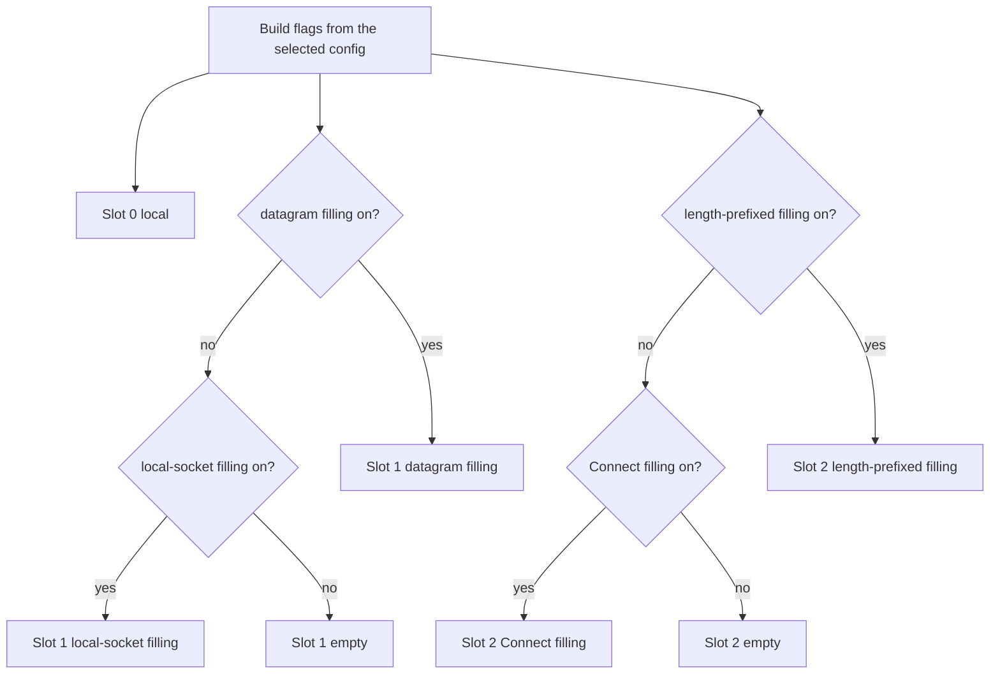

### 2.6.5 The local link

`src/vta/inproc/ops.c` keeps a context with a listening flag. Listen ignores the address, marks the flag, and returns. There is no accept thread. The comment in the file is the rule: the caller's thread is the connection. Call enters `vii_dispatch` with the same `vii_msg_t`. Close frees the context.

This filling exists so a library body and a test can target "another row in this process" with the same `vedam_node_call` they would use for a socket, and so the local slot has a real operations table for `vti_open`.

### 2.6.6 A present inter-process filling

This is one filling of the inter-process link, not the link itself. The operations table is the hook. Another byte stream can occupy the same link. The layout below is what this filling sends today. A deployment is not required to keep it.

Compiled only when the queue flag is on. Four workers block in `poll` on the listen queue and a wake pipe. Accept is not implemented. The listen path creates the POSIX queue and starts the workers. Connect opens the peer queue write-only and a private reply queue. Call sends one request and waits up to 5000 milliseconds for the matching reply id.

Integers are big-endian. The request magic is `0x564d5131`. The reply magic is `0x564d5152`.

Request, `N` the reply-name length, `B` the protobuf body length:

| Offset | Size | Field |
|--------|------|--------|
| 0 | 4 | magic `0x564d5131` |
| 4 | 4 | request id |
| 8 | 4 | verb |
| 12 | 16 | row UUID |
| 28 | 4 | origin |
| 32 | 4 | `N` |
| 36 | `N` | reply-name bytes, no trailing NUL |
| 36+`N` | 4 | `B` |
| 40+`N` | `B` | `vedam.v1.Message` |

Reply:

| Offset | Size | Field |
|--------|------|--------|
| 0 | 4 | magic `0x564d5152` |
| 4 | 4 | request id |
| 8 | 4 | `B` |
| 12 | `B` | message |

A frame shorter than 40 bytes, or a request magic mismatch, is rejected. An unknown UUID is a distinct unpack failure from a truncated frame. The worker that owns the listen queue runs the verb and writes one reply on a send handle opened once and reused. The POSIX message length is the whole frame. It is not an extra field inside the frame.

The queue name `/vedam.` plus the process id is the listen name. The reply name is private to the connector. Mode on create is owner read and write. A connector that cannot open the listen name for send fails the call. That failure is a transport status, not a lock restart.

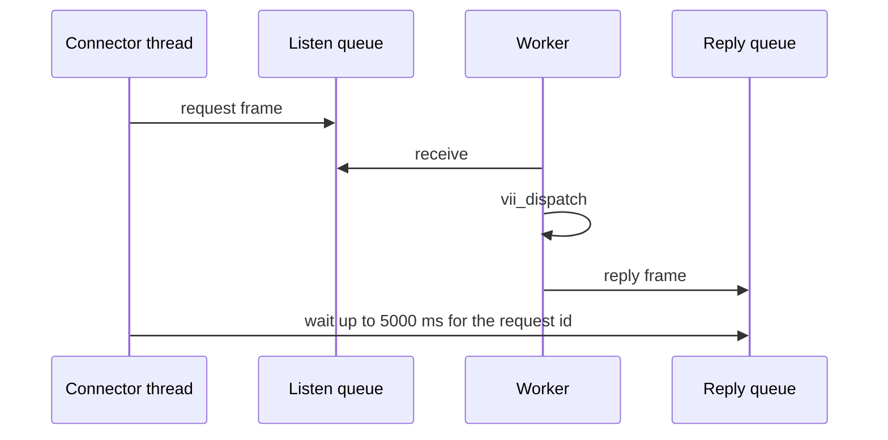

### 2.6.7 Listen on the present datagram filling

Listen allocates a context with the three queue handles and the wake pipe set to the empty sentinel.

The name is the address argument when it is non-empty. Otherwise it is `/vedam.` plus the process id, the same text init already formatted. The name must fit 64 bytes.

The listen path then:

1. Allocates four worker memories, and a codec workspace in each.
2. Creates a wake pipe.
3. Opens the POSIX queue for read, creating it if needed, with a message size that holds one codec buffer.
4. Starts four threads. Each blocks in `poll` on the wake pipe and the queue descriptor.
5. Marks the context listening.

Accept is not implemented. Callers do not accept a queue. A sender opens the listen name itself.

Stop writes a byte to the wake pipe, joins the workers, and closes the queue. A worker that sees the wake byte drains the pipe and continues the loop, and exits when the stop flag is set. A worker that sees a poll error other than `EINTR` exits.

### 2.6.8 Dial and call on the present datagram filling

Connect opens the peer queue write-only and creates a private reply queue. The reply name is stored in the context. The listen name is not opened for read by the connector.

A call:

1. Rejects a listen context used as a client, and a positive count with a null list.
2. Increments `next_id`, skipping 0 so an id of 0 is never a live request.
3. Packs the frame described in section 2.6.6 into the context encode buffer.
4. Sends it on the peer queue. A send error is failure.
5. Polls the reply queue for 5000 milliseconds. A timeout or a poll error is failure.
6. Receives one datagram. A short read is failure. A frame that is not a reply is failure.
7. If the id does not match, keep polling. The 5000 milliseconds is the timeout of each poll, not a budget summed across mismatches.
8. On a match, decode into the caller's message and return the status the reply carried.

The connector does not hold a Wait-Die lock across steps 4 through 8. Those steps run only when `vedam_node_call` allowed the send.

### 2.6.9 The worker of the present datagram filling

Each worker owns `rx` and `enc` buffers of the codec size, and a codec memory. It also keeps one reply-send handle, opened on the first reply name and reused while the name stays the same.

1. Poll the wake pipe and the listen queue with no timeout.
2. A wake byte is drained and the loop continues.
3. A receive error of `EAGAIN` or `EINTR` continues. Any other receive error exits.
4. Unpack. A frame shorter than 40 bytes, or a bad magic, is ignored or answered as a bad frame according to the unpack result. An unknown UUID is a distinct failure from a short frame.
5. The unpacked message uses the worker's codec memory as the attribute storage. The verb comes from the frame. The worker overwrites origin to external before dispatch. The frame may still carry the word the sender wrote. The class id, major, and minor come from the UUID map.
6. Dispatch.
7. Pack a reply with the request id and send it on the reply name from the request.

The worker's dispatch is a new thread, so it is a new attempt. Its locks are the server's locks. The client's locks, if the client is another process, are a different map.

```text
connector                         worker
   | pack request                    |
   | send listen queue ------------> | receive
   |                                 | dispatch
   |                                 | pack reply
   | poll reply queue <------------- | send reply name
   | match id                        |
```

### 2.6.10 How the present datagram filling is opened

The listen open is `vplatform_mq_open_recv` with a maximum of 10 messages and a message size of 8192, the codec buffer. The POSIX open is create, read-only, and non-blocking, mode owner read and write (`0600`). An existing name is not unlinked first. A name that already exists is opened. If its attributes disagree with the requested size, the operating system rejects the open and listen fails.

The connector's peer open is send-only on that same name. It does not create the queue. Connect fails when nothing is listening.

The reply open creates a fresh receive queue and writes the name into the connector's buffer. That name is what the request frame carries. Close of a send handle does not unlink. Close of a receive handle unlinks the name it was given, so process exit through `vti_close` removes the listen name and the reply name.

A message is one datagram. The length is the return of the receive, not a field the platform adds. The frame's own length fields are inside those bytes, as section 2.6.6 lays out. A send longer than 8192 cannot be queued. Pack fails before the send when the frame would exceed the encode buffer, which is the same 8192.

The receive is non-blocking at the queue, and the worker blocks in `poll` instead. That split is why a stop byte on the wake pipe can interrupt a worker that would otherwise sit inside a blocking receive. The worker sees the wake, drains it, and checks the stop flag.

### 2.6.11 Bytes of one present datagram request

Take a reply name of 16 bytes, `vedam.reply.0001`, and a protobuf body of 20 bytes. `N` is 16. `B` is 20. The header length is 36 + 16 + 4 = 56. The frame is 76 bytes.

| Offset | Bytes | Meaning |
|--------|-------|---------|
| 0 | `56 4d 51 31` | Magic `0x564d5131`, the characters `VMQ1` |
| 4 | request id | For example `00 00 00 01` for id 1 |
| 8 | verb | Get is 1, so `00 00 00 01` |
| 12 | 16 | Row UUID, the version-5 id from the model line |
| 28 | origin | External is 0, so `00 00 00 00` |
| 32 | `00 00 00 10` | Name length 16 |
| 36 | 16 | The reply name, no trailing NUL |
| 52 | `00 00 00 14` | Body length 20 |
| 56 | 20 | The message |

The reply is shorter. Magic `0x564d5152` is `VMQR`. Then the same request id, then the body length, then the message. Twelve bytes of header, plus the body. A connector that receives a reply whose id is not the id it just sent leaves it and polls again. It does not dispatch that reply as a call.

Integers are big-endian on both frames. A little-endian host still writes them with the shift in `put_u32`. A peer that shares the struct layout of the host instead of this layout is not a Vedam queue peer.

### 2.6.12 A datagram the worker rejects

| Bytes | Result |
|-------|--------|
| Shorter than 40 | Unpack returns −1. The worker does not dispatch. |
| Magic not `VMQ1` | Same. |
| UUID not in the map | Unpack returns −2 after it has parsed the name, so the failure is distinct. |
| Name length 0, or name length that does not fit the name buffer | −1 |
| Body length that runs past the datagram | −1 |
| Protobuf that does not parse | −1, from the codec |
| More attributes than the 32 prepared slots | Buffer overflow from the codec, which unpack turns into −1 |

After unpack, the worker has three outcomes. A return of −2 means the UUID is not in the map. The worker sends a reply with not implemented, an empty attribute list, and the request id, and it does not dispatch. A return of −1 means the frame or the protobuf is unusable. The worker drops it and waits for the next datagram. No reply is sent, because a broken frame may not have a reply name that is safe to write. A return of 0 with a decode status other than success skips dispatch and still sends a reply carrying that status. A return of 0 with success arms the write watch, dispatches, and sends the reply. A verb the row refuses is this last path: dispatch runs, the verb check returns not implemented, and the reply carries that code.

The 40-byte minimum is 36 bytes of fixed header plus a 4-byte body length when the name length is 0. The unpack then rejects a name length of 0, so a 40-byte frame still fails. The minimum that can succeed has a non-empty reply name. The 40-byte test is the early reject, not the success minimum.

### 2.6.13 What the worker does with one datagram

```text
receive
  unpack
    -2 unknown UUID -> reply NOT_IMPLEMENTED, no dispatch
    -1 broken frame -> drop, no reply
     0 and decode failed -> reply that status, no dispatch
     0 and decode ok -> watch, dispatch, reply, unwatch
```

The reply send handle is opened the first time a reply name is used and kept while the next reply name matches. A different name closes and reopens. The handle is a send-only open of a queue the connector created. If that open fails, the verb has already run. The worker cannot undo it. The connector times out. This is why a body must tolerate a caller that never sees the reply, and why a body that needed a reply to commit would be the wrong shape. The present bodies return a status. They do not wait for the connector to acknowledge the reply.

### 2.6.14 When the present datagram filling fails

| Observation | Status |
|-------------|--------|
| Descriptor is a listen context, or the message is null | Invalid parameter |
| Pack fails, including a missing UUID | Invalid parameter |
| Send on the peer queue fails | Failure |
| Reply poll times out or errors | Failure |
| Reply magic or length is wrong | Failure |
| Reply id does not match | Keep waiting until the poll budget |
| Peer dispatch returns not found | That status, in the reply body |

A timeout does not cancel the worker. The worker may still run the verb and send a reply the connector will not read. The next call on the connector uses a new id. An old reply with the previous id is skipped when it arrives during a later wait, and the later wait's poll may then expire. Callers that share one connector descriptor from two threads are outside what this filling locks. The context has one encode buffer and one id counter.

### 2.6.15 Another present inter-process filling

This is another filling the build may place on the inter-process link. It uses a local socket and the same temporary framing as the present remote filling. A later inter-process filling does not have to use this socket or this framing.

Compiled when the Unix socket flag is on. It binds an `AF_UNIX` path, listens, and uses the same HTTP pool and the same 5-byte framing as TCP. The helpers that bind, unbind, and exchange HTTP live in `src/vta/grpc/http.cc` and are compiled when either TCP or the Unix socket is on. The TCP operations table itself is compiled only when TCP is on. A build with the Unix socket and without TCP therefore still links `vti_grpc_unbind` and the pool, and does not link the TCP operations table.

Close unlinks the socket path. The path at init is `/tmp/vedamd.` plus the process id plus `.sock`, when this slot is the inter-process slot.

### 2.6.16 Local-socket filling, listen path

The operations table is a second listen path onto the same HTTP pool and the same codec. The socket is `AF_UNIX` and `SOCK_STREAM`. Bind copies the path into `sun_path`. Listen backlog is 16. An empty path is invalid parameter. Bind or listen failure closes the socket and listen returns failure.

Close unlinks the path after the pool stops, so the next process can bind the same name.

The present Unix-domain listen starts the pool and does not allocate a codec workspace on the slots. The TCP listen does that allocation after the pool starts. A slot whose workspace pointer is null fails the codec, and the worker answers with digit 12 and an empty body. The framing, the path shape, and the pool are the same. The workspace is the difference in the two listen functions.

Init uses this filling for slot 1 only when the queue flag is off and this flag is on. The path is then `/tmp/vedamd.` plus the process id plus `.sock`.

### 2.6.17 A present remote filling

This is one filling of the remote link. It writes a length in front of one message so a test can call the hook before a gRPC or Connect library is linked. It is not the gRPC library, and it is not the deployment choice for the remote link. The opening of this part states the direction.

Compiled when TCP is on. This is not the gRPC C++ library. It speaks the unary gRPC framing on HTTP/1.1: a 5-byte prefix (a zero flag byte and a big-endian length) and then protobuf bytes. One listen socket serves every row. The path is `/<package>.<Service>/<Method>`. The package and service come from the generated map, not from a string compare in the application. A worker keeps the accepted socket open and reads the next request. The content type is the gRPC protobuf type. The status digit string is carried as the gRPC status header.

Bind of `127.0.0.1:0` asks the kernel for an ephemeral port. The bound address is what a later connect on this node uses when the caller asks for the listen address.

The codec workspace holds one protobuf arena and one message. Listen slots and connect contexts own that workspace. A call does not allocate a second message. Encode fills the message, measures it, and serialises. Decode parses and drains. Struct values go through a codec table indexed by the attribute metadata, not through a switch on the row name in the hot path.

### 2.6.18 Length prefix of the present remote filling

The protobuf bytes are not the HTTP body by themselves. In front of them:

| Offset | Size | Value |
|--------|------|--------|
| 0 | 1 | 0, the uncompressed flag |
| 1 | 4 | Payload length, big-endian |
| 5 | length | `vedam.v1.Message` |

The encoder writes the message at offset 5, then fills the prefix. The total framed length is 5 plus the payload. A buffer shorter than that is buffer overflow, and nothing is sent.

On receive, the prefix is stripped only when byte 0 is 0 and the big-endian length plus 5 equals the body length. An empty body is accepted as already stripped. Any other shape is left unchanged. The protobuf parser then fails, and the HTTP worker answers with digit 12 and an empty body.

```text
HTTP body
+------+------------------+---------------------------+
| 0    | length, 4 bytes  | protobuf Message          |
+------+------------------+---------------------------+
  flag   big-endian         key, attrs, status
```

### 2.6.19 Request bytes of the present remote filling

The client sends one request and reads one response on the socket it already connected. It does not open a second socket for the response.

```text
POST /<service>/<Method> HTTP/1.1
Content-Type: application/grpc+proto
Content-Length: <framed length>
Connection: keep-alive

<five-byte prefix><Message>
```

`<service>` is the name returned by the service map for the class id and the major. `<Method>` is one of `Create`, `Get`, `Set`, `Delete`, `Subscribe`, `Unsubscribe`, `Notify`. A verb with no name returns not implemented before any byte is written. A class id and major with no service name do the same.

The header block is formatted into a 320-byte stack buffer. If the service name makes that format exceed the buffer, the call fails and the socket is left as it was. The header and the body are two sends. A short send is failure.

### 2.6.20 Response bytes of the present remote filling

The worker writes the status in the header block, then the body. The HTTP status line is 200 even when the gRPC digit is not 0. The digit is the gRPC status. The header name is `Grpc-Status`.

```text
HTTP/1.1 200 OK
Content-Type: application/grpc+proto
Grpc-Status: <digits>
Content-Length: <body length>
Connection: keep-alive

<body, or nothing>
```

A missing digit pointer is written as 12. A request that is not `POST`, or whose path does not contain a slash with a method after it, is answered 200 with digit 12 and an empty body, and the socket stays open. A codec failure is the same answer. A codec success writes the framed reply and the digit for the overall status.

The worker then reads another request on the same socket. It stops when the read fails or the peer closes.

### 2.6.21 One accepted connection

`handle_client` is the loop on a worker that has claimed a connection.

1. Read one HTTP/1.1 request into the slot's 65536-byte buffer. Split method, path, and body using `Content-Length`.
2. Try to strip the five-byte prefix.
3. Reject a non-POST or a path that does not start with `/`.
4. Split the path at the last `/`. The left side, without the leading slash, is the service. The right side is the method.
5. Call the codec. Unknown service or unknown method returns success to this loop with digit 12 and a zero length, which still produces a response. A body that cannot be parsed returns failure, and the loop writes digit 12 and an empty body.
6. On a parsed body whose overall status is success, arm the write watch, dispatch, encode the reply at offset 5, frame it, and set the digit from the overall status.
7. Write the response.
8. Repeat until the read ends, then close the socket.

Dispatch on this path uses origin external. The worker thread is not the client's thread. The attempt, when Wait-Die is on, is a new attempt in the server process.

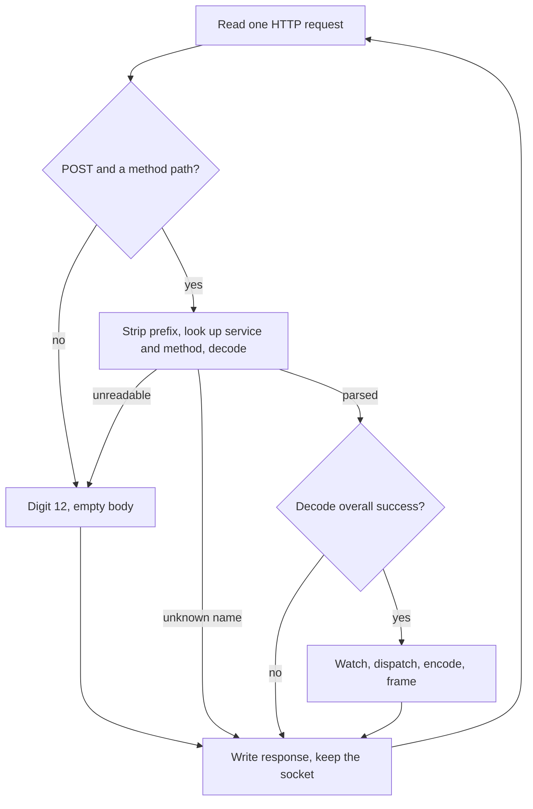

### 2.6.22 The worker pool of the present remote filling

The pool has one listen thread and four worker slots. Each slot has a socket, a busy flag, a kick pipe, a thread, a 65536-byte HTTP buffer, an 8192-byte output buffer, and a codec memory structure.

The listen thread accepts only while a slot is free. Its poll set contains the wake pipe always, and the listen socket only when `any_free` is true. A full pool therefore does not call `accept`. The kernel keeps the connection in the listen backlog, which is 16, until a worker finishes and writes the wake pipe. The listen thread then claims a slot by a compare-and-exchange of `busy` from 0 to 1, accepts one socket, stores it on the slot, and writes the slot's kick pipe. If the kick write fails, it closes the accepted socket and clears busy. The worker, on the kick byte, runs `handle_client`, then sets the socket to −1, clears busy, and writes the pool wake pipe so the listen thread can accept again.

Stop sets a flag, writes the wake pipe, joins the listen thread and the workers, and closes the pipes. Close of the descriptor calls stop and then unbinds. Unbind closes the listen socket. For a Unix-domain path it also unlinks the path.

Accept on the operations table is not implemented for this filling. The pool owns accept. A caller of `vti_accept` on a TCP or Unix-domain descriptor gets not implemented. That is intentional. The listen thread is the acceptor.

### 2.6.23 Listen on the present remote filling

Listen requires a non-empty address. An empty address is invalid parameter, before any socket is created.

1. Allocate the context. The socket starts at −1.
2. Copy the address into the context.
3. Bind. The address `127.0.0.1:0` asks the kernel for a port. The bound text, including that port, replaces the address stored in the context. A later reader of the bound address sees the port the kernel chose.
4. Start the pool on that socket.
5. Allocate one codec workspace on each of the four slots. If any allocation fails, destroy the ones that succeeded, stop the pool, unbind, and return failure.
6. Mark the context running and log the bound address.

Connect on a listen descriptor is a different object. The application, or a test, opens a second descriptor and connects it to the bound address.

### 2.6.24 Dial and call on the present remote filling

Connect parses `host:port` from the last colon. A missing colon, an empty host, or a host that does not fit 128 bytes is invalid parameter. `inet_pton` must accept the host as IPv4. A name that is not an IPv4 literal is invalid parameter. This filling does not resolve DNS.

The socket is `AF_INET` and `SOCK_STREAM`. Connect is one syscall. The context records that it is connected and counts the connect. Two calls on the same descriptor do not connect again. The count stays 1, which is how a test shows the socket was kept.

A call on that descriptor:

1. Reject a missing context, a socket that is not connected, a missing codec, or a positive attribute count with a null list.
2. Map the verb to a method name and the class id plus major to a service name.
3. Encode the message at offset 5 of the context buffer.
4. Write the five-byte prefix.
5. Exchange: send the HTTP request, read headers until the blank line, honour `Content-Length`, leave the socket open.
6. Unframe the response and decode into the same `vii_msg_t` the caller passed.

The call does not take the object lock. The caller is outside an attempt, or the node refused the send before this function ran.

### 2.6.25 Bind of the present remote filling

`vti_grpc_bind_tcp` is the socket under the TCP listen.

1. Reject an empty spec, a null bound buffer, or a bound buffer shorter than 8.
2. Split on the last colon. The host must be non-empty and fit 128 bytes. The port must be a decimal integer from 0 through 65535, with nothing after it.
3. Open `AF_INET` `SOCK_STREAM`. Set `SO_REUSEADDR`.
4. `inet_pton` the host. A hostname that is not an IPv4 literal fails and the socket is closed.
5. Bind and listen. The backlog is 16, the same number the Unix-domain listen uses.
6. `getsockname` reads the port back. Port 0 becomes the kernel's choice. The bound buffer is `host:port` with that port in decimal.
7. Return the socket. Any failure closes it and returns −1, which listen turns into failure of `vedam_init` when this is the boot listener.

The bound string is what a test connects to. Init does not print it. The filling logs it.

### 2.6.26 When the present remote filling fails

| Observation | What the peer sees | What the caller sees |
|-------------|--------------------|----------------------|
| Not POST, or a bad path | Digit 12, empty body | The digit and a decode failure if the client required a body |
| Unknown service or method | Digit 12, empty body | Not implemented, or a failed decode of an empty body |
| Prefix not a single uncompressed frame | Digit 12, empty body | Failure |
| Decode overflow | Digit from the overflow family if a reply was produced, otherwise 12 | The status in the body when a reply exists |
| Dispatch not found | Digit 2, body carries the library code | Not found |
| Dispatch success | Digit 0, body carries the values | Success, values in the caller's buffers |
| Short socket write | The client sees failure | Failure, before a status exists |

The server does not close the socket on a bad request. The client decides whether to reuse it. A client that saw a short read should drop the descriptor. The present client returns failure and leaves the socket in the context. The next call on that descriptor sends again on the same socket. A peer that already closed will fail that send.

### 2.6.27 The Connect filling of the remote link

Connect is the other public form of the remote call: the same service and method as gRPC, carried on an ordinary web request. This filling is that hook. Its listen, connect, and call return not implemented. The index stays the remote link. Completing it does not add a fourth link.

The connect filling is the second remote hook. Its listen, connect, and call are stubs that return not implemented, except where a later edit fills them. It is compiled only when that flag is on. The default `.config` leaves it off. It exists so the slot assignment has a second compiled-in choice without inventing a fourth slot index.

### 2.6.28 Connect filling, as compiled today

The connect filling is compiled only when its flag is on. Its close returns success. Its listen, accept, connect, and call return not implemented. It does not open a socket. Init will still call listen on slot 2 when this flag is the one selected and TCP is off. That listen returns not implemented, and init rolls the node back. A build that enables this hook and disables TCP therefore does not finish `vedam_init` until the hook's listen succeeds. The default selection leaves the hook off and leaves TCP on, so this path is not the one a normal process runs.

The slot index is still 2. There is no fourth index for a later filling. A replacement of TCP occupies the same slot.

### 2.6.29 Codec memory

One `vti_codec_mem` is the scratch a connection or a worker keeps for the life of that connection, not for the life of the process.

| Field | Size | Role |
|-------|------|------|
| `ws` | one pointer | Arena and one protobuf message. Reused. Cleared at the start of each encode. |
| `scratch` | 32 by 256 bytes | Room for attribute `i` on a server. |
| `key` | 256 bytes | Server copy of the key. |
| `attrs` | 32 | Attribute structs aimed at the scratch. |
| `statuses` | 32 | Per-attribute status. |

`vti_codec_rx_prepare` points the public message at these arrays and sets the count to 32, which is the room. The decoded count replaces it. A request with more than 32 attributes does not fit.

The workspace is not on the caller's stack. A library body that runs on the server writes into this memory. When dispatch returns, the reply encode reads it, and the next request on that worker reuses it. A body must not keep a pointer into the scratch after it returns.

### 2.6.30 The two maps built at init

Local calls do not use these maps. A queue frame and an HTTP path do. `vti_class_uuid_map_init` builds both, once, after the lock map opens and before any listener accepts. Failure is no memory, or uninitialised if the node pointer is missing. Init treats that as a reason to roll back.

The UUID map is a hash from 16 bytes to a hit record. The hit holds the class id, the major, and the minor. The key is the version-5 UUID of the model line, not the text of the line. Lookup of a null pointer, or a null output, is invalid parameter. Lookup before the map exists is uninitialised. Lookup of 16 bytes that are not in the table is not implemented. That is the code the queue worker turns into a reply. The HTTP path turns an unknown service name into digit 12 without calling that UUID function. The service map is the HTTP path's table.

The service map is a hash from the service name string to the same kind of hit. The name is the package and the service the generator emitted. The method is not part of the key. The method is parsed separately into a verb. A service that exists and a method that does not is not implemented from the verb parse, after the service lookup has already succeeded.

Both maps store their hit records in one allocation each, `uuid_hits` and `service_hits` on the node, so finish is one free of the records and one destroy of the hash. Destroy frees the hash nodes. It does not free the hit array. Finish frees the array. The call path does not insert. A peer cannot add a row by sending a new UUID. A new row is a regenerated table and a new process.

`vti_class_uuid_bytes` is the other direction, used when a queue request is packed. It returns the 16 bytes for a class id, or null when the id has no line. Pack treats null as failure. The HTTP client uses the service name for that class id and major, and a null name is not implemented before any socket write.

The maps are the reason a filling does not contain a switch on a row. The bytes select a hit. The hit selects a class id. The class id selects `vii_classes[id]`. Adding a row adds a seed in the generated file and a slot in the class table. It does not add a branch in the worker loop.

### 2.6.31 Call timeline on the inter-process link

The steps below are the present datagram filling of the inter-process link. A different filling of that link still enters at dispatch and still uses `vi_msg_t`. Only the bytes between the caller and the worker change.

1. Steps 1–2 of the local get, but the descriptor's link is inter-process and the attempt is not held. A body that still holds locks must not be the caller. An application calling the queue directly is already outside an attempt.
2. `vti_call` hits the queue call hook.
3. The connector builds the request frame, including a fresh request id and the reply-queue name, then the protobuf body.
4. A worker wakes, checks magic and length, maps the UUID, decodes into its codec memory, overwrites origin to external, and calls `vii_dispatch`. The frame may still carry the word the sender wrote.
5. That dispatch is a new thread, so it is a new attempt, with its own locks in the worker's process. It is not the connector's process. Each process has its own node and its own lock map.
6. The worker encodes the reply and writes the reply queue.
7. The connector matches the request id or times out at 5000 milliseconds.

The lock in step 5 does not synchronise with the connector's threads. It synchronises with other calls inside the process that owns the listen queue.

### 2.6.32 Call timeline on the remote link

The steps below are the present length-prefixed filling of the remote link. A gRPC or Connect filling of the same link still names a service and a method, still carries one message, and still enters at dispatch.

1. The application fills `vi_msg_t` the same way as a local get. The text length is the room.
2. The caller holds a descriptor whose link is remote, already connected. The thread is not inside an attempt. `vedam_node_call` allows the send.
3. The call hook maps the verb to `Get` and the class id plus major to the service name. Either map miss returns not implemented and writes nothing.
4. Encode writes the message at offset 5 of the connection buffer. The request carries no values, because get does not write values. The key is copied when its length is positive.
5. The five-byte prefix is written in front: flag 0, then the payload length in big-endian.
6. One HTTP request goes out on the socket opened at connect. The socket is not opened again.
7. The server's listen thread, if a worker is free, accepts and kicks a worker. The worker strips the prefix, splits the path, decodes into its 256-byte key buffer and its per-attribute scratch, and dispatches with origin external.
8. That dispatch is a new thread in the server process. On a Wait-Die build it is a new attempt and a new ticket. It does not share holds with the client.
9. The body writes into the scratch through the put helper. The reply encode sends that value because get does not write values and the status is success. The client's room length is not what is encoded. The server's scratch length is.
10. The worker writes HTTP 200, digit 0, and the framed body, and reads for another request.
11. The client reads `Content-Length`, strips the prefix, and copies the value into the application's buffer. If the value is longer than the room, the length becomes the needed length, nothing is copied, and the attribute status is buffer overflow.

A second get on the same descriptor repeats from step 3. The connect count stays 1. A get attempted from inside a body on the client process never reaches step 3. `vedam_node_call` returns failed precondition first.

### 2.6.33 One get on the local link, an inter-process link, and a remote link

Each link is the five hooks: close, listen, accept, connect, and call. A get is the call hook. The bytes under that hook are a filling the build may leave unused.

On the local link the application buffer is the memory the body writes. The call hook is dispatch on this thread. The call passes that buffer straight through. One thread runs it. Locks are taken and released around the body.

On the inter-process link the call hook encodes once, waits, and decodes once into the caller's buffer. The present datagram filling uses a queue and a reply name so the worker can answer without a connection. A build may leave that filling unused. The worker has its own scratch. The call uses two threads, and when the filling crosses a process it uses two lock maps.

On the remote link the call hook names a service and a method and carries one message. gRPC and Connect are the direction for this link. The present filling writes a length in front of the message and keeps the socket open. A build may leave that filling unused. The worker scratch is the slot. The next get on that descriptor does not connect again.

All three run `vii_verb` with the same class table. A bug in the attribute check shows up on all three. A bug in the hand-written length prefix shows up only on the present remote filling that uses it. A bug in the ticket shows up only where Wait-Die is linked.

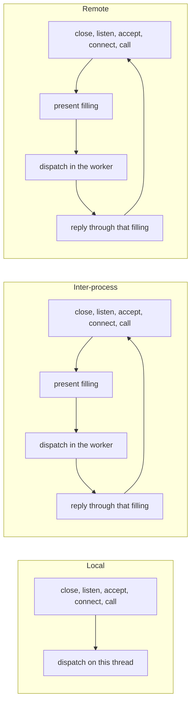

## 2.7 The lock

The lock is per attribute. This part is the order of takes, the map that holds the locks, and the die rule when two attempts would cycle. The depth counter used when the lock is not compiled is the last subsection.

### 2.7.1 Lock algorithm

`vedam_lock_invoke` is the attempt loop. One invocation from dispatch is the outermost attempt unless depth is already positive, in which case this invocation joins.

**Join.** If this thread is already inside an attempt, do not allocate a new age. Take the additional locks the nested call needs and run its body. A restart from the nested body propagates to the outermost loop.

**Take locks**, in order:

1. Pin the object `(class id, key)`. Pin failure returns no-memory or the pin's status.
2. Acquire the existence lock, exclusive for create and delete, shared otherwise.
3. If the object is marked dead and this acquire is a new hold, release existence. For create, pin again and take existence exclusive. If it is still dead, return object-in-use. For any other verb, return not-found without running the body.
4. If the verb is create, stop. No attribute locks.
5. If the verb is delete, snapshot every non-null attribute lock under the object's small spin lock, then take each exclusive. The snapshot avoids holding the spin lock across Wait-Die.
6. Otherwise, if the attribute count exceeds the list maximum, return invalid parameter. Copy the ids, skipping id 0. An unknown id writes the unknown-attribute status at that index and fails the take before any attribute lock. Sort the remaining ids. Skip a duplicate of the previous id. Ensure the attribute lock exists (allocate on first use, up to 64). Acquire it exclusive for set and delete, shared otherwise.

**Run.** If take returns retry, the primitive has already dropped the earlier holds of this attempt and left the contended lock held. The C record list is cleared and then records only that contended lock. Depth is decremented and the outer loop starts the take again from the existence lock. The contended lock is not released first. The next take meets it as a join when the same thread reaches it again. If take returns any other non-zero code, release whatever this attempt holds, unpin, and return that code. If take returns zero, call the body. If the body returns restart, the outer loop starts again. A successful delete marks the object dead before the holds are released. Otherwise release, unpin, and return the body's status.

**Release.** `vedam_lock_release_attempt` walks the thread-local list of holds and unlocks each. The list is cleared. Pins are dropped so an object with no pins and no holds can be freed.

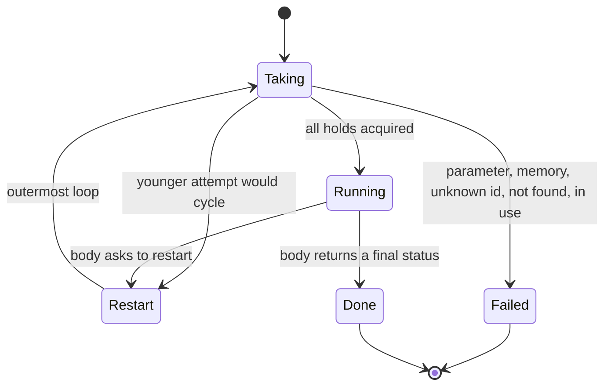

### 2.7.2 Identification of a lock

A hold is not "the node's lock". It is one wwlock object reached by three coordinates.

| Coordinate | Source | Notes |
|------------|--------|-------|
| Class id | `vii_msg_t.class_id` | Index of the row. |
| Key | `vi_msg_t.key` and `key_len` | Copied into the map. Compared by length and bytes. |
| Attribute id | `v_attr_t.id` | Absent for the existence lock. Id 0 is never a wwlock. |

`ensure_attr` grows the object's attribute array until it covers the id, without passing 64. The array slot stores the `vedam_lock_t`, which wraps one `wwlock_t` from the node's wwlock class. Two objects never share a `wwlock_t`. Two attributes never share one. The existence lock is a different `wwlock_t` from attribute 1 even when both are taken by the same call.

The spin lock inside the object protects the attribute array and the dead bit against a concurrent ensure. It is not the Wait-Die lock. It is not held while wwlock sleeps.

### 2.7.3 Parallel readers and writers

For an attribute lock, shared and exclusive obey:

$$
w(a) = 1 \implies r(a) = 0
$$

$$
r(a) > 0 \implies w(a) = 0
$$

Readers of the same attribute do not wait for each other. A writer waits until both are zero. A reader waits while a writer holds it.

Readers of different attributes do not wait for each other's attribute locks. They both take the existence lock shared, so they do not block each other there either. A delete needs existence exclusive and every attribute exclusive, so it waits for every reader and writer of that object.

Create needs only existence exclusive. It does not serialise with a get of a different key.

A thread that already holds a lock and acquires it again is joined, not queued behind itself. Each acquire still has one release, except the joined acquire that did not add a hold.

### 2.7.4 Two attempts

Attempt O is older. Attempt Y is younger. Both need attribute 3 and attribute 9 of the same object, and nothing else.

Both sort to 3 then 9. O takes 3. Y takes 3 only if O took it shared and Y wants it shared. If O wants 3 exclusive, Y waits, because Y is younger and waiting does not yet form a circle through a lock Y already holds. Y holds nothing, so it waits rather than dies.

Now O holds 3 and also needs a lock Y already holds on a different object. Waiting would cycle. O is older, so O waits. Y, holding that other lock and needing 3, would cycle. Y is younger, so Y dies: the primitive drops Y's earlier holds, sleeps until attribute 3 is held, and returns with attribute 3 still held. The outer loop takes the locks again from the existence lock. O then proceeds.

The sleep is inside the primitive, before it returns. It sleeps until the contended lock is held, and it returns with that lock held. Vedam does not add a second wait after the return. The application thread running Y does not see the die. It sees the status of the attempt that finishes.

### 2.7.5 What the lock does not do

It does not lock the UUID map. That map is built before listeners accept, and it is not mutated on the call path.

It does not lock a filling's socket buffer. The filling's own workers own that memory.

It does not implement fairness beyond age. An old attempt that needs an exclusive lock waits out the readers who arrived first. New readers do not skip ahead of a waiting writer inside one wwlock. That queue is wwlock's.

It does not survive process death. It is not a file lock. It is not shared with another process. Two processes take their own maps and exchange bytes through a filling.

It is not compiled into the browser module. That module refuses re-entry with a depth counter instead.

### 2.7.6 wwlock itself

The sources live in `third_party/wwlock` and keep the MIT licence they arrived with. Vedam does not relicense them. The lock module links the static archive. `libvedam.so` contains the wwlock symbols. `libvedam.a` does not absorb the archive, so a static application also links `libwwlock.a`. The shared wwlock library is not installed with Vedam.

A class is initialised with park callbacks. On a host those callbacks are a futex wait and a futex wake on one 32-bit word. The browser build does not call them.

`WWLOCK_READ` is shared. `WWLOCK_WRITE` is exclusive. `wwlock_lock` is the exclusive take. A die returns `WWLOCK_DIE`. The die lock is held, and the caller does not unlock it. `WWLOCK_ALREADY` means this take did not add a hold. A second exclusive take by the owner returns success and needs a second unlock.

Vedam's wrapper records each hold that added a reference on a thread-local list so release does not depend on the body remembering the set.

### 2.7.7 Objects in the lock map

The map is `vedam_lockdb`. It is created by `vedam_lockdb_open` and stored on `vedam_t.locks`. A build without wwlock stores null and never allocates this structure.

| Field | Role |
|-------|------|
| `group` | One Wait-Die class. Every lock in the process is created from it, so every attempt shares one ticket counter. |
| `singleton[id]` | The one object for a row whose metadata says singleton. Index 0 is unused. |
| `keyed[id]` | A hash from key bytes to the object, for a row that is not a singleton. |
| `all` | Intrusive list of every object, singleton and keyed, for close. |
| `gate` | A spin word that protects the tables and `all`. It is not a Wait-Die lock. |
| `miss_count` | How many times an object was allocated because the lookup missed. Relaxed atomic. Tests read it. The call path does not branch on it. |

One object is `vedam_lock_object`.

| Field | Role |
|-------|------|
| `next` | Link on `all`. |
| `gate` | Spin word for `attrs`, `attr_cap`, and the dead bit's writers that also touch the array. |
| `ref` | Pin count. The last unpin may destroy the object when it is not reachable from a table. |
| `dead` | Set after a successful delete, before the holds are released. |
| `is_singleton` | Non-zero when the object lives in `singleton[]` rather than a hash. |
| `class_id` | Row index. |
| `hash_key`, `hash_len` | Key bytes owned by the object. Empty for a singleton. |
| `existence` | The Wait-Die lock for the object as a whole. |
| `attrs` | Array of attribute locks, indexed by attribute id. A null slot means that id has never been locked. |
| `attr_cap` | Allocated length of `attrs`. Grows by doubling from 8, and stops at 64. |

Id 0 is never an attribute lock. The array may still have a null at index 0. `ensure_attr` rejects id 0 and any id at or above 64.

### 2.7.8 The spin gate

Two gates exist: one on the map, one on each object. Both are a 32-bit atomic word, 0 free and 1 held. Acquire is a weak compare-and-exchange from 0 to 1 with acquire ordering. The failure path is a `pause` on x86, a `yield` on AArch64, or a compiler fence elsewhere. Release stores 0 with release ordering.

The map gate is held only while a pointer is read or published: the singleton slot, a hash lookup that must not race a rehash, the `all` list insert. It is not held while a Wait-Die lock sleeps, and it is not held while a new object is allocated. Allocation happens before the second acquisition of the gate, and the insert is retried if another thread published the same key in between.

The object gate is held while the attribute array pointer and the dead bit's companion slots are read for a snapshot, and while a newly created attribute lock is published. It is not held across `vedam_lock_acquire`.

A spin gate has no ticket and no die. It is correct only because the critical section does not call back into the map. A body must not run under either gate. The call path does not hold one.

### 2.7.9 Pinning a singleton

A row with `singleton` set rejects a non-zero key length with invalid parameter. A zero length pins as follows.

1. If the class id is 0 or above the table, return invalid parameter.
2. Allocate a spare object with an existence lock and no key. If that allocation fails, return no memory. The spare is not yet visible.
3. Take the map gate. If `singleton[id]` is already set, increment its ref, drop the gate, destroy the spare, finish the pin, and return the existing object.
4. Otherwise publish the spare in `singleton[id]`, link it on `all`, increment `miss_count`, drop the gate, finish the pin, and return the spare.

Finish-pin records the object on a thread-local pin list and checks that the ref did not fall to zero under the caller. A pin is what keeps the object alive for the rest of the attempt. The hash and the singleton slot are the other keepers.

### 2.7.10 Pinning a keyed object

A row that is not a singleton rejects a zero key length with invalid parameter.

1. Copy the key. A key of at most 264 bytes uses a stack buffer. A longer key is allocated, up to 4096 bytes. Longer than that is invalid parameter. Allocation failure is no memory.
2. Take the map gate and look the key up in `keyed[id]`. On a hit, increment ref, drop the gate, free a heap key copy, finish the pin, and return.
3. On a miss, drop the gate and allocate a spare object that owns the key bytes, plus a hash node that points at the spare.
4. Loop. Take the gate and look up again. If another thread inserted the key, adopt that object, free the spare and the unused node, and leave the loop.
5. If `count + 1` still fits in `nbucket`, insert the node, link the spare on `all`, count a miss, drop the gate, and leave the loop.
6. If the table is full, drop the gate, prepare a bucket array of twice the size outside the gate, take the gate again, and swap it in only if the table is still the smaller one. Free the old buckets outside the gate. Then retry the insert.
7. A bucket count that would pass `0x7fffffff` fails with no memory rather than wrapping.

The double lookup is the point. The spare is built without the gate so a slow allocate does not stall every other pin. The second lookup throws the spare away when the race was lost. The winner's object is the one the attempt uses.

```text
lookup under gate
    hit  -> pin existing
    miss -> drop gate
            allocate spare and hash node
            lookup under gate again
                hit  -> destroy spare
                room -> insert spare
                full -> drop gate, double buckets, retry
```

### 2.7.11 The key the object keeps

The hash stores a copy. The caller's `vi_msg_t.key` pointer is not retained after the pin returns. Two keys are the same object when their lengths match and their bytes match. The hash is FNV-1a, offset basis `2166136261`, prime `16777619`, one byte at a time. A null key pointer hashes as 0 and is not used for a keyed row, because a keyed row already rejected length 0.

A new table starts at 8 buckets, rounded up to a power of two. Load is kept at or below one: the insert refuses to grow `count` past `nbucket`. That is a chain hash, not an open-addressed table. Values are caller-owned. Destroying the table frees nodes and keys that the node owns, and the object destructor frees the Wait-Die locks.

### 2.7.12 Growing the attribute array

`ensure_attr` returns the lock for one id, creating it on first use.

1. Id 0 or id at or above 64 returns null. The caller treats null as no memory.
2. Under the object gate, if the slot is already filled, return it.
3. Drop the gate. Create a Wait-Die lock from the process group. If the id is past `attr_cap`, compute a new cap: 8 when the cap is 0, then double until the id fits, and stop at 64. If doubling cannot pass the id, destroy the new lock and return null.
4. Allocate the grown array outside the gate.
5. Take the gate again. Another thread may have filled the slot. If so, keep the lock already stored and remember the spare as extra, to be destroyed after the gate drops.
6. Otherwise copy the old slots, publish the new array and cap, and store the new lock if the slot is still empty.

The array is indexed by id, not packed. Id 3 and id 9 allocate a cap of at least 10, with nulls in the unused slots. Delete's snapshot skips nulls, so an id that was never locked is not taken on delete. An attribute that exists in metadata but was never the target of a lock has no `wwlock_t` until the first get, set, subscribe, or unsubscribe names it.

### 2.7.13 Taking locks

`take_locks` is the only function that turns a verb and an attribute list into holds. The order is fixed.

1. Pin. A pin failure returns that status and holds nothing.
2. Acquire existence, exclusive for create and delete, shared for get, set, subscribe, unsubscribe, and notify.
3. If the acquire did not hold, return its code. Retry is one of those codes. No memory and invalid parameter are the others.
4. Apply the dead-bit rule in the next section.
5. Create returns here. It holds existence and no attribute lock.
6. Delete snapshots attribute locks and takes each exclusive.
7. Every other locking verb checks the list, sorts, and takes each attribute lock.

A list longer than 32 attributes is invalid parameter, before any attribute lock. A non-zero count with a null list is the same. The 32 is `VEDAM_LOCK_LIST_MAX`. The codec's attribute ceiling is the same number. A call cannot ask the lock for more attributes than a frame can carry.

Ids are collected only after that check. Id 0 is skipped and its status entry, when the status pointer is non-null, is set to success. Any other id at or above 64, or any id the class table does not define, writes unknown-attribute minus the list index, and the take fails with the first such code before any attribute lock is acquired. Existence is already held. The attempt wrapper releases it.

Surviving ids are insertion-sorted. A duplicate of the previous id is skipped, so two list entries for id 9 take one lock. The lock is created if needed, then acquired exclusive for set and for delete, shared for get, subscribe, unsubscribe, and notify.

```text
pin
existence
    create  -> stop
    dead and newly held
        create -> pin again, exclusive, or object-in-use
        other  -> not found, body skipped
    delete  -> snapshot every existing attribute lock, exclusive
    else    -> sort ids, skip 0 and duplicates, shared or exclusive
```

### 2.7.14 The dead bit

The dead bit is how delete and a later create agree without a generation counter in the public message.

A successful delete sets `dead` after the body returns success and before the holds are released. The exclusive existence hold is what makes that store race-free against a new holder. A holder that joined an already-held existence lock does not treat the object as dead on that entry: the test requires `VEDAM_LOCK_HELD`, the code for a hold this call added, and not `VEDAM_LOCK_JOINED`.

When a new holder finds the object dead:

1. Release existence.
2. Unpin.
3. If the verb is create, pin again and take existence exclusive. If the object is still dead, release existence and return object-in-use. If a concurrent path cleared the way and the object is no longer dead, return success from the take and run the body with existence held. The present delete path sets dead and does not clear it. A create that observes dead therefore returns object-in-use.
4. For any other verb, do not run the body. The attempt returns not found.

The second pin on create exists because the first pin's object was dropped. The second pin may observe a replacement or the same dead object. It does not run the body against a dead object.

### 2.7.15 Delete's snapshot

Delete does not walk `attrs` while holding a Wait-Die lock, and it does not hold the object spin gate across a Wait-Die sleep.

Under the gate it copies every non-null `attrs[i]` into a stack array of 64 pointers. It caps the walk at 64 even if `attr_cap` were larger. It drops the gate. Then it acquires each copied lock exclusive, in the order the array was filled, which is ascending id because the array is indexed by id.

An attribute lock created after the snapshot is not in the snapshot. The existence lock is already exclusive, and `ensure_attr` publishes a new slot under the object gate, but a concurrent get needs existence shared. Exclusive existence excludes that get, so no new attribute lock is required for correctness of the delete's exclusion of current readers. A get that already passed existence before the delete took it can still be in its attribute lock. That lock is in the snapshot if it existed, and the delete waits for it.

### 2.7.16 One attempt

`vedam_lock_invoke` is the loop the dispatch calls.

If the verb is not one of the seven, or the node or the map is missing, the body runs with no lock. Every verb the header defines is in the locking set, so the skip is the empty-map case and a future verb index that this function does not know. Dispatch has already rejected an out-of-range verb when the class table is consulted. The skip matters for the build whose map pointer is null: that build never calls this function, because dispatch uses the depth counter instead.

On the locking build:

1. Reject a null body with invalid parameter. The origin argument is unused. Origin is enforced later, in the verb check.
2. If this thread's depth is 0, this call is the outermost attempt. Loop: run one attempt, and if it returns restart, run it again.
3. If depth is already positive, this call joins. It takes locks and runs the body, and a restart from the join is returned to the outermost loop.

One attempt does this:

1. Increment depth.
2. Take locks.
3. On retry: decrement depth and return restart. Do not call the full release. The primitive has already dropped the earlier holds and left the contended lock held and recorded.
4. On any other non-zero take: release every recorded hold, unpin every pin on this thread, decrement depth, and return the code.
5. On the early not-found mark: same release and unpin, return not found, do not call the body.
6. Call the body.
7. If the body returns the restart code: decrement depth and return restart, without the release call. Locks still recorded stay held for the next take, which joins them.
8. If the verb is delete and the body returned success: set `dead`.
9. Release holds, unpin, decrement depth, and return the body's status.

Pins taken on a retry path stay on the thread-local list until a later attempt releases them or the successful finish unpins. A retry does not leak them past the outermost return, because the loop continues until the take is not a restart, and every non-restart exit unpins.

### 2.7.17 A joined call

A library body that calls `vedam_node_call` on the local slot re-enters dispatch on the same thread. Depth is already positive, so `vedam_lock_invoke` takes the nested path.

The nested path does not allocate a new ticket. The first hold of the outer attempt already took one. The nested take adds holds for the other object's existence lock and attribute locks. If that take dies, the primitive drops the earlier holds, including holds the outer call had taken, leaves the contended lock held, and the nested function returns restart. The outer loop sees that restart from the body and starts the whole outer take again.

That is why a body must be safe to run twice. A body that publishes a result before its locks are held will publish it again on the restart. The Wait-Die primitive states the same rule for its own helper: do not allocate, open, or publish before the locks are held, and do not leave the function by a jump that skips the restart point.

A joined acquire of a lock this thread already holds returns joined and adds no hold record. A later release of the attempt releases one hold per record, not one per join. A second exclusive acquire that the primitive counts as a new hold, which it does when a read is followed by a write on the same thread, needs its own release. The record list stores that case. A pure join does not.

### 2.7.18 The ticket

The group comment is the rule. The first acquire of an attempt adds one to a counter inside the Wait-Die class and keeps that value until the last release. A smaller value is older. Every lock created from the class uses that counter, so two threads that start attempts at the same moment are ordered even when their first locks are different objects.

Vedam does not read the ticket. It does not store it in the message. Age is entirely inside the primitive. The C wrapper's job is to record which locks this attempt added, to map the primitive's die onto restart, and to release those records when the attempt ends.

There is one group per node. Two nodes in two processes have two counters. They do not wound each other. They meet only as bytes on a filling.

### 2.7.19 The hold list

Each thread has a list of `hold` records. A record is a pointer to a `vedam_lock` and a next pointer. `vedam_lock_acquire` appends a record when the primitive returns a fresh hold, and when it returns die (the contended lock is held and must be remembered). It does not append a record when the primitive returns already-held.

`vedam_lock_release` unlocks once and unlinks one matching record. `vedam_lock_release_attempt` walks the list, unlinks each record, and unlocks. The unlock is what ends the ticket, on the last hold.

If the record allocation fails after a fresh hold, the wrapper unlocks immediately and returns no memory, so a lock is not left held without a record. If that allocation fails on the die path, the wrapper unlocks the contended lock and returns no memory. The earlier holds were already dropped by the primitive. The attempt does not continue with an unrecorded hold.

### 2.7.20 Die, in order

This is the sequence when the primitive decides the caller is the younger attempt in a cycle. It is the sequence in `wwlock_lock_mode` and `vedam_lock_acquire`, not a second policy on top.

1. The primitive drops the holds this thread took earlier in the attempt.
2. It sleeps until the lock the thread is asking for is held.
3. It returns the die code. That lock is held.
4. The wrapper frees the C records of the holds that were dropped. It does not unlock them again.
5. The wrapper records the lock that is still held.
6. The wrapper returns retry.
7. The attempt function decrements depth and returns restart to the outer loop.
8. The outer loop calls the attempt again. The take starts at pin and existence. When it reaches the lock that stayed held, the primitive returns already-held, and the wrapper returns joined.

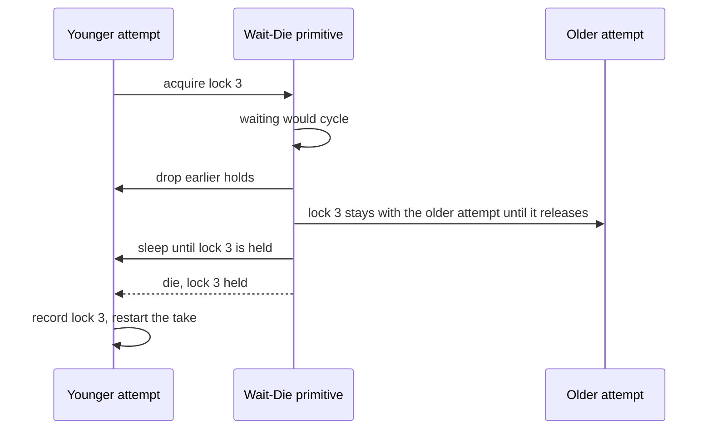

An older attempt that would cycle waits. It does not die. Vedam does not implement the wound half, in which the older attempt would abort the younger one.

### 2.7.21 Limits

| Limit | Value | Where it is enforced |
|-------|-------|----------------------|
| Key length | 4096 bytes | Pin of a keyed object. |
| Stack key | 264 bytes | Longer keys allocate. |
| Attribute id | 1 .. 63 | `ensure_attr`. Id 0 is skipped. |
| Attribute locks on one object | 64 slots | Array cap. |
| Attributes in one call | 32 | `VEDAM_LOCK_LIST_MAX`, also the codec ceiling. |
| Ids sorted on the stack | 32 | A longer list would allocate. The list maximum is 32, so the allocate path is the same bound. |
| Nested write watches | 4 | `vattr_write_watch`. |
| Queue workers | 4 | Listen. |
| HTTP workers | 4 | Listen. |
| Queue name | 64 bytes including the terminator the buffer holds | Address format at init, and the reply name. |
| Queue call wait | 5000 ms | Connector. |
| Codec buffer | 8192 bytes | One encode or one decode. |
| Codec value scratch | 256 bytes per attribute | Server-side text, list, or struct. |
| Codec key scratch | 256 bytes | Server-side key copy. |
| HTTP I/O buffer | 65536 bytes | One request read on a worker. |

A limit is a refusal, not a truncation. A key longer than 4096 does not lock a prefix. A list longer than 32 does not lock the first 32.

### 2.7.22 The hash table

`vds_hash` is the keyed lock index and the two maps a byte link uses (row UUID, service name).

| Field | Role |
|-------|------|
| `bucket` | Array of list heads. |
| `nbucket` | Power of two. |
| `count` | Nodes stored. |

A node is a list link, the FNV-1a hash, the key length, the value pointer, and the key bytes in the same allocation. Lookup compares length and bytes after the hash matches. Set replaces the value of an equal key. Get returns not found when the chain has no equal key. Destroy frees nodes. It does not free values. The lock map frees objects itself. The UUID map frees its hit records on finish.

The lock map does not use the convenience insert that grows under a single lock. It prepares the new bucket array, swaps under the map gate, and frees the old array outside the gate, as section 2.7.10 says. That keeps the spin section to pointer writes.

### 2.7.23 The other containers

The `src/ds` tree also has a doubly linked list, a stack, a queue, a key-value helper over the hash, a singleton index, and a small index. They are available to rows. The lock map uses the hash and the list link inside the hash node. It does not use the stack or the queue for locks. The present fillings use a POSIX queue or a socket, not `vds_queue`, for bytes on the wire. A later filling brings its own wait.

A container does not lock itself. The caller holds whatever exclusion the object needs. The map gate is that exclusion for the hash inside the lock map. A library body that stores its own hash uses its attribute lock as that exclusion, by running only while the attempt holds it.

### 2.7.24 What the depth counter refuses

On the lockless build the sequence is shorter, and the refusal is earlier.

1. Dispatch checks the node and the message.
2. If `dispatch_depth` is non-zero, return failed precondition. Do not call the body. Do not call the lock functions.
3. Otherwise increment, call `dispatch_body`, decrement.

`vedam_lock_invoke` on that build is the direct call of the body, but dispatch does not use it. `vedam_lock_in_attempt` returns 0, so `vedam_node_call` will not refuse a non-local descriptor on account of a lock. The depth counter is what stops the body from re-entering. A body that called a socket function without going through dispatch would be outside this rule. The body is not given a socket. The only send is `vedam_node_call`, and the local slot re-enters dispatch, which the counter refuses.

There is no ticket, no pin, no dead bit, and no restart. A body runs once. If two threads call, both run. The lockless build does not serialise them. That is acceptable for the browser selection because the page has one thread and the counter rejects re-entry. It is not a substitute for Wait-Die on a host with many threads. A host selection turns Wait-Die on.

## 2.8 Figures and the edge of this chapter

The drawings, then the subjects this chapter leaves to later parts.

### 2.8.1 Reading the sources next to this chapter

The sections above name the function that implements them. A reader who wants the bytes opens that function. The chapter is the order and the refusal. The function is the spelling.

| Section | Function |
|---------|----------|
| Init and deinit | `vedam_init`, `vedam_deinit` |
| Open, listen, call | `vti_open`, `vti_listen`, `vti_call` |
| Send from a body | `vedam_node_call` |
| Dispatch | `vii_dispatch` |
| Verb and check | `vii_verb`, `vii_attr_check` |
| Attempt | `vedam_lock_invoke` |
| Pin and take | `take_locks` in the lock map |
| Acquire and die | `vedam_lock_acquire` |
| Queue frame | `pack_request`, `unpack_request` |
| HTTP bytes | `vti_grpc_http_exchange`, `write_http`, `handle_client` |
| Prefix | `vti_codec_grpc_frame` |
| Message | `fill_message`, `drain_message` |
| Bind | `vti_grpc_bind_tcp` |
| Empty map | `vedam_lockdb_open` in the lockless file |
| Daemon | `main` of vedamd |

Generated files carry a line that says they are generated and must not be edited. A change to a row is a change to the model, then a regeneration. A change to a refusal in this chapter that is not true of those functions is a defect in the chapter.

### 2.8.2 Figures

The drawings in this chapter are control or data, not decoration. Each one is the picture for the section beside it.

| Figure | Section | What a reader should be able to trace |
|--------|---------|----------------------------------------|
| Row id from the DNS name and the model line | 2.3.4 | Namespace bytes, then the version-5 id |
| Dispatch, with and without Wait-Die | 2.4.3 | Uninitialised, bad message, re-entry, body |
| A body sending local and remote | 2.4.5 | Join versus failed precondition |
| Init and rollback | 2.5.1 | Publish, then listeners, then the internal create |
| Present inter-process request and reply | 2.6.6 | Listen queue, worker, reply queue |
| Which filling a build attaches | 2.6.4 | One table for the inter-process link, one table for the remote link |
| Attempt states | 2.7.1 | Taking, running, restart, failed, done |
| Die of the younger attempt | 2.7.20 | Earlier holds dropped, contended lock kept |
| One connection on the present remote filling | 2.6.21 | Post, decode, dispatch, digit, keep-alive |
| Local, inter-process, and remote get | 2.6.33 | Same verb check, different bytes |
| Layer stack | 2.4.1 | Adapter, dispatch, lock, check, body, link |

A box that says "everything else" is not used. If a later edit adds a step, the figure for that section gains the step, and the table in this section gains a row.

### 2.8.3 What remains outside this chapter

The purpose of each row, grants, and the durable log are not specified here. [Interfaces](../interfaces/interfaces.md) lists placeholder rows and the build classes. Part I remains the mission and the motivation.

[^ww-mutex]: Wound/Wait deadlock-proof mutex design, Linux kernel documentation, <https://docs.kernel.org/locking/ww-mutex-design.html>. Vedam implements the die rule only.

