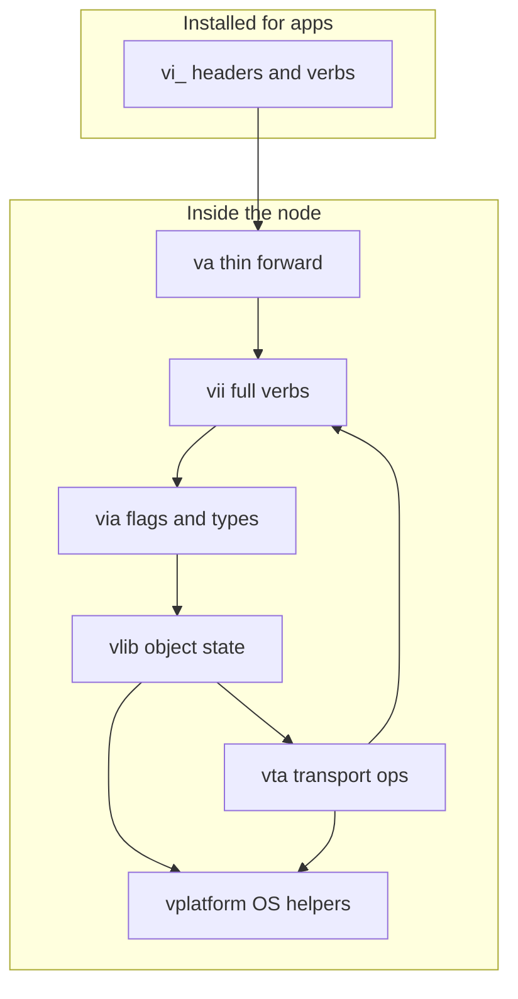
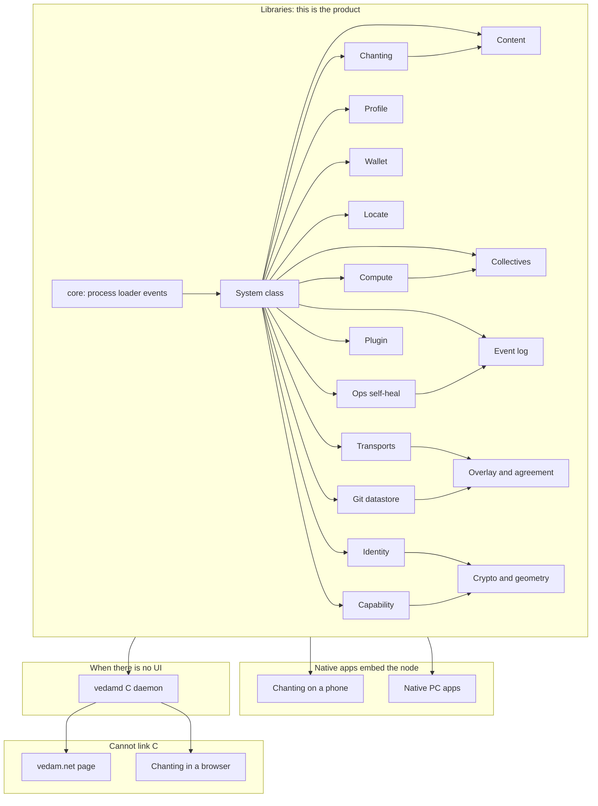
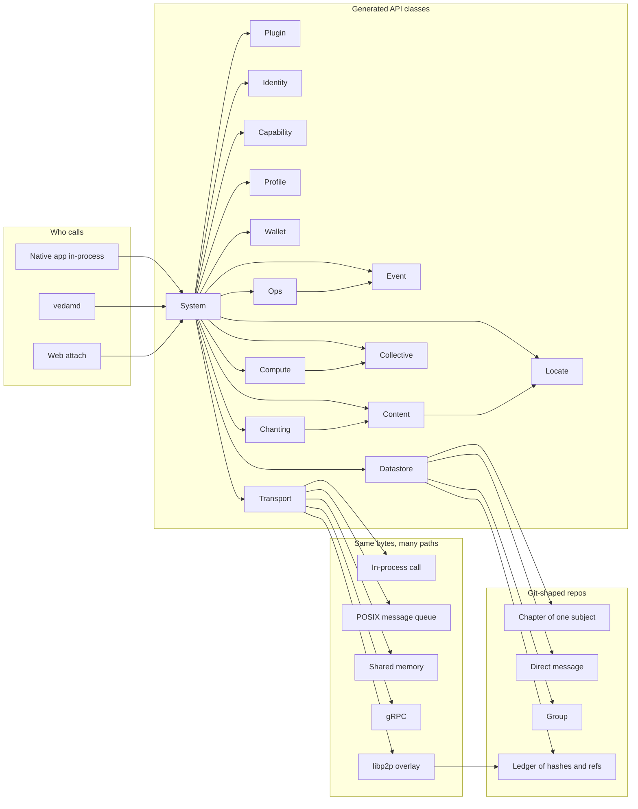
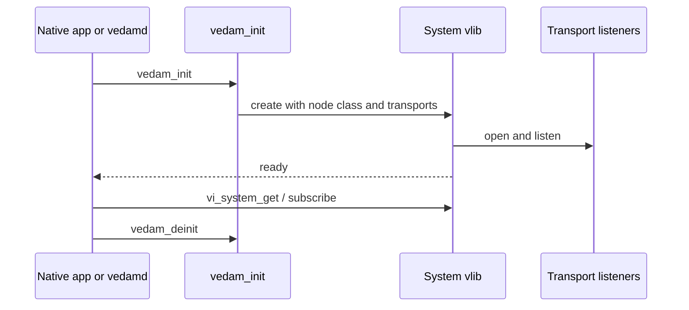
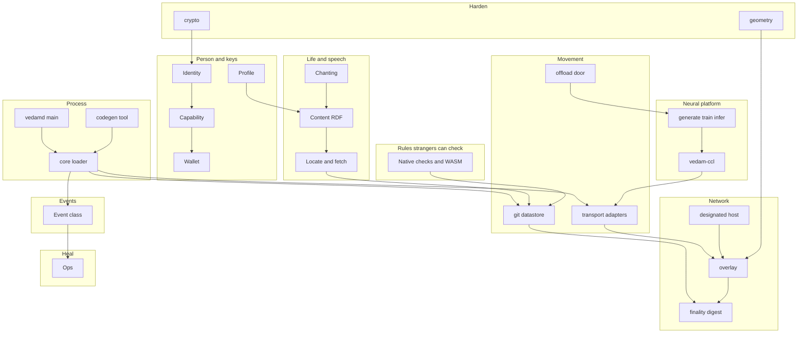
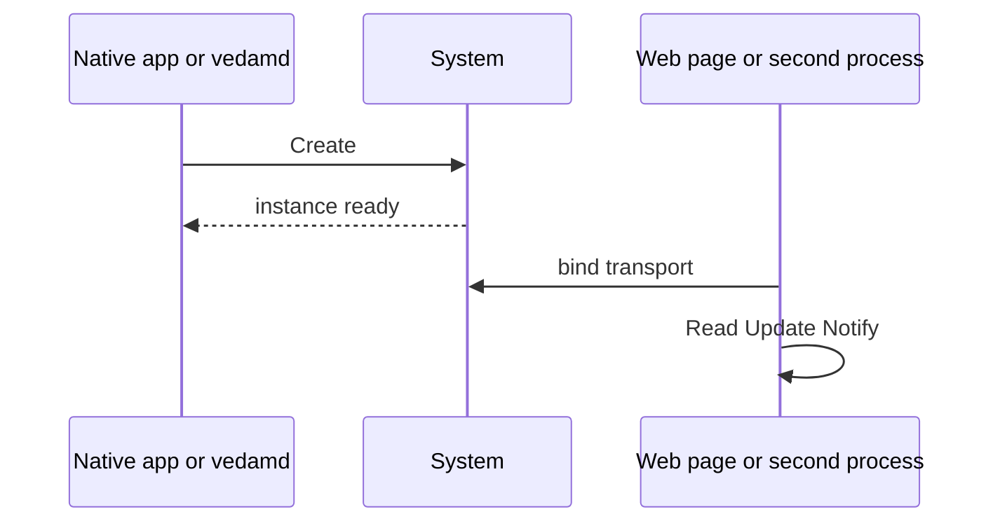

# 5. High-level architecture

This chapter is the design of the platform at one viewing distance: close enough to name every public interface and every inner library, far enough that line-by-line C still belongs in the implementation tree and in Part III for the first class. Interfaces are designed first. Module interiors follow them.

Vedam is **library-first**. A node is those libraries after the System class has been created. Peers will keep history in **git-shaped repositories**. Every public action is a **generated** message that can travel inside a process or across the world without changing shape. Two execution tiers share the same agreement on history: **native validation** of Vedam’s own rules, and **WebAssembly** for rules strangers must be able to check without a company server.

The first shipping slice implements System, codegen, and enough transports to get and watch attributes. Later classes reuse the same layering.

---

## 5.1 Ideas this chapter borrows — explained first

A reader should not need a web3 dictionary. The next paragraphs name the public ideas Vedam is **inspired by**, in ordinary language, and then say which joint Vedam reuses.

**Git** is the version-control tool most software projects already use. It stores a tree of files as a chain of snapshots. Each snapshot has a hash. If two machines have the same hash, they have the same history. Vedam uses that property as a **datastore**: a chanting thread, a subject’s chapter, a ledger of public commitments are all git repositories. The node does not invent a second private database beside git.

Some projects already move git objects between peers without a central host. **Radicle** (and its Heartwood stack) is one public example of “git over a peer network.” Vedam looks at that precedent for **how packs of objects can travel**. It does not take Radicle’s product scope, identity, or governance. Whether any Radicle code could ever be reused is a license question, not a design assumption — see [Open questions](../governance/open-questions.md).

**RDF** is a way to write facts as small triples: this thing, this relation, that thing. **Solid** is Tim Berners-Lee’s project in which a person holds a pod of such facts and applications come to the pod, rather than the person living inside an application. Vedam takes the useful joint: the account owner holds the readable graph; applications are replaceable; the public ledger holds hashes, not diaries. Vedam does not take a hosted issuer and does not let a server be the real lock on the door.

**Ethereum** showed that a small program in a sandbox can be the contract between strangers. Vedam takes the useful joint: when two parties must trust a rule, that rule runs as a native check or as **WebAssembly** (a portable sandbox originally built for browsers, now used for untrusted code in many places). Vedam does not take Ethereum’s accounts, gas, or a token that must be paid in order to exist.

**libp2p** is a toolkit for speaking to peers: dial, listen, encrypt a session, gossip. **gRPC** is a way to call a function on another process as if it were local, carrying protobuf messages. **protobuf** is a typed, compact encoding of messages. **libsodium** is a well-audited box of cryptographic primitives. Vedam uses these as **tools**, introduced here so later sentences can name them without magic.

**Local-first** means the copy on the owner’s device is the real copy. The network is how copies meet, not a landlord. **Privacy as default** means sharing is a later, explicit act. Vedam takes both habits. They are not citations to hide behind; they are how a node behaves after System create with the cable pulled out.

None of this is lineage. Vedam’s own vision — four conditions, no happyness score, grants that only shrink, geometry instead of growth targets — is the reason to take a joint and leave the rest of the house.

---

## 5.2 Source tree

This is the layout of the **vedam** repository for the System slice and the rooms reserved for what follows.

```
vedam/
  tools/codegen/            YAML + Jinja → vi / vii / va / via / proto
  include/vi/               Public C API (installed)
  include/vii/              Full C API and transport ops (not installed)
  include/lib/              Hand declarations for vlib_*
  include/platform/         vplatform_* categories
  include/util/             Shared helpers (attributes, log, trace)
  include/vti/              protoc C++ (compile only)
  generated/proto/          Generated .proto for this tree
  src/core/                 vedam_init / vedam_deinit
  src/lib/                  Class bodies (system.c owns vedam_t)
  src/va/ src/via/          Generated thin forwards and contract checks
  src/vta/                  Transport ops: inproc, mq, grpc, grpc_uds, connect
  src/platform/posix/       OS bodies behind vplatform_*
  src/vedamd/               C daemon: flags, daemonise, init, wait, deinit
  config/                   defconfig.class-* (compile-time plan)
  examples/                 Programs that include only vi/
  tests/                    Grouped util / system / transport tests
```

**Interfaces first:** YAML under `tools/codegen/` is the source of truth for C headers and for the `.proto` this tree compiles. The public **vedam-interface** repository is the published copy for application authors when a message change is ready for them. Product applications are **separate repositories**. They are not folders inside `vedam/`.

**vedamd** lives in `src/vedamd/`. It is a **Unix daemon written in C**. It does not contain a user interface. After optional daemonise it is only: call `vedam_init`, wait for a signal, call `vedam_deinit`. The first slice links `libvedam`. Optional modules loaded by registered identifier remain the direction for plugins; empty `lib/` and `plugins/` placeholder trees are not part of this layout.

## 5.2.1 Call layers

Applications never see VII, VIA, or transport ops tables. Inside the node every public verb still walks the same stairs so a local call and a remote unpack cannot disagree on the contract.



| Layer | Responsibility |
|-------|----------------|
| VI | Public attribute ids and verbs only |
| VA | External origin into VII |
| VII / VIA | Origin, collapse, flags, types, then library |
| VLIB | Singleton or object state |
| VTA | Same verb over in-process, queue, or network bytes |
| VPLATFORM | calloc, threads, sleep, mq, getenv, daemonise |

Detail for System: [System class](../interfaces/system.md). Generator: [Proto layout and codegen](../interfaces/proto-codegen.md).

---

## 5.3 How a node starts: an app, or vedamd

A **node** is not a particular binary. It is the libraries after `System.Create`.

On a **phone**, a native app (chanting will be its own repository) **dlopen**s the libraries and starts the System class in the app process. The app is the node.

On a **PC or in the cloud**, when nothing on the screen should own the process, **vedamd** runs as a daemon and starts the same libraries. A [vedam.net](https://vedam.net) page, or chanting in a browser, **attaches** to that daemon. A browser may instead run a **WebAssembly build of the same libraries** (node class E). That is a compile of Vedam, not a second contract.

A second process on the same machine **may** attach to an instance that already exists. That is optional. It is not the phone default.



| Piece | What it is | What it is not |
|-------|------------|----------------|
| **`libvedam-*` and plugins** | Events, dispatch, git, transports, each API class, overlay, crypto | A fat user interface shipped as “the protocol” |
| **Native product app** | Links libraries and starts System in-process | Something that needs vedamd on a phone |
| **vedamd** | A tiny C daemon that hosts the same libraries | The only way to start a node |
| **vedam.net / chanting web** | Talk to vedamd, or run a WASM build of the same libraries | The usual architecture of the phone |

---

## 5.4 Public interfaces and inner modules — one picture

Every application-facing class is a **vertical**: its own `.proto`, its own generated header, its own directory under `src/`. Transports are not classes an app picks in the header; they are how the same bytes move. Inner modules that applications never call directly (crypto helpers, overlay internals) still appear here so the figure is the design, not a slogan.



Read the figure left to right. Callers only see the generated classes. The System class is the door. Event is the diary. Identity, capability, profile, and wallet are the person-and-keys verticals. Content, locate, and chanting are the life-and-speech verticals. Compute and collective are the neural-platform verticals. Ops is how the node heals itself. Transport and datastore are how those messages move and rest. Git repos are scoped: a chapter is one subject; a ledger is what validators must see and is not a diary.

---

## 5.5 Each public class as a vertical

Headers for applications live at `include/vi/class/<class>.h`. On the wire, verbs still exist; a class that is implied simply **does not put create in the public header**.

| Class | Create in the public header? | What this vertical is for |
|-------|------------------------------|---------------------------|
| **System** | No (internal; `vedam_init`) | Birth and death of the instance. Health, class, protocol version, transport slots. |
| **Plugin** | Yes | Install or enable an **optional** module. Mandatory modules are already loaded by System create. |
| **Event** | No | The log. Everything that would have been a line in a file is an event with attributes (severity, audience, correlation). Events are not ranked. |
| **Transport** | No | Listeners bound at System create. Applications do not open sockets by hand. |
| **Datastore** | No | Git directories opened at System create. |
| **Identity** | Yes when the object is truly new | Register a root subject (rare), device keys, app-scoped pseudonyms (everyday). No central issuer. |
| **Capability** | No | Probe and verify grants. An agent cannot widen what the master signed. |
| **Profile** | No | Empty stub at start. Public fields are RDF behind Content. No happyness attributes. |
| **Wallet** | No for the stub | Keys and signing in client-side wallet code. Simple transfer is native. Custom token rules, if any, are WebAssembly. No fee market as a substrate requirement. |
| **Content** | Rare; upsert via set | Objects the owner holds. Encryption on by default. Sharing is a set, never a silent create default. |
| **Locate** | No | Find and fetch ciphertext by hash. Plaintext exists only in authorised application memory. |
| **Chanting** | Application repo, not this tree | High-intention messages. No like, follower, or dwell fields. |
| **Compute** | Yes | A session or a training swarm is opt-in. System create does **not** enrol the device. |
| **Collective** | Yes | A group for collective compute. Same opt-in rule. |
| **Ops** | Issues appear via set | Observe → issue → review → upgrade, all as events. Optional adapters to GitHub or a builder. Never a silent worldwide push. |

Validator-facing votes and proposals share the codec and the transports. They are not all account-owner CRUD. The client still sees only **finalized** or **rejected** on the class that submitted the work (Content, Identity, Compute, and later apps).

Detail of System: [System class](../interfaces/system.md). Remaining headers: [API classes](../interfaces/api-classes.md). How bytes move: [Transport and datastore](../interfaces/transport-datastore.md).

---

## 5.6 Starting an instance

`vedam_init` is the ordinary way to start in this slice. It builds transport attributes and calls internal System create. Analogues in other systems (construct an object and it runs; start a unit and its dependencies follow) are research shape only.



Implied by System create in the **full** design (some items still wait for later classes):

- Transport listeners for the selected local, IPC, and remote ops
- The event bus and Event-class registrations
- The git datastore and default repositories
- The plugin loader and **mandatory** plugins
- A capability profile probe
- Device key material if none exists, or a wait-for-owner path (see [Open questions](../governance/open-questions.md))
- Empty profile, wallet stub, and public-content root so later get and set have somewhere to stand

**Today’s slice** starts transports and exposes System get / subscribe. The other implied objects arrive as their classes ship.

**Delete** stops listeners and tears down the singleton (`vedam_deinit`). **Get** returns health fields that exist now (node class, protocol version, system state). **Set** and richer notify streams grow with later attributes. Subscribe watches protocol version and system state.

System create does **not** enrol the device in a training swarm, does **not** turn on a ranking service, and does **not** make sharing the default.

---

## 5.7 How the same message travels

Three plug-in tables exist in the full design: **transport**, **datastore (git)**, and **offload (a door for later)**.

| Transport | What actually moves today | How subscribe arrives |
|-----------|---------------------------|------------------------|
| In-process | Direct calls into VII on the caller thread | Same-process hooks |
| POSIX message queue | Length-prefixed protobuf | Queue receive thread |
| gRPC-style HTTP (TCP or Unix socket) | Unary POST with gRPC length prefix (temporary) | Same HTTP path until official gRPC streams |
| Connect / QUIC | Stub ops; listen succeeds without a socket yet | Planned |
| Shared memory | Planned | Planned |
| libp2p / QUIC | Planned | Planned |

All of them stream in the full design. The application author does not pick a transport in the class header. Init, or a later bind, selects the ops table.

Git is the datastore when that vertical ships. A browser build uses **libgit2 compiled to WebAssembly** behind the same operations. There is not a second application database.

The node is **event-driven**. When Event ships, events persist, notify, or trigger. Logging is the Event class.

---

## 5.8 Inner modules and how they connect

Each cluster below is a directory (or a small set of directories) under `src/`. The arrows are runtime dependence, not a build order slogan. Detail of interiors: [Module inventory](../modules/inventory.md).



| Cluster | Responsibility | What it refuses |
|---------|----------------|-----------------|
| Process and codegen | Core, loader, capability probe, thermal governor, **vedamd**, the API generator | Shipping a product UI as the platform |
| Events | Persist, notify, trigger. The log is this class | A `vedam.log` file as the design |
| Transport, git, offload | Stream and load-balance; git packs; offload as a door only | Kernel-bypass networking in this generation; “WASM on the wire” as git |
| Identity internals | Nullifier versus subject versus device versus pseudonym versus ledger | A central `id.vedam.net` |
| Content and locate | RDF, envelopes, find and fetch | Global query over ciphertext |
| Programmable rules | Native checks; WebAssembly; wallet | A fee market in order to exist |
| Network and agreement | libp2p overlay, designated host, finality digest, tiered finality | Trusting the sequencer alone |
| Neural and collectives | Platform generate / train / infer / distribute | Treating a phone as a billion-parameter box; a thin client **running** training |
| Chanting | First application library | A companion or a feed |
| Security and geometry | libsodium, Noise, Penrose / Z[φ], Fibonacci backoff | Hand-rolled cryptography or consensus |
| Build | CMake reads defconfig; Nix; packages | A required fat binary store |
| Ops | Observe, issue, review, upgrade | Requiring Jenkins; a silent worldwide push |

---

## 5.9 Node roles and kinds of repository

A node class is a **role**, selected by defconfig, not a different Vedam.

| Class | Role | What it stores |
|-------|------|----------------|
| **A** | Archivist | Pins a broad set of allowed ciphertext it may not be able to read |
| **B** | Full validator | Validates, finalizes, executes |
| **C** | Light operator | Typical phone or laptop that **embeds** the node. Partial clone |
| **D** | Small gateway | Recent refs; optional gateway for older web protocols |
| **E** | Thin web | WASM libraries in the page, or talk to **vedamd**. Uses neural services; does not run them |

There is no fee or token required to take part.

Repositories are scoped by application:

| Kind | Scope | Who can read the plaintext |
|------|-------|----------------------------|
| **Chapter** | One subject | The subject and those holding a capability, plus optional per-app cryptography |
| **Direct message** | The participants | End-to-end ciphertext |
| **Group** | The member set | End-to-end ciphertext |
| **Ledger** | Validators | Metadata only: envelope, hashes, refs, finality digest, nullifier commitments, identity registry |

Class A and B nodes may pin ciphertext they cannot read. Cloud mirrors are **non-authoritative copies of ciphertext**.

---

## 5.10 How work enters the network

Applications **never** sequence their own transactions on the **same node instance** that submits them.

For each submit window, a **designated host** is chosen from the active validator set by a hash of the sender’s chapter, the application, the repository, and an epoch. The epoch advances on timeout or on a schedule.

That host may validate **other account owners’** work. It does not act as sequencer for **its operator’s own** submits. If the host times out, the client retries, then bumps the epoch. If the host misbehaves, validators refuse finality and the client hears about it through Event / Notify.

A **node host** in the validator sense is native code that accepts API transactions, checks them against finalized heads, writes **one message per git commit** in the first shipping generation, proposes a finality digest, takes part in asynchronous quorum replay, and replicates over libp2p. The host is **not** trusted alone. A supermajority of validators must match the digest.

---

## 5.11 High-level journeys

### A second process talks to a running instance

A web page, or another local program, may attach to a node that already called Create — often **vedamd** on a PC, or a native app that exposed a listener.



How a web client finds vedamd (a local socket path, a name on the local network, or an address typed by the owner) is specified in [Engineering](../engineering/engineering.md). Chanting on a **phone** does not take this path by default: it starts System in-process.

### Sending a chant

1. The sender builds an RDF body and encrypts it on the device.
2. The chanting application calls the generated API on the **remote designated host** (never on itself as sequencer).
3. The host writes one git commit of ciphertext on the direct-message or group repository. The envelope carries a hash of the payload.
4. Validators agree a finality digest. The ledger git stores the digest and the refs, not the diary.
5. libp2p replicates objects to archive and validator peers.
6. Status returns as **Notify / Event**, not as a line in a log file.

### Fetching and decrypting

Locate the hash, fetch the ciphertext, unwrap the content key with the app-scoped pseudonym (or request access), decrypt in memory on the authorised device. Machines in the middle never keep plaintext. Sequence detail lives in [Module inventory](../modules/inventory.md).

### Register versus everyday use

**Register** is rare: a personhood nullifier gates one root subject; a commitment goes on the ledger; a device key is delegated.

**Use** is common: an app-scoped pseudonym signs; the assertion is self-issued; there is no central issuer. Linking two apps is opt-in.

### Local versus remote

| Path | When it is used |
|------|-----------------|
| Inside the process | The native app linked the libraries and started System — chanting on a phone |
| Local socket, queue, or shared memory | Another process on the same device attaches |
| Remote gRPC or libp2p | A web client or a chosen peer talks to **vedamd**. A node never operates another subject’s storage credentials |

### Submit and finality (first shipping generation)

A submit is proposed, the digest is replayed, the quorum acknowledges, and the ledger becomes durable — or the client sees a rejection or a timeout as an Event. Work may proceed in parallel across repositories. Inside one repository, the nonce chain is serial.

---

## 5.12 Where the detail lives next

| This high-level piece | Public interface chapter | Inner module chapter |
|-----------------------|--------------------------|----------------------|
| System, generated dispatch | [System class](../interfaces/system.md), [codegen](../interfaces/proto-codegen.md) | Process |
| Event / log | [API classes](../interfaces/api-classes.md) | Events |
| Transport / git / offload | [Transport and datastore](../interfaces/transport-datastore.md) | Movement |
| Identity | [API classes](../interfaces/api-classes.md) and [Part V](../identity-security/external.md) | Person and keys |
| RDF / locate | Content and Locate classes | Life and speech |
| Wallet / WASM | Wallet and Compute | Rules strangers can check |
| Overlay / agreement | Validator-facing; not all are account-owner CRUD | Network |
| Neural / collectives | Compute | Neural platform |
| Chanting | Chanting | Life and speech |
| Crypto / geometry | Not a ranking API | Harden |
| Build | — | [Engineering](../engineering/engineering.md) |
| Ops | Ops class | Heal, and Part VI |

---

## 5.13 References

- git; libgit2; libp2p; gRPC; protobuf; libsodium.
- Solid and RDF, as citizen ideas, not as a product to clone.
- Radicle / Heartwood, as a public example of git moving between peers.
- Jennings et al., *Human–Agent Collectives*, CACM 2014.
- HotStuff / Narwhal–Bullshark as literature on how validators can agree, informing the overlay — not as Vedam’s name for itself.
