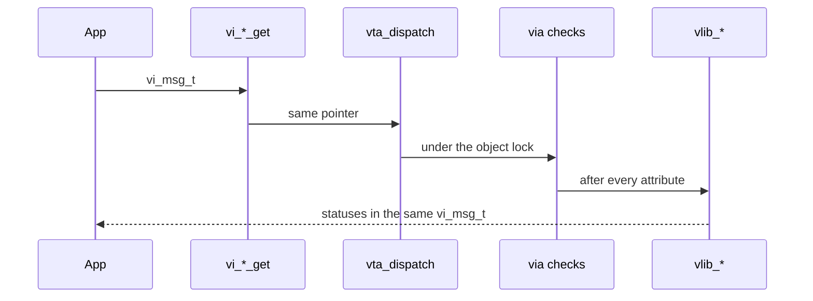

# 2. Introduction

Part I said why Vedam exists. This part says how the platform is put together so that why can survive contact with running software. It is the map of the house: who lives here, what the rooms are called, which doors connect them, and which later chapters walk into each room and stay.

The [Mission](../foundations/mission.md) remains the authority on purpose. Nothing in this part is allowed to quietly become an engagement machine, a happyness score, or a landlord.

---

## 2.1 Purpose

This part is written for people who will build on Vedam, review it, or live on it and want to know what they are being asked to trust.

It explains, in order: the words the rest of the spec will use; whose questions the architecture must answer; then the high-level design itself — the source tree, the public interfaces, the inner modules, and the two ways a node starts (inside an app, or as the **vedamd** daemon). Later parts do not repeat that map. They fill it in. Interfaces come first. Interiors of libraries come after.

The design choice underneath everything else is simple. Vedam is libraries. An app that can link those libraries **is** a node. A page that cannot link them talks to a node that is already running. The chapters that follow exist to make that sentence precise.

---

## 2.2 Scope

This part describes the **shape of the platform**: how a node instance is born and ended; how public messages and C headers are generated from one contract; how those messages travel (inside a process, on a local queue, over a local or remote call, or later across the peer network); how history will be stored as git-shaped repositories; how events are the log; how identity looks from the inside and from the account owner’s chair; how programmable rules run as native checks or as WebAssembly; how peers overlay and come to agreement; how neural libraries sit on the platform for later apps; and how operators and a test network are expected to behave.

This part does **not** walk every C file of the implementation tree line by line. That tree follows this spec; it is not this spec. This part does not record private agent memory, sell a product, rank anyone’s happyness, or charge a fee or a token in order to take part. It does not require kernel-bypass networking or production GPU offload in this generation (an offload slot exists so later work has a door).

A browser build is the **same libraries**, compiled to WebAssembly, or a thin conversation with a helper node. It is not a second Vedam.

---

## 2.3 Audience

| Reader | What this part must make clear |
|--------|--------------------------------|
| Someone writing a Vedam library | Which layer they implement (public VI, internal VII, library body, or transport), and that plugins use the same message shapes as code linked at build time. |
| Someone maintaining **vedamd** | That the daemon stays small: parse flags, optionally daemonise, call `vedam_init`, wait for a signal, call `vedam_deinit`. The product is still the libraries. |
| Someone writing an application | When to link the libraries and start a node inside the app, and when to talk to a node that is already running. Which verbs are public on each class. |
| An account owner reading for trust | Where the human terms live (Part V). This part will not bury them in cryptography. |
| An auditor or researcher | Who the stakeholders are, why a node never sequences its operator’s own submits, and that grants cannot be widened by an agent. |

---

## 2.4 Call layers in one glance

Application authors see one public surface. Inside the node the same verb walks several layers before state changes or a reply is filled. Part III spells this out for the System class first; the names here are stable for every later class.

| Layer | Prefix | Who may call it | Job |
|-------|--------|-----------------|-----|
| **VI** | `vi_` | Applications, **vedamd**, examples | Public verbs, public attribute ids, and `vi_msg_t`. |
| **VA** | (thin) | Generated only | Puts the caller’s `vi_msg_t` on a local dispatch with external origin. |
| **VII** | `vii_` | The dispatch path | Full attribute ids, origin, major, and minor. |
| **VIA** | (generated) | After the lock is taken | Visit every attribute, write each status, enforce flags and types, then call the library. |
| **VLIB** | `vlib_` | VIA only | Object behaviour. In this generation the bodies return success and do not store values. |
| **VTA** | `vta_call` | A queue or network caller | Encode once, or pass the pointer when the call stays in-process. |
| **VTI** | protobuf C++ | The queue and HTTP codecs | Wire encoding. Not installed for applications. |
| **VPLATFORM** | `vplatform_` | Libraries and transports | Memory, threads, sleep, message queues, environment, process. |

**Origin** is external when the call came through the public header or from outside the process, and internal when the node is bringing itself up. Create, set, and delete are internal. Notify is the stream of later changes in the message file. The public C header does not ask an application to push it. Public callers use get, subscribe, and unsubscribe after `vedam_init`.

A public get in this process:

A queue or HTTP accept runs the same dispatch after it has decoded into its own `vi_msg_t`. It does not enter through a second local call.

Detail: [Proto layout and codegen](../interfaces/proto-codegen.md), [System class](../interfaces/system.md), [High-level architecture](high-level-architecture.md).

---

## 2.5 Documents this part relies on

| Document | What it supplies |
|----------|------------------|
| [Mission](../foundations/mission.md) and [Motivation](../foundations/motivation.md) | Why the platform exists, and which primitives make those goals harder to violate. |
| The rest of this part | Words, viewpoints, and the high-level design. |
| [Part III](../interfaces/proto-codegen.md) | The generated contract, System as the first class, transports. |
| [Part IV](../modules/inventory.md) | What sits inside each later library. |
| [Part V](../identity-security/external.md) | Identity and terms in the account owner’s language. |
| [Part VI](../engineering/engineering.md) | Build, tests, and operations. |
| [Part VII](../governance/open-questions.md) | Open decisions, glossary, and the bill of rights. |
| libgit2, libp2p, gRPC, protobuf, libsodium | Existing libraries named where Vedam actually uses them. Each is introduced in the high-level architecture before it is treated as known. |

---

## 2.6 Assumptions and constraints

The protocol libraries are written in **C**, because they must link into phones, PCs, small devices, and a daemon. A native app links them through the usual foreign interface on that platform. **vedamd** is the headless host. A client that cannot link C — a page in a browser — speaks to a node that is already running.

By default there is **one running System object per process**. Another program on the same machine may attach to that instance instead of starting a second one. The account owner may still choose to run more than one instance. The platform does not force a swarm.

Most devices Vedam cares about are ordinary: phones, laptops, browsers, small gateways. Machines with graphics processors are welcome and optional. **A node must work on CPU alone.**

**The device works first.** After `vedam_init`, the instance is useful with the network unplugged. Joining other peers is an enhancement, not a login.

A node **never sequences its operator’s own submits**. The replica that orders incoming work for a window is a designated host, not a master, and it does not order the work of the person who operates it.

**Logging is the Event class** when that class ships. Diaries are not written to ad-hoc files as the design.

Neural generate, train, infer, and distribute are **platform libraries**. Account-owner neural applications come later. They are not a later personality of the daemon.

The first shipping slice implements **System** end to end: codegen, layers, local and remote transports enough to get and watch attributes. Other classes remain designed in Part III and filled in as their YAML and libraries land.

The license intent is on the [cover](../../vedam.md).

---

## 2.7 Two ideas Vedam is inspired by

Vedam’s vision is its own. Two public lines of work are still worth naming, because the platform **takes a part of each** and refuses the rest.

**Data in the owner’s hands.** A person should hold their own facts. Applications should be replaceable. The public record can hold hashes; the readable life stays with the owner. Vedam takes that. It does not take a hosted identity issuer, and it does not let a server be the real access-control brain.

**Rules strangers can check.** When two people who do not share a company must trust a rule, that rule should run where both can see it — as native validation or as WebAssembly — not as a private service. Vedam takes that. It does not take a global fee market, and it does not require a token in order to exist.
