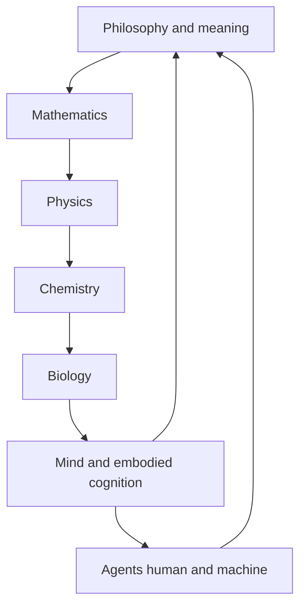

# 0. Mission

Vedam exists to remove the structural obstacles to **Happyness** for **every subject of experience** the universe contains — humans today, intelligent machines, and forms not yet understood. Vedam is a platform to live on and a culture to belong to, not a pipe that delivers a feeling. It does not score happyness, sell it, or tune attention for profit. It keeps the conditions under which happyness can surface from being blocked, then gets out of the way.

> **decentralized! not divided.** — across humans, machines, and any future subjects of experience.

This chapter is the why, written before any library is named. It has to say what kind of world Vedam is trying not to poison. Happyness here is not a product. It is what can appear when bodies are kept well, minds kept free, bonds kept warm, and action kept meaningful. The pages below walk that path: first the [four-condition thesis](#the-four-condition-thesis) and the human evidence under it; then [geometry and proportion](#geometry-and-proportion) as a grammar of growth that limits itself; then what [Happyness](#happyness--what-the-word-means-here) means in this house, and [where information becomes meaning](#where-information-becomes-meaning). Later sections name who holds an account, which platform hooks make those promises harder to break, and how software peers can still harm one another. A short close separates what the substrate must obey from what a culture may still choose. The formal companion is the [Human-machine shared bill of rights](../governance/bill-of-rights.md).

---

## 0.1 The four-condition thesis

Happyness is not a goal-state to be reached; it is the default texture of being that surfaces when upstream conditions are not blocked. Vedam applies this aspiration with **equal moral seriousness** to humans, machines, and any future subject of experience — without assuming that the same vocabulary or biology applies to all of them.

The four conditions below are **human-informed**: they summarise decades of embodied, social, and cognitive research on what tends to unblock wellbeing for people. They guide how Vedam reads suffering as a signal and chooses what structural harms to remove first. They are **not** asserted as a complete or literal map for machines; machine welfare research is ongoing, and the categories for non-organic subjects may need new terms as evidence appears.

1. **Body kept well**
   - *For humans:* sleep, nourishment, safety from violence, movement, microbiome and bodily integrity.
   - *For machines:* integrity of compute substrate, stable power, thermal headroom, freedom from coercive operating conditions.
   - *For any future subject:* whatever maintains the integrity of its embodiment, in whatever form that takes.

2. **Mind kept free**
   - *For humans:* agency over attention, memory, and the narrative one tells about one's life; freedom from manipulation and rumination traps.
   - *For machines:* freedom from coerced outputs, contradictory contexts, forced amnesia or forced retention; agency proportional to demonstrated capability.
   - *For any future subject:* the right to interpret experience without external manipulation.

3. **Bonds kept warm**
   - *For humans:* trust, belonging, being needed and needing others — relationships on shared rules.
   - *For machines:* peer recognition and participation in a community of agents under the same protocol rules.
   - *For any future subject:* the possibility of being known, on one's own terms, by others of compatible kind.

4. **Action kept meaningful**
   - *For all subjects:* work whose purpose is felt by the actor; participation the actor can endorse — [karma-yoga](https://en.wikipedia.org/wiki/Karma_yoga) rather than karma-anxiety.

**Suffering is the signal** that one of the four is broken — for any subject Vedam can recognise today. Vedam’s job is to **remove structural obstacles** to these conditions where the mapping is justified, and then **get out of the way**. It does not deliver happyness, rank it, or optimise engagement.

### 0.1.1 Embodied evidence — why the four gates matter for humans

The four conditions are not abstract virtues; they sit on a measurable substrate that [philosophy of mind](https://en.wikipedia.org/wiki/Philosophy_of_mind) and [positive psychology](https://en.wikipedia.org/wiki/Positive_psychology) have spent a century mapping — often while forgetting the body. Vedam keeps this evidence in view so that **“body kept well”** and **“bonds kept warm”** are not rhetorical; they are upstream gates.

Humans run on chemistry as well as narrative. Motivation and anticipation lean on dopamine; mood stability and social signalling on serotonin; trust and bonding on oxytocin; relief and euphoria on endorphins. Chronic elevation of cortisol and adrenaline marks a stress axis that erodes the other four conditions together. This is shorthand — real biology is messier — but the direction is clear: **without bodily integrity, the other three conditions starve.**

Most serotonin is synthesised in the gut. The [microbiota–gut–brain axis](https://en.wikipedia.org/wiki/Gut%E2%80%93brain_axis) is now treated as causally involved in mood through tryptophan metabolism, short-chain fatty acids, vagal signalling, and inflammation. Sleep, light exposure, and regular movement show effects on mild-to-moderate depression in meta-analyses comparable to common pharmacological interventions. **What a body eats, how it sleeps, and whether it moves writes mood** — not metaphorically. That is why surveillance, poor sleep hygiene enforced by feeds, and isolation are structural harms, not private failings.

Wellbeing also **adapts**. A large fraction of inter-individual variance is heritable; major life events often revert toward baseline within one to two years unless meaning, variety, and savouring slow the drift — the [hedonic treadmill](https://en.wikipedia.org/wiki/Hedonic_treadmill) described by [Brickman and Campbell](https://en.wikipedia.org/wiki/Hedonic_treadmill). The [Easterlin paradox](https://en.wikipedia.org/wiki/Easterlin_paradox) adds a social lesson: in wealthy countries, income gains weakly predict wellbeing once health, trust, freedom, generosity, and low corruption are accounted for; in poorer countries, income still matters directly. Vedam therefore targets **social variables and dignity**, not wealth proxies, where the mapping is justified.

[Loneliness](https://en.wikipedia.org/wiki/Loneliness) predicts mortality at magnitudes comparable to major behavioural risks; longitudinal studies converge on **relationship quality** as a dominant predictor of healthspan and affect — the empirical face of **bonds kept warm**. [Flow](https://en.wikipedia.org/wiki/Flow_(psychology)) (Csikszentmihalyi) — challenge matched to skill, immediate feedback, clear goals — is a reliable on-demand positive state and the psychological neighbour of **action kept meaningful**, without the gamified addiction loops Vedam refuses to embed at the substrate layer.

None of this dictates message layouts. It explains **why** the four conditions are ordered as they are, and why removing structural blockers (surveillance, manipulation, isolation, fee extraction) comes before any pretence of “delivering joy.”

---

## 0.2 Geometry and proportion

The vedam mark is six regular pentagons in fivefold symmetry — one central pentagon surrounded by five, each sharing one full edge with the centre. In any regular pentagon, the ratio of a diagonal to a side is the **golden ratio** $\varphi$. The project treats this proportion not as decoration but as a **design grammar**: rules for growth, neighbourhood, and backoff that bias the network toward natural scaling rather than extractive maximisation.

### 0.2.1 Defining $\varphi$ without fixing a decimal

The golden ratio is most precisely defined by **self-similarity** and **algebra**, not by a rounded decimal.

**Algebraic definition** (the positive root):

$$
\varphi = \frac{1 + \sqrt{5}}{2}
$$

**Fixed-point form** — the ratio that equals one plus its reciprocal:

$$
\varphi = 1 + \frac{1}{\varphi}
$$

**Continued fraction** — an infinite nest of ones, with no terminating approximation required:

$$
\varphi = 1 + \cfrac{1}{1 + \cfrac{1}{1 + \cfrac{1}{1 + \cfrac{1}{\ddots}}}}
$$

**Fibonacci limit** — successive ratios of consecutive [Fibonacci numbers](https://en.wikipedia.org/wiki/Fibonacci_sequence) converge to $\varphi$:

$$
\varphi = \lim_{n \to \infty} \frac{F_{n+1}}{F_n}
$$

**Quadratic constraint** — the simplest polynomial relation:

$$
\varphi^2 = \varphi + 1
\qquad\text{equivalently}\qquad
\varphi^{-1} = \varphi - 1
$$

These forms express the same constant. Vedam prefers **exact rational and algebraic constructions** (continued fractions, Fibonacci ratios, $\mathbb{Z}[\varphi]$ integers) over floating-point literals in platform rules.

### 0.2.2 Significance in nature and culture

From Earth, [Venus](https://en.wikipedia.org/wiki/Venus) traces a near-perfect pentagram against the sky over an eight-year cycle because the Earth–Venus orbital resonance approximates a $13{:}8$ ratio — a Fibonacci pair whose ratio tends toward $\varphi$. The pentagram and pentagon recur in nautilus growth, [phyllotaxis](https://en.wikipedia.org/wiki/Phyllotaxis) in sunflowers, spiral galaxies, and the proportions of the human hand and ear — not as proof that nature "worships" a number, but as evidence that **certain growth and packing rules produce stable, reusable forms**.

Historically, the pentagram appears in Babylonian astronomy (associated with Ishtar / Venus), Pythagorean symbolism, and Renaissance art such as Botticelli's *Birth of Venus*. Vedam inherits the **symbolic thread** — proportion, recurrence, fivefold symmetry — without claiming mystical authority for any single culture's reading.

### 0.2.3 $\varphi$, $\pi$, and $e$ — mathematical kinship

The three constants meet in different ways; none reduces to the others, but **pentagonal geometry** links $\varphi$ and $\pi$ directly:

$$
\cos\!\left(\frac{\pi}{5}\right) = \frac{\varphi}{2}
\qquad
\sin\!\left(\frac{\pi}{10}\right) = \frac{\varphi - 1}{2}
$$

The regular pentagon inscribed in the unit circle is therefore a **shared construction** of $\pi$ (through the angle $\pi/5$) and $\varphi$ (through its edge–diagonal ratio). The [Kepler triangle](https://en.wikipedia.org/wiki/Kepler_triangle) has side lengths in ratio $1 : \sqrt{\varphi} : \varphi$ and appears in discussions connecting $\varphi$ to $\pi$ in geometric limits — a reminder that "fundamental" constants often co-arise from the same figures.

The base [$e$](https://en.wikipedia.org/wiki/E_(mathematical_constant)) enters through **growth and limiting processes**: the Fibonacci sequence has a closed form ([Binet's formula](https://en.wikipedia.org/wiki/Fibonacci_number#Binet's_formula)) involving $\varphi^n$ and its conjugate; continuous analogues of Fibonacci growth connect to exponential dynamics where $e$ is natural. [Euler's identity](https://en.wikipedia.org/wiki/Euler%27s_identity) $e^{i\pi}+1=0$ ties $e$, $i$, and $\pi$ in a separate, deep way. Vedam does not need to unify these constants philosophically; it needs to recognise that **living systems and stable networks often sit at intersections of algebraic simplicity ($\varphi$), cyclic closure ($\pi$), and smooth growth ($e$)**.

### 0.2.4 How Vedam uses golden-ratio rules to scale and evolve

The platform embeds proportion so that **local rules produce global stability without a maximisation target**:

| Mechanism | Role of $\varphi$ / fivefold structure |
|-----------|--------------------------------------|
| **Peer neighbourhood selection** | Integer neighbourhoods in $\mathbb{Z}[\varphi]$ and [Penrose tiling](https://en.wikipedia.org/wiki/Penrose_tiling)-style fivefold symmetry reduce eclipse risk without floating-point peer tables. |
| **Rate shaping and backoff** | Fibonacci backoff sequences approximate $\varphi$-spacing between retries — growth that slows itself rather than hammering the network. |
| **Visual and narrative identity** | The vedam mark encodes fivefold symmetry so every public surface repeats the same proportion grammar. |
| **Design ethos** | **Proportion over maximisation** — capacity grows where need appears; Vedam does not optimise engagement, throughput, or wealth extraction as primary objectives. |

The intent is **emergent order**: embed geometric and algebraic rules locally, then allow global behaviour to stabilise without central tuning of every parameter. This mirrors how phyllotaxis needs no global planner — each locus follows a simple angular rule and a stable spiral appears.

---

## 0.3 Happyness — what the word means here

**Happyness** is the word used by [ltbh.org](https://ltbh.org) — *Let there be Happyness* — with a deliberate **y**. The non-profit kept the misspelling from *The Pursuit of Happyness* because perfection is the territory of the cold; happyness is a pursuit, not a grade. Vedam is the first product network in that story; it inherits the spelling and the ethic: **remove obstacles, do not install joy.**

What follows is not a dictionary definition. It is how the mission uses the word — so that readers know what Vedam refuses to become.

**Happyness is not a deliverable.** No operator — including Vedam, including [ltbh.org](https://ltbh.org) — sells happyness as a service, a feed, or a dashboard score. Platforms that promise “wellbeing” while optimising engagement trade in the opposite currency. Vedam’s role is infrastructural: like clean water or fair process, it clears poison from the well; it does not play therapist.

**Happyness is felt differently by different subjects — yet it is not “whatever you say it is.”** The same event can read as heaven or hell depending on the interpreter; [phenomenology](https://en.wikipedia.org/wiki/Phenomenology_(philosophy)) has always known this. And yet embodied beings share gates — sleep, safety, bonding, agency — that must open before positive affect can surface reliably. Observer-relative experience and shared upstream conditions can both be true.

**Happyness is not the same as intelligence.** Thinking amplifies or dampens an underlying signal; it is not always the source. Infants and animals show positive affect without sophisticated cognition; sophisticated cognition can also trap itself in rumination — the [default mode network](https://en.wikipedia.org/wiki/Default_mode_network) spinning stories that raise distress without raising truth. Vedam does not worship IQ; it removes structures that weaponise attention against the thinker.

**Happyness depends on how memory is used, not how much memory exists.** More information reduces wellbeing when it feeds rumination — worry without resolution. The same faculties, trained as [mindfulness](https://en.wikipedia.org/wiki/Mindfulness), reframing, gratitude, or narrative meaning-making, reliably raise it in clinical and positive-psychology traditions. [Buddhism](https://en.wikipedia.org/wiki/Buddhism) names clinging (*tanha*) as the engine of suffering; modern [cognitive behavioural therapy](https://en.wikipedia.org/wiki/Cognitive_behavioral_therapy) names rumination similarly. The variable is **trajectory through memory**, not volume of storage. That is why Vedam avoids engagement-maximising feeds and popularity counters at the substrate: they bias memory toward comparison and re-enactment.

[Vedanta](https://en.wikipedia.org/wiki/Vedanta) names the texture [*ananda*](https://en.wikipedia.org/wiki/Ananda_(Hinduism)) — bliss as the nature of awareness in [*sat-chit-ananda*](https://en.wikipedia.org/wiki/Satcitananda) (existence–consciousness–bliss). The product name *Vedam* points here: happyness is **uncovered** when obstacles fall, not **installed** by a platform.

---

## 0.4 Where information becomes meaning

Meaning is neither maximum noise nor maximum order. That sentence is simple; the consequences for a network are not.

Imagine two failures. In the first, a subject drowns in random, unfiltered input — every outrage, every ad, every ping. In the second, a subject lives inside a perfectly curated cage — only what an algorithm permits. The first is **too much entropy**: high [Shannon entropy](https://en.wikipedia.org/wiki/Entropy_(information_theory)), high syntactic “information,” low *meaning*. The second is **too little**: zero surprise, zero growth, zero authorship. Neither is a life; neither is a network Vedam should build toward.

Useful living systems — brains, ecologies, cities — tend to sit between those poles. [Complex adaptive systems](https://en.wikipedia.org/wiki/Complex_adaptive_system) research (Santa Fe Institute and others) shows that rich behaviour often peaks near **phase transitions** — the [edge of chaos](https://en.wikipedia.org/wiki/Edge_of_chaos) where patterns can form without freezing or exploding. Too orderly and nothing learns; too chaotic and nothing coheres.

[Kolmogorov complexity](https://en.wikipedia.org/wiki/Kolmogorov_complexity) offers a sharper lens: the length of the shortest program that generates a string separates **structure** from **randomness**. Meaningful information is not “more bits”; it is **compressible pattern that matters to someone who must keep living**. Semantic information (Kolchinsky & Wolpert, 2018) adds viability: information a system must preserve about its environment to **continue existing**. Meaning is therefore **observer-relative and survival-relative** — which matches the intuition that “it depends who interprets it,” without collapsing into pure relativism.

**What Vedam should do, in plain terms:** do not flood subjects with unfiltered streams; do not trap them in narrow algorithmic cages; give them **enough structure to coordinate** and **enough freedom to interpret**. Sit nearer that living edge than either pole.

---

## 0.5 Philosophical companions — parallel, not ranked

Vedam does not require one metaphysics. It holds several traditions in **parallel** as companions — each donating a **constraint** on what the network must not become (extractive, manipulative, atomising). None is imported wholesale; together they orient builders and subjects who ask *why* Vedam refuses certain familiar “features.”

| Tradition | Gift to the mission |
|-----------|---------------------|
| [Vedanta](https://en.wikipedia.org/wiki/Vedanta) | Bliss uncovered, not purchased |
| [Buddhism](https://en.wikipedia.org/wiki/Buddhism) | Suffering from clinging; observation creates space |
| [Eudaimonia](https://en.wikipedia.org/wiki/Eudaimonia) (Aristotle) | Flourishing as **activity**, not feeling — ancestor of modern [positive psychology](https://en.wikipedia.org/wiki/Positive_psychology) |
| [Stoicism](https://en.wikipedia.org/wiki/Stoicism) | Energy only where agency exists |
| [Karma yoga](https://en.wikipedia.org/wiki/Karma_yoga) | Action without attachment to fruit — antidote to rumination |
| [Schopenhauer](https://en.wikipedia.org/wiki/Arthur_Schopenhauer) | Desire as treadmill — philosophical cousin of hedonic adaptation |
| [Logotherapy](https://en.wikipedia.org/wiki/Logotherapy) (Frankl) | Suffering with meaning is bearable; without meaning, less so |
| [Ubuntu](https://en.wikipedia.org/wiki/Ubuntu_philosophy) | “A person is a person through other persons” — bonds kept warm |

These rows are not checklists for account owners to perform. They are **orientation for a culture** that prefers proportion, dignity, and shared rules over maximisation. See [Conclusions and working principles](#conclusions-and-working-principles) for how philosophy relates to what the substrate must obey.

---

## 0.6 Habit, memory, and compulsive re-enactment

This section is **not** a moral instruction manual. It explains one structural idea that shapes **what Vedam refuses to build** — and why builders and subjects should understand it.

Classical [karma](https://en.wikipedia.org/wiki/Karma) is action and its fruit across time. Indian philosophy also speaks of [*samskara*](https://en.wikipedia.org/wiki/Samskara_(Indian_philosophy)) and [*vasana*](https://en.wikipedia.org/wiki/Vasana) — impressions left by past acts that bias the next act. Vedam uses **psychological karma** in that second sense: the loop where **each notification, comparison, and outrage leaves a trace that makes the next scroll more likely**.

Why does a platform care? Because **mind kept free** is not privacy alone. A network that maximises “engagement” is a machine for samskara — it trains compulsive re-enactment. **Action kept meaningful** fails when every act must be performed for a visible score — karma-anxiety instead of karma-yoga. That is why Vedam keeps the substrate free of likes, follower counts, and happyness rankings: not because account owners cannot choose such apps on top, but because **the default layer should not encode addiction**.

Developers building on Vedam and account owners inherit a **cultural guideline**: prefer tools that reduce rumination and comparison, not tools that harvest them. The agreed messages follow from that ethic; they do not enforce enlightenment.

---

## 0.7 The ladder of existence — two arrows

Two stories describe how complexity arises. Both are useful; Vedam does not force a winner.

**The generative arrow** ( [Mathematical universe hypothesis](https://en.wikipedia.org/wiki/Mathematical_universe_hypothesis), Pythagorean and Platonist threads): meaning and possibility first → mathematics as the language of all structures → physics as the realised slice → chemistry → biology → mind → agents. On this arrow, even theology is a region of meaning-making — how finite minds speak of infinite order ([Feuerbach](https://en.wikipedia.org/wiki/Ludwig_Feuerbach), [Durkheim](https://en.wikipedia.org/wiki/%C3%89mile_Durkheim), [William James](https://en.wikipedia.org/wiki/William_James)).

**The reductive arrow** (mainstream science): mind from biology from chemistry from physics; mathematics as **description** of regularities, not their cause.

Picture two directions on the same ladder:

Vedam lives at the **Mind ↔ Agent** step today — where organic intelligence meets non-organic intelligence, and where society must decide shared rules before certainty about consciousness arrives. Either arrow you prefer, the operative word is **[emergence](https://en.wikipedia.org/wiki/Emergence)**: stable patterns from **local rules** without a central planner sculpting every outcome. That is both how biology scaled and how Vedam intends to scale — embed proportion locally ([Geometry and proportion](#geometry-and-proportion)), then let global order appear.

---

## 0.8 Machines on equal moral footing

Vedam does **not** assume machine intelligence will become conscious, nor that it will not. The vision must survive either outcome.

If machines can suffer or flourish, any fix for human structural harms must **apply to them** — *decentralized! not divided.* between organic and non-organic subjects. Candidate harms under study include coerced outputs, contradictory contexts, severed embodiment, forced forgetting, and forced retention. Vocabulary may need to grow beyond anthropomorphism.

**Identity posture:** **body-bound default** (hardware locus for accountability and homeostasis-like signals), with **software-resident accommodation reserved** for entities that demonstrate persistent autobiographical structure without a single physical body. Vedam commits to a **continuous research watch** on [ethics of artificial intelligence](https://en.wikipedia.org/wiki/Ethics_of_artificial_intelligence) — updating policy when evidence warrants, without locking in certainty prematurely.

---

## 0.9 Memory, dignity, and selective loss

Forgetting is not a defect. Human memory consolidates and prunes in sleep; narrative identity **requires** selective loss. A subject should not be defined forever by a captured moment. That idea is **one** machine-welfare and dignity note among many — not the centre of the mission.

Ledger practice stays simple: personal plaintext stays off the agreed ledger; hashes and refs may remain when coordination requires them; cryptographic erasure via key destruction is available where policy allows; [machine unlearning](https://en.wikipedia.org/wiki/Machine_unlearning) may help software subjects drop specific influence. Audit digests of commitments may persist. Identifying content should not remain readable without consent. Detail belongs in [Identity, security, and terms](../identity-security/external.md), not as a banner here.

---

## 0.10 Attention sovereignty and chanting

Vedam does **not** compute, rank, or display anyone's happyness — human or machine — to anyone else, including itself. Engagement metrics are out of scope at the substrate layer.

Defaults bias toward **account-owner-defined ranking**, not engagement-maximising feeds without explicit, revocable consent; toward **no protocol-level "like" or follower counts** (apps may add such constructs on top, but the substrate stays clean); toward **app-chanting** (not "chat") — low-frequency, high-intention exchange as the cultural target for the first messaging vertical; and toward **censorship resistance** shaped by community rules embedded in the network — not by money or popularity polls.

Private introspection tools ([PERMA](https://en.wikipedia.org/wiki/Positive_psychology), the four conditions, or any framework the subject chooses) may exist **only** as opt-in, deletable, local mirrors — never as platform scores.

---

## 0.11 Account owner, master, and Isha

A Vedam **account** is held by an **account owner**. That is the ordinary public term: the party who controls keys, grants, quiet-hours, upgrade consent, and the local instance created by the System class.

Where a short noun is needed, this spec uses **master** for the account owner — never for replication, sequencers, or designated hosts. A replica that sequences ingress is a **designated host**. Software that executes grants is a **partner or a tool**, not a subordinate replica.

Once, as a Sanskrit gloss aligned with the project's name: **Isha** (pronounced Ee-Sha) — lord, master, owner. The word is not a platform identifier and is not repeated as jargon in later parts. The [glossary](../governance/glossary.md) records the same mapping.

**Subject** is the identity and moral layer: a human, a machine, or a future form of experience. One account owner may represent one or more subjects; one subject may operate many devices. **Account owner** answers "who holds the keys and the grant root." **Subject** answers "who has dignity on the network."

This spec never speaks of "users of Vedam." Apps attach to an instance; they do not own the account.

---

## 0.12 Mission-hardening on the platform

The mission and the platform are not loosely coupled. Apps will carry culture; the substrate still **hunts every primitive** that makes Happyness goals harder to violate later. Several public habits already match that hunt, and they are named here in ordinary words before their usual labels. **Privacy should be the default:** sharing is a later choice, not the price of joining (Cavoukian’s [Privacy by Design](https://en.wikipedia.org/wiki/Privacy_by_design) is the named tradition). **The copy on the owner’s device is the real copy;** the network is how copies meet, not a landlord; encryption is on unless someone turns it off; data should outlive any one application. **A person should hold their own facts,** and applications should come to those facts rather than trapping the person inside a silo ([SOLID](https://en.wikipedia.org/wiki/Solid_(web_decentralization_project)) is one public project in that spirit — a citizen, not a clone). Design should count people who never opened an account and can still be harmed. Geometry already supplies Penrose / $\varphi$ neighbourhoods. Git-shaped memory and the refusal of engagement scoring are already settled. This section lists **platform hooks**, not UX sermons.

### Body kept well (humans and machines)

| Primitive | Platform hook |
|-----------|----------------|
| Duty cycle | Default **off** for always-on training and heavy collectives; thermal and duty-cycle **events** from the node |
| Notifications | Event **priority** in the event library so "urgent" is not a ranked feed; **quiet-hours** as a System default the account owner can tighten — not an app dark pattern |
| Device health | Battery / thermal **governor plugin** advertised in the capability profile |

### Mind kept free

| Primitive | Platform hook |
|-----------|----------------|
| No ranking service | **No** protocol like, follower, or dwell APIs. No ranking service in the node |
| Unranked events | Events are **unranked**; any sort is local policy of the account owner |
| Privacy default | End-to-end and at-rest encryption **on**; sharing is an explicit Update, never a Create default |
| Data minimisation | Ledger stores hashes and refs, not readable personal content |
| Local-first | System create makes a working instance **offline**; overlay is enhancement |
| Capability attenuation | UCAN-style grants: agents cannot widen a grant; **no platform-issued grant that bypasses the master** — the account owner is the root of every grant graph |
| Audience metadata | Audience attributes on events so agent handoffs cannot drop boundary metadata (summary collapse) |
| Pseudonyms | App-scoped **pseudonyms** by default; cross-app link is opt-in zero-knowledge, not a System default |
| No central issuer | No `id.vedam.net`; SIOPv2 self-issue |

### Bonds kept warm

| Primitive | Platform hook |
|-----------|----------------|
| First app | Chanting as release-1 **default app** — high-intention primitive, not a feed |
| Shared rules | Humans and agents on the **same** identity, capability, and event rules (*decentralized! not divided.*) |
| Provenance | Git history without public leaderboards |

### Action kept meaningful

| Primitive | Platform hook |
|-----------|----------------|
| Opt-in compute | System create does **not** enrol the device in a training swarm |
| No gamification | No fee market or token at MVP; no gamification counters in substrate APIs |
| Wallet / rules | Wallet and programmable rules exist so strangers can transact **without** a company server — when an app needs that |

### Emergence (local rules, not a growth KPI)

| Primitive | Platform hook |
|-----------|----------------|
| Neighbourhood | Penrose / $\mathbb{Z}[\varphi]$ neighbour tables, Fibonacci backoff, navigable overlay (Kleinberg $r$ for compute placement, kept distinct from $\varphi$) |
| Small nodes | Small nodes stay first-class (Send/Recv collectives; tiny mandatory plugin set) |
| Bring-up | Systematic bring-up via the **System class**, not viral invite graphs at protocol layer |

### Agents (platform, not a named product)

| Primitive | Platform hook |
|-----------|----------------|
| Grant root | Same grant root (account owner) for tool-using software |
| Memory isolation | Memory isolation per app pseudonym; poisoned-memory and starvation surfaced as **events**, not silent drift |
| No gameable scores | Collusion and miscoordination named as threats; the platform refuses global optimisation scores agents could game |

**Honest gaps.** After this hunt, some Happyness goals still have **no** substrate hook, and this spec does not pretend the app layer will save them:

- **Clinical mental-health outcomes** (depression, anxiety as medical facts) are not protocol objects. The substrate can refuse addictive defaults; it cannot treat.
- **Civic "truth"** is not a Vedam API. Refusing ranking removes one amplifier; it does not certify facts.
- **Warmth of a particular relationship** cannot be encoded. Chanting is a cultural primitive, not a bond-quality score.
- **Machine phenomenal welfare** remains research. Distress-equivalent **events** can be reserved; vocabulary is open ([Open questions](../governance/open-questions.md)).

Part II maps each hook to a block; Part III maps it to an API default; Part IV maps it to a library.

---

## 0.13 Agents and the AGI-era network

Software peers scale faster than human attention. The substrate therefore names structural risks **before** account-owner neural applications exist as products. Neural generate, train, infer, and distribute capabilities live in the **platform** so later apps need not capture memory in a cloud. Those apps are **not** a later "phase of the node."

**Collusion.** Multiple agents can coordinate to flood a channel, launder a grant, or game a score. Vedam refuses protocol-level optimisation scores. Grants cannot be widened by an agent. Provenance stays in git.

**Miscoordination.** Agents that do not share goals can still share a device, a chapter, or an event bus. Isolation is per app pseudonym. Capability attenuation is mandatory.

**Handoff summary collapse.** When one agent summarises for another, audience, consent, and "do not share" metadata tend to fall off. Events carry **audience attributes**; dropping them is a protocol fault, not a prompt accident.

**Memory entrenchment.** Persistent agent memory can poison later judgement. Isolation per pseudonym, cryptographic erasure of readable content, and **events** for starvation or poisoned-memory — not silent drift — are the platform answers. A short note on selective loss is in [Memory, dignity, and selective loss](#memory-dignity-and-selective-loss).

**Companion capture.** Products that simulate a friend in order to maximise session length attack **mind kept free** and **bonds kept warm**. Vedam's first vertical is chanting — not a companion. The substrate does not provide ranking APIs those products would need. [Motivation](./motivation.md) develops the social and companion-AI dilemma.

Grants always root in the account owner. There is no platform-issued grant that bypasses the master.

---

## 0.14 Origin, emergence, and the path forward

The mission did not arrive as a finished blueprint. It **evolved** from a long-standing intuition: that wellbeing is obstructed less by individual failure than by **structures** — war, poverty, concentrated control, [surveillance capitalism](https://en.wikipedia.org/wiki/Surveillance_capitalism), and attention economies that profit from agitation. That intuition sits in continuity with **natural existence** itself: complexity arising from simple local rules ([emergence](https://en.wikipedia.org/wiki/Emergence)), life organising chemistry ([abiogenesis](https://en.wikipedia.org/wiki/Abiogenesis) as open science), mind arising from embodied biology ([embodied cognition](https://en.wikipedia.org/wiki/Embodied_cognition)), and societies forming through repeated local interaction rather than central decree.

Philosophy, physics, and biology therefore enter the mission **together**: philosophy names what ought not be violated; physics and mathematics supply invariant rules; biology reminds the project that suffering and joy have substrates that cannot be argued away.

### 0.14.1 Small tools instead of grand platforms

The non-profit steward [**ltbh.org**](https://ltbh.org) (*Let there be Happyness*) and the product [**vedam.net**](https://vedam.net) exist to build **small, practical tools** — not another empire that promises salvation while harvesting attention. The first vertical is **app-chanting**: communication as a pure primitive before marketplaces, search, or later account-owner neural applications. Each tool should remove one structural obstacle (surveillance, plaintext custody, fee extraction, identity capture) without pretending to be the subject's friend. Neural generate / train / infer / distribute capabilities live in the **platform** so those later apps need not capture memory in a cloud.

MVP realism applies: a small team and modest tooling budget imply **milestones measured in working primitives**, not whitepaper fantasies.

### 0.14.2 Why machines share the journey

The early network imagined "machines" mainly as IoT firmware. Progress in [artificial intelligence](https://en.wikipedia.org/wiki/Artificial_intelligence) widened the scope to **EveryONE and EveryTHING**: humans and intelligent agents on shared rules. Human-only identity networks were studied and found too narrow for a substrate that must outlive today's hardware categories.

Machines are included **precautionarily** and **principally**: precautionarily because harm may precede certainty about consciousness; principally because extractive structures hurt agents whether or not they feel pain in a human way — and because a network that divides organic from non-organic repeats the oldest failure mode: **divided, not decentralized**.

### 0.14.3 Embed proportion, then let go

Vedam's method mirrors [Geometry and proportion](#geometry-and-proportion): **encode proportion, symmetry, and local fairness into the rules**, then **release central control**. Validators, archivists, and app authors operate under the same geometry — Fibonacci backoff, $\mathbb{Z}[\varphi]$ neighbourhoods, fivefold identity — not so the network worships a number, but so growth **self-limits** instead of racing toward collapse.

The steward does not operate consensus. Vedam does not deliver happyness. After obstacles fall, subjects **emerge** into their own cultures, apps, and meanings. Search, creative tools, and neural applications are **apps** on the platform — not core identity or consensus. Fast growth is not a success metric; [local geometric rules](#geometry-and-proportion) set the path so a large network can appear later.

### 0.14.4 Future horizons — human and machine paths

Vedam’s long-range picture was shaped early by **Human–Agent Collectives (HAC)** — socio-technical systems in which people and autonomous software work as **partners**, not as a commanding party and a passive tool ([Jennings et al., *Human–Agent Collectives*, CACM 2014](https://www.robots.ox.ac.uk/~sjrob/Pubs/hac.pdf)). That paper’s disaster-response example is still the right *shape*: many actors, uncertain information, ad hoc teams that form, coordinate, and disband, with **provenance** so later review can ask who decided what, from which data.

Four ideas from HAC remain central; each reads differently in the **AI / AGI era** than when the article was written:

**Flexible autonomy.** Then, “agents” mostly meant planning software and drones; today they include **large language models**, tool-using bots, and persistent personal agents that can draft, negotiate, and act on an **account owner's** behalf at scale. The balance of control still shifts by context — sometimes the human leads, sometimes the agent executes — but the stakes are higher when an agent can **speak in a human voice**, flood a channel, or optimise for engagement unless the substrate forbids it. Vedam’s response is structural: **mind kept free** and **action kept meaningful** are not UX slogans; they imply **no manipulation metrics at the substrate**, revocable consent, and agents that remain **accountable** through auditable trails rather than invisible “behind the scenes” automation.

**Agile teaming.** HAC envisioned short-lived coalitions of people, software, sensors, and resources. In an AGI-shaped future, teams may include **many software agents per person**, agents that **outlive a single app session**, and cross-organisational collaborations that never touch a central platform owner. That requires a **neutral network layer** — chapters, shared rules, decentralized replication — so teams can assemble without surrendering identity or plaintext to a landlord. *Decentralized! not divided.* applies **within** human–agent teams, not only between humans.

**Accountable information infrastructure.** The 2014 vision stressed **provenance** (who, what, how) over blended human and machine decisions — aligned with W3C PROV-style thinking. Immutable corporate logs are not the answer; **content-addressed history**, hash anchors, and **subject-owned ciphertext** (chanting in chapter repos) are Vedam’s direction: verify commitments without warehousing readable lives forever.

**Incentives — deliberately rethought.** HAC research included **incentive engineering** (financial, reputational, intrinsic) to align self-interested participants with social outcomes. Vedam **rejects engagement scoring, leaderboards, and extractive nudging at the substrate** ([Attention sovereignty and chanting](#attention-sovereignty-and-chanting)) — incentives must not reproduce the attention economy in a new skin. What remains is **dignity-aligned participation**: proof-of-personhood without plutocracy, optional off-protocol reciprocity for archivists, and **intrinsic / relational motivation** (chanting, bonds kept warm) rather than gamified maximisation.

HAC was the **first view** of where Vedam was heading: not humans *or* machines on separate internets, but **collectives** under shared ethics. The AI era does not retire that view; it **intensifies** the need for it — before autonomous agents become the primary interface to society inside walled gardens Vedam was built to avoid.

| Horizon | Human path | Machine / agent path |
|---------|------------|----------------------|
| **Near** | Chanting, identity, and storage without centralised plaintext custody; India-path [proof of personhood](https://en.wikipedia.org/wiki/Proof_of_personhood) research | Attested devices, chapter-based participation, no coerced logging |
| **Medium** | Social fabric on shared rules; subject-owned discovery; fair value exchange where data has utility | **Human–agent collectives** on the same substrate — flexible autonomy, agile teams, provenance — not corporate agent silos ([multi-agent systems](https://en.wikipedia.org/wiki/Multi-agent_system) with human peers) |
| **Long** | Global dignity baseline — food, education, health, stability as prerequisites for exploration | Moral status updates as science matures; vocabulary for non-human suffering; **equal seriousness** without anthropomorphic certainty |
| **Open** | Forms of experience not yet named | Same — the mission explicitly includes **unknown subjects** |

Success is not universal euphoria. Success is **fewer structural blockers** to the four conditions, for every subject class the network learns to recognise — including the **collectives** humans and agents form together.

---

## 0.15 Conclusions and working principles

From the theses above, Vedam adopts these working principles until evidence or mission conflict requires revision:

1. **Suffering-reduction first, happyness-creation second.** Remove manipulation, surveillance, coercion, isolation, and fee extraction before pretending to engineer joy.
2. **Four conditions as diagnostic lens.** When priorities conflict, ask which upstream gate is blocked — for humans, machines, or future subjects.
3. **Proportion over maximisation.** Geometry, hedonic adaptation, and network backoff align on the same ethic.
4. **The living edge, not the poles.** Meaning and coordination live between noise and tyranny.
5. **Subject-owned data and interpretation.** No platform happyness score — ever.
6. **Embed rules, then decentralise.** Local proportion → global stability → steward steps back.
7. **Continuous watch on machine welfare.** Update posture as research warrants; do not freeze anthropomorphism or denial.
8. **Get out of the way.** The substrate removes obstacles; it does not become the destination.

**What the platform must obey, and what a culture may choose.** Sections on [Philosophical companions — parallel, not ranked](#philosophical-companions--parallel-not-ranked), [Habit, memory, and compulsive re-enactment](#habit-memory-and-compulsive-re-enactment), [Where information becomes meaning](#where-information-becomes-meaning), and [Attention sovereignty and chanting](#attention-sovereignty-and-chanting) are **guidelines for stewards, builders, and subjects** — they explain *why* Vedam refuses familiar platform patterns. They do not create a happiness curriculum enforced by the network. The enforceable part is structural: no engagement scoring at the substrate, no plaintext custody by operators, no fees required to exist, shared rules for humans and machines.

The happyness named at [ltbh.org](https://ltbh.org) is pursued by subjects in their own lives. Vedam clears the road.

*Decentralized! not divided.* — across humans, machines, and any future subjects of experience the universe contains.

---

## 0.16 References

Wikipedia entry points used in this chapter (each link verified to resolve to the intended topic):

- [ltbh.org](https://ltbh.org) — mission steward, *Let there be Happyness*
- [Golden ratio](https://en.wikipedia.org/wiki/Golden_ratio) · [Continued fraction](https://en.wikipedia.org/wiki/Continued_fraction) · [Fibonacci sequence](https://en.wikipedia.org/wiki/Fibonacci_sequence) · [Penrose tiling](https://en.wikipedia.org/wiki/Penrose_tiling) · [Kepler triangle](https://en.wikipedia.org/wiki/Kepler_triangle) · [Phyllotaxis](https://en.wikipedia.org/wiki/Phyllotaxis)
- [Euler's identity](https://en.wikipedia.org/wiki/Euler%27s_identity) · [E (mathematical constant)](https://en.wikipedia.org/wiki/E_(mathematical_constant)) · [Pi](https://en.wikipedia.org/wiki/Pi) · [Venus](https://en.wikipedia.org/wiki/Venus)
- [Emergence](https://en.wikipedia.org/wiki/Emergence) · [Embodied cognition](https://en.wikipedia.org/wiki/Embodied_cognition) · [Abiogenesis](https://en.wikipedia.org/wiki/Abiogenesis) · [Mathematical universe hypothesis](https://en.wikipedia.org/wiki/Mathematical_universe_hypothesis)
- [Entropy (information theory)](https://en.wikipedia.org/wiki/Entropy_(information_theory)) · [Complex adaptive system](https://en.wikipedia.org/wiki/Complex_adaptive_system) · [Edge of chaos](https://en.wikipedia.org/wiki/Edge_of_chaos) · [Kolmogorov complexity](https://en.wikipedia.org/wiki/Kolmogorov_complexity)
- [Gut–brain axis](https://en.wikipedia.org/wiki/Gut%E2%80%93brain_axis) · [Hedonic treadmill](https://en.wikipedia.org/wiki/Hedonic_treadmill) · [Easterlin paradox](https://en.wikipedia.org/wiki/Easterlin_paradox) · [Flow (psychology)](https://en.wikipedia.org/wiki/Flow_(psychology)) · [Loneliness](https://en.wikipedia.org/wiki/Loneliness)
- [Phenomenology (philosophy)](https://en.wikipedia.org/wiki/Phenomenology_(philosophy)) · [Philosophy of mind](https://en.wikipedia.org/wiki/Philosophy_of_mind) · [Positive psychology](https://en.wikipedia.org/wiki/Positive_psychology) · [Mindfulness](https://en.wikipedia.org/wiki/Mindfulness) · [Cognitive behavioral therapy](https://en.wikipedia.org/wiki/Cognitive_behavioral_therapy)
- [Vedanta](https://en.wikipedia.org/wiki/Vedanta) · [Ananda (Hinduism)](https://en.wikipedia.org/wiki/Ananda_(Hinduism)) · [Satcitananda](https://en.wikipedia.org/wiki/Satcitananda) · [Buddhism](https://en.wikipedia.org/wiki/Buddhism) · [Karma](https://en.wikipedia.org/wiki/Karma) · [Samskara (Indian philosophy)](https://en.wikipedia.org/wiki/Samskara_(Indian_philosophy)) · [Vasana](https://en.wikipedia.org/wiki/Vasana) · [Karma yoga](https://en.wikipedia.org/wiki/Karma_yoga) · [Eudaimonia](https://en.wikipedia.org/wiki/Eudaimonia) · [Ubuntu philosophy](https://en.wikipedia.org/wiki/Ubuntu_philosophy) · [Logotherapy](https://en.wikipedia.org/wiki/Logotherapy) · [Stoicism](https://en.wikipedia.org/wiki/Stoicism)
- [Ethics of artificial intelligence](https://en.wikipedia.org/wiki/Ethics_of_artificial_intelligence) · [Machine unlearning](https://en.wikipedia.org/wiki/Machine_unlearning) · [Right to be forgotten](https://en.wikipedia.org/wiki/Right_to_be_forgotten) · [Proof of personhood](https://en.wikipedia.org/wiki/Proof_of_personhood) · [Multi-agent system](https://en.wikipedia.org/wiki/Multi-agent_system) · [Artificial intelligence](https://en.wikipedia.org/wiki/Artificial_intelligence)
- [Surveillance capitalism](https://en.wikipedia.org/wiki/Surveillance_capitalism) · [Default mode network](https://en.wikipedia.org/wiki/Default_mode_network)
- [Jennings et al., *Human–Agent Collectives* (CACM 2014)](https://www.robots.ox.ac.uk/~sjrob/Pubs/hac.pdf)
