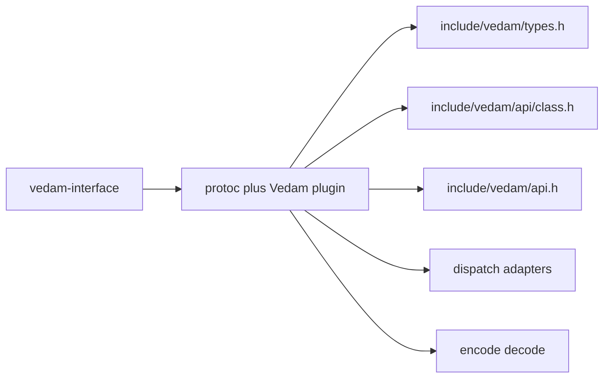

# 7. Proto layout and codegen

Public C headers are **generated**. Hand-edited `include/vedam/api/*.h` is a spec violation. App authors include `types.h` and the class headers they need; they do not select a transport in those headers.

This chapter specifies the **contract**. It does not name analogue switch-ASIC C APIs.

---

## 7.1 Source of truth

The public contract is the **[vedam-interface](https://github.com/ltbhappyness/vedam-interface)** repository. The C tree mounts it as `proto/`. Application authors clone that repository; they do not need the C sources.

```
vedam-interface/vedam/
  types.proto          # keys, attribute structures, errors, event envelope
  system.proto         # System class — Create starts the instance
```

Further class files (`event.proto`, `identity.proto`, and the rest) are added there as each slice is designed. There is no `chanting.proto` in the node contract: chanting is a separate application.

Each class proto may mark `implicit_create` so the generator **omits** Create from that class header. Wire servers may still expose the four verbs and return unimplemented / failed precondition (“exists after System create”).

**One message, many transports.** The same protobuf bytes travel in-process, on POSIX MQ, in shm, on gRPC, and on libp2p. Codec: protobuf-c and/or nanopb (small devices) — choice is an [open question](../governance/open-questions.md); both may ship.

---

## 7.2 Codegen pipeline

CMake runs `protoc` plus **`tools/codegen/protoc-gen-vedam-api`**:



| Output | Content |
|--------|---------|
| `include/vedam/types.h` | Keys, attr maps, error codes, event envelope |
| `include/vedam/api/<class>.h` | Per-class function tables; Create omitted where implicit |
| `include/vedam/api.h` | Umbrella include |
| Adapters | In-process function pointers; MQ length-prefix; shm ring; gRPC stubs; libp2p framing |
| Codec | Encode/decode the **same** messages |

Headers are a **CMake custom command**. Checked-in generated copies, if any, must match a clean configure.

Research backing (not analogue names): `protoc` custom plugins; protobuf-c / nanopb; gRPC bidirectional watch streams for Notify.

---

## 7.3 Key, attributes, errors

Every object is addressed by a **key** (class + identifier bytes). **Attributes** are typed fields on that key. CRUD is key-based:

| Verb | Meaning |
|------|---------|
| **Create** | Allocate a new key (rejected if implicit) |
| **Read** | Return attrs (and handles) for a key |
| **Update** | Patch attrs; upsert where the class says so |
| **Delete** | Tear down (System Delete unloads the instance) |
| **Notify** | Stream of attr/lifecycle events for a watch key |

Errors are typed in `types.proto` (not errno soup): not-found, exists, unimplemented-create, failed-precondition, capability-denied, offline, thermal-shed.

Expected states may appear as comments in generated headers. Full state machines: [Module inventory](../modules/inventory.md).

---

## 7.4 Transport independence

`System.Create` / bind selects the transport **plugin**. Class functions stay:

```
vedam_status_t vedam_<class>_<verb>(vedam_object_t key, ...);
```

No `grpc_` prefix in the public class API. Adapters fill the table.

---

## 7.5 Versioning

`tx_version` / proto package version on the wire. Validators advertise `protocol_version`. Overlap windows: [Engineering](../engineering/engineering.md). Dual decoders for N and N−1 during rolling upgrade.
