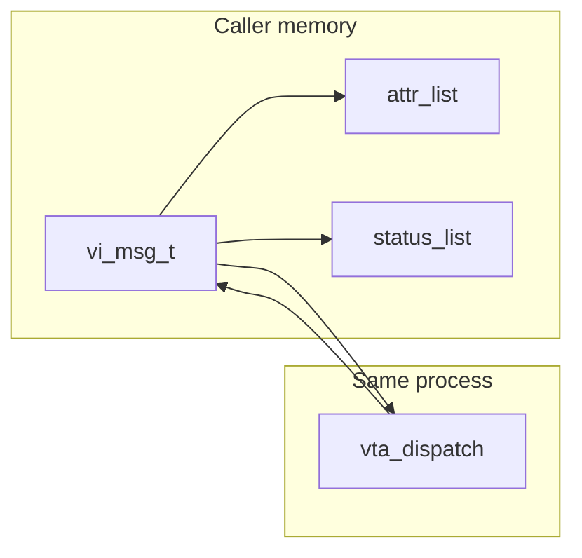
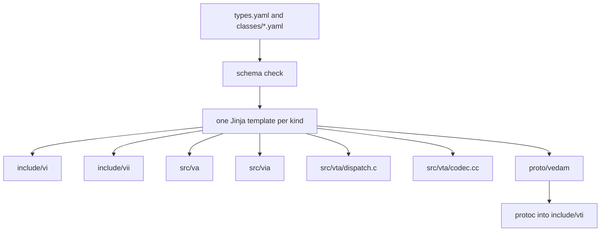
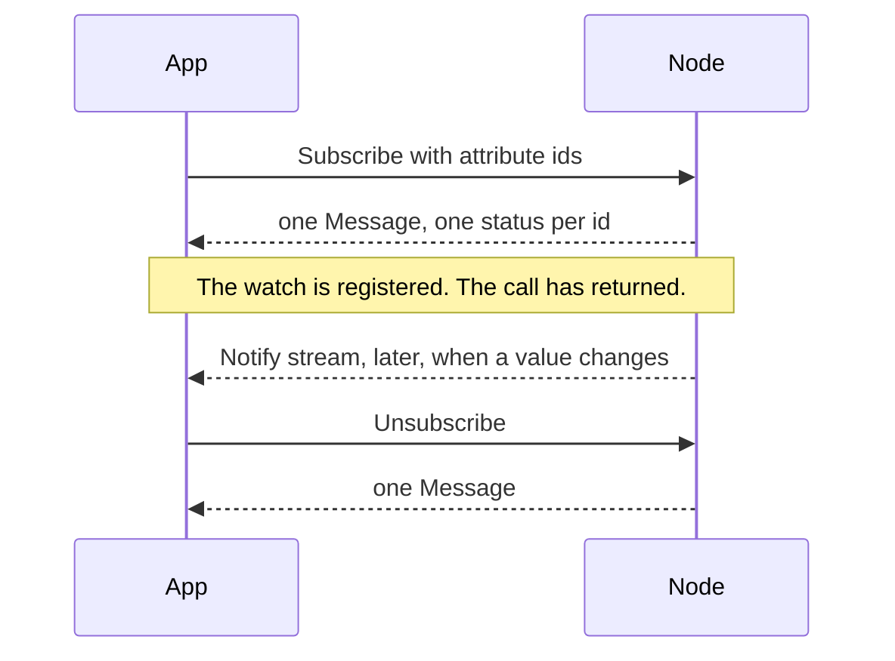

# 7. Proto layout and codegen

Public C headers and the published messages are **generated**. Hand-editing `include/vi/` or `proto/vedam/` as the contract is a spec violation. An application includes `vi/types.h`, `vi/vedam.h`, and the vertical headers it needs. Those headers do not name a transport.

This chapter is the contract and the generator for the northbound node that ships now. A later vertical is a new YAML file, not a new template.

**Protobuf** here means a compact, typed encoding of a message that another language can compile. Vedam uses it for the bytes that leave the process. The C call inside the process does not encode those bytes.

---

## 7.1 One call

Every public verb takes one `vi_msg_t` and writes the reply into that same object.

| Field | What the caller sets | What comes back |
|-------|----------------------|-----------------|
| `key` | Object key, or empty when the vertical has one object | Unchanged on a local call. A peer copies the key into its own buffer. |
| `key_len` | Length of `key`, or 0 | Same rule as `key` |
| `attr_count` | How many attributes are in the list | May shrink to the number the peer understood |
| `attr_list` | Each entry’s id, and a value when the verb writes | Filled values for a get |
| `status_list` | One slot per attribute, same length as `attr_list` | One result per attribute |

The node visits every attribute. It does not stop at the first failure. The function’s return value is success only when every slot succeeded. Otherwise it is the first failure. Each slot still holds its own result.

Duplicate ids in one list keep the **last** entry before the checks run.

The same shape is the published `Message` in `proto/vedam/types.proto`. `key` is the object key. `attrs` is the list. Each `Attr` has an id, a value, and a status. `status` on the message is the overall result. `Attr.id` is a number. The caller sets it to a value from that vertical’s attribute enum (`SystemAttr`, `IdentityAttr`, and so on). The enum is the contract. A comment is not a substitute for the name.

A queue or a network call encodes that object once into a buffer the connection already owns, and writes the reply back into the same object. The other process builds its own `vi_msg_t`. The caller’s address is not sent.

---

## 7.2 Source of truth

YAML under `vedam/tools/codegen/` is checked, then rendered by Jinja.

| Path | Role |
|------|------|
| `tools/codegen/schema/vedam.yaml` | Allowed shapes |
| `tools/codegen/src/types.yaml` | Status codes and the vertical registry |
| `tools/codegen/src/classes/<name>.yaml` | One vertical: key rule, enums, verbs, attributes |
| `tools/codegen/templates/c/*.j2` | C headers and thin bodies |
| `tools/codegen/templates/cxx/codec.cc.j2` | Encode and decode used by the queue and by HTTP |
| `tools/codegen/templates/proto/*.j2` | Published messages |

The generator writes `proto/vedam/`. That directory is the `proto/` submodule, published as [vedam-interface](https://github.com/ltbhappyness/vedam-interface). The C tree compiles those files. It does not keep a second copy under `generated/proto/`.

Each class file lists:

- whether the vertical has one object (`singleton`) or many objects addressed by `key`
- `uuid_lines`: major, minor, and the commit that opened that line
- enums and structs that belong to that vertical
- verbs, each public or internal
- attributes: a stable id, a type, visibility, and flags

Adding a vertical is a new YAML file plus a row in `types.yaml`.

---

## 7.3 What the generator writes

CMake runs `python3 tools/codegen/generate.py` when YAML or templates change. The script checks the schema, then writes into the source tree.

| Output | What an author finds there |
|--------|----------------------------|
| `include/vi/types.h` | Status codes, the value union, `vi_msg_t`, and the Vedam namespace id |
| `include/vi/vedam.h` | `vedam_init` and `vedam_deinit` |
| `include/vi/class/<name>.h` | Public enums, public attribute ids, the latest 16-byte id, and `vi_<name>_get`, `subscribe`, `unsubscribe` |
| `include/vii/class/<name>.h` | Every supported id line, indexed by major and minor, and the internal verbs |
| `src/va/<name>.c` | The public verb. It stores the caller’s `vi_msg_t` on a local call and dispatches. |
| `src/via/<name>.c` | Checks, then `vlib_<name>_*` |
| `src/vta/dispatch.c` | A table of class and verb, filled at init |
| `src/vta/codec.cc` | One encode and one decode for the queue and for HTTP |
| `proto/vedam/types.proto` | `Message`, `Attr`, `Status`, and the namespace id |
| `proto/vedam/<name>.proto` | That vertical’s enums, its attribute enum, and Get, Subscribe, Notify, Unsubscribe |

Install ships `include/vi` only.

---

## 7.4 Verbs

| Verb | Who calls it | What it does |
|------|----------------|--------------|
| **get** | Public | Fill values for the ids in the list. |
| **subscribe** | Public | Register a watch for ids that allow subscribe. The call returns once. It does not stream. |
| **unsubscribe** | Public | Stop watches for those ids. An empty list stops every watch for that caller. The call returns once. |
| **notify** | The node, toward a registered watcher | The stream of later changes. It is a public message so another language can wait on it. The C header does not offer it as something an application calls to push. |
| **create** | Internal | Bring the object up. Not in the public header in this generation. |
| **set** | Internal | Change attributes that allow set. Not in the public header in this generation. |
| **delete** | Internal | Tear the object down. Not in the public header in this generation. |

The node does not yet push that Notify stream. Library bodies return success and do not store subscribers. The message file still names Notify so the contract is visible before the delivery exists.

---

## 7.5 Attributes and flags

An attribute id is a small integer that never changes meaning. The public header has `VI_<VERTICAL>_ATTR_<NAME>`. The message file has the same number as `<Vertical>Attr.<VERTICAL>_ATTR_<NAME>`. A caller in another language uses the enum. A caller in C uses the header constant. They are the same number.

Flags on a public attribute, in plain language:

| Flag | What a caller may do |
|------|----------------------|
| Read only | Do not send a new value. A get fills it. |
| Subscribable | Subscribe and Unsubscribe may name this id. Notify may carry it later. |
| Create only | Only create may write it. |
| Set only | Set may write it. |
| Create and set | Create and set may write it. |
| Mandatory on create | Create must include this id. |
| Key | This id is the object key. `Message.key` carries the same bytes. |

Internal attributes stay out of `include/vi` and out of the published message file. An external call that names one is rejected.

---

## 7.6 Identity of a vertical

Vedam’s own verticals form a 16-byte id as UUID version 5. UUID version 5 is a standard way to mix a fixed namespace and a name into 16 bytes that do not change if the name does not change. The namespace is itself version 5 of the DNS name `vedam.net`. The name is `vertical/major/minor/commit`. The commit is the constant that opened that major and minor. A later line does not rewrite it.

`types.proto` stores that namespace as the file option `namespace_uuid`. Each vertical file stores its own id as the service option `vertical_uuid`. The public C header publishes the latest 16 bytes as `vi_<name>_uuid`. Older supported lines stay in the internal header, indexed by major and minor, until that line is removed.

A local call does not carry those 16 bytes. It uses the class index and the latest major and minor. A queue or HTTP message carries the 16 bytes once, at the edge. The node hashes them at start-up into class, major, and minor.

The commit of a running build is the System attribute `RELEASE_COMMIT`. It is for a person to read. It is not part of the id.

Another author may use the same recipe with their own domain, or may publish 16 bytes chosen another way. The node only rejects an id that is already loaded.

---

## 7.7 Status

Status codes live in `types.yaml` and in `Message`. Each attribute has `Attr.status`. The message has `status` for the overall result. `vedam_status` on the status message carries the library code, including the indexed forms that say which attribute failed. A codec must not collapse every failure into one generic code.

---

## 7.8 Why the generator is shaped this way

One template per kind means the thousandth vertical does not grow a hand-written switch or a hand-written message file. The hot path after init is an index: class, then verb. The attribute enum is data, so an application does not scrape a comment for a number. The in-process path does not encode, because the caller already holds the only copy of the list. Encoding happens once, at the door that leaves the process.

---

## 7.9 Per-vertical chapters

A chapter for one vertical states purpose, whether it has one object, its types, its attribute enum, its verbs, and the walk from the public header to the library. [System class](./system.md) is that chapter for System. [API classes](./api-classes.md) names the other verticals that exist in this tree, and the ones that do not yet.
