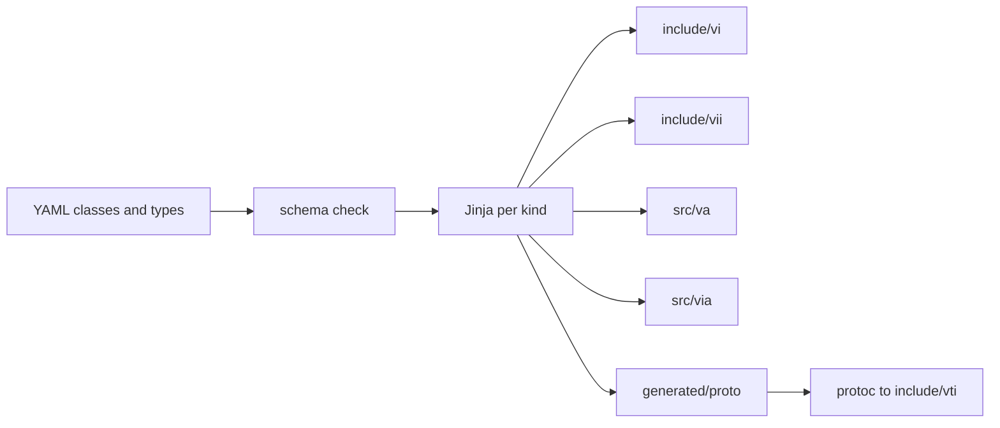

# 7. Proto layout and codegen

Public C headers are **generated**. Hand-editing installed headers under `include/vi/` as the contract is a spec violation. Application authors include `vi/types.h`, `vi/vedam.h`, and the class headers they need. They do not select a transport in those headers.

This chapter specifies the **contract and the generator**. It does not freeze every future class attribute before that class’s YAML exists.

---

## 7.1 Source of truth

For the C node, the source of truth is **YAML under `vedam/tools/codegen/`**, checked by a schema, then rendered by Jinja templates.

| Path | Role |
|------|------|
| `tools/codegen/schema/vedam.yaml` | Allowed shapes for types and classes |
| `tools/codegen/src/types.yaml` | Shared status codes, primitive aliases, the class registry |
| `tools/codegen/src/classes/<name>.yaml` | One file per API class (System is first) |
| `tools/codegen/templates/c/*.j2` | Headers and thin C bodies |
| `tools/codegen/templates/proto/*.j2` | Wire `.proto` files |

Protobuf remains the **wire encoding**. Generated `.proto` files live under `generated/proto/` in the C tree. The public **[vedam-interface](https://github.com/ltbhappyness/vedam-interface)** repository is the copy application authors clone when a message change is ready for them. The C tree does not wait on that publish to build. After an interface release lands, both trees should name the same bytes.

```
tools/codegen/src/
  types.yaml
  classes/system.yaml
generated/proto/vedam/
  types.proto
  system.proto
include/vi/…          # public, installed
include/vii/…         # full API, not installed
src/va/, src/via/     # generated thin bodies
include/vti/…         # protoc C++ for codecs (compile only)
```

Each class YAML lists enums, structs, verbs (public or internal), and attributes with ids, types, visibility, and flags. Adding a class is a new YAML file plus a row in `types.yaml`, not a fork of the System templates.

---

## 7.2 Codegen pipeline

CMake runs `python3 tools/codegen/generate.py` as a custom command when YAML or templates change. The script validates, then writes into the source tree (committed outputs stay in sync with a clean configure).



| Output | Content |
|--------|---------|
| `include/vi/types.h` | Status codes, attribute value union, shared types |
| `include/vi/vedam.h` | `vedam_init` / `vedam_deinit` |
| `include/vi/class/<name>.h` | Public enums, structs, attribute ids, public verbs |
| `include/vii/types.h` | Origin, class id, verb id, `v_transport_t` / ops |
| `include/vii/class/<name>.h` | Full attribute ids and internal verbs |
| `src/va/<name>.c` | Thin `vi_*` → `vii_*` with external origin |
| `src/via/<name>.c` | Contract checks then `vlib_*` |
| `src/via/meta.h` | Flag and type-kind tables for VIA |
| `generated/proto/…` | Messages for get / subscribe style RPCs |
| `include/vti/…` | C++ protobuf sources for pack and HTTP paths |

Headers carry a generated banner and Vedam copyright. Function and type comments use Doxygen `@brief` so editors and later doc tools can read them.

---

## 7.3 Verbs, attributes, and status

Every object is addressed by **class** and an **attribute list**. Callers pass an array of `{ id, value }`. Duplicate ids collapse to the **last** entry before checks run.

| Verb | Meaning in this era |
|------|---------------------|
| **create** | Bring up the object (often internal; System create is not in the public header) |
| **get** | Fill values for the attribute ids in the list (replaces older “read” wording) |
| **set** | Patch attributes that allow set |
| **delete** | Tear down the object |
| **subscribe** | Watch attributes marked subscribable |
| **unsubscribe** | Stop watches for the same caller |
| **publish** | Push changed attributes to current subscribers (internal) |

Attribute **flags** (VIA) include mandatory-on-create, create-only, read-only, set-only, key, and subscribable. Public visibility hides internal ids from VI headers and from external-origin checks.

**Status** values are typed in `types.yaml` (success, uninitialized, not implemented, unknown attribute indexed from a base, invalid value indexed from a base, and so on). They are not a pile of raw `errno` values.

---

## 7.4 Transport independence

`vedam_init` (or a later bind) selects transport **ops tables**. Class functions stay:

```
v_status_t vi_<class>_<verb>(…);
v_status_t vii_<class>_<verb>(v_origin_t origin, …);
```

There is no `grpc_` prefix in the public class API. Adapters under `src/vta/` fill `v_transport_ops_t` (open, close, connect, listen, call, subscribe, unsubscribe, publish).

Environment variables choose which ops and addresses to use at init. Compile-time defconfig macros will later gate optional sources; today every transport stub still builds. See [Transport and datastore](./transport-datastore.md) and the implementation `config/README.md`.

---

## 7.5 Versioning

`PROTOCOL_VERSION` on System reports the agreed message era for the node (this era: major 0, minor 1). Wire packages carry proto package version. Overlap windows for rolling upgrade: [Engineering](../engineering/engineering.md). Dual decoders for N and N−1 remain the direction when a second era ships.

---

## 7.6 Per-class documentation pattern

Each class gets a Part III chapter (or section) that follows the same template:

1. Purpose and singleton rules
2. Types (enums and structs)
3. Attributes (id, type, public or internal, flags)
4. Verbs (who may call; public header or not)
5. Layer walk (VI → VA → VII → VIA → VLIB → transports)
6. Mission defaults that this class must not violate

**System** is the first filled chapter: [System class](./system.md). Remaining classes stay listed in [API classes](./api-classes.md) until their YAML lands.
