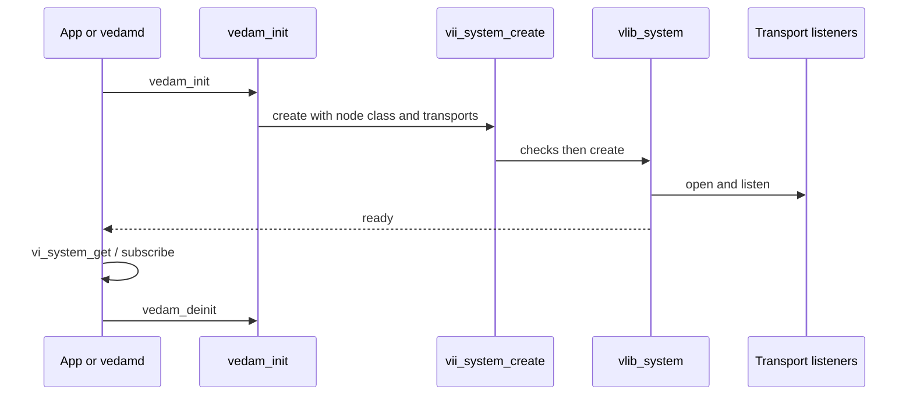

# 8. System class

System is the **first API class**. It is the process-wide door to the node. Other classes will make the node useful; several will have no public create because System create implied them.

Public header (generated): `include/vi/class/system.h`.  
Full header (generated): `include/vii/class/system.h`.  
Library body (hand-written): `src/lib/system.c`.  
YAML source: `tools/codegen/src/classes/system.yaml`.

Application code calls `vedam_init` / `vedam_deinit` and then the public System verbs. It does not call `vii_system_create` itself.

---

## 8.1 Purpose

One System object exists per process. Create builds it, starts the selected transport listeners, and leaves the node ready for get and subscribe. Delete stops listeners and frees the object. Get and subscribe are how an account owner or a local helper learns health without becoming a landlord over other subjects’ data.

System create does **not** enrol the device in a training swarm, does **not** turn on a ranking service, and does **not** make sharing the default.

---

## 8.2 Types

### Node class

`vi_system_node_class_t` names the role of this process. It is chosen at create and is read-only afterward.

| Enumerator | Meaning |
|------------|---------|
| Unspecified | No role has been chosen (invalid for a live node). |
| A | Archive. Keeps a full copy of agreed history. |
| B | Full check of agreed history. |
| C | Light operator. Default for this process in the first slice. |
| D | Small gateway. |
| E | Thin client. |

### Operational state

`vi_system_state_e` sits inside `vi_system_state_t` (with reserved room for later fields).

| State | Meaning |
|-------|---------|
| Starting | Create has begun; get is not ready. |
| Ready | Transports are up; get and subscribe are allowed. |
| Degraded | The process is up with a reduced set of transports. |
| Draining | The process is finishing work and will stop. |
| Dead | The process has stopped; get returns uninitialized. |

---

## 8.3 Attributes

Callers pass a list of `{ id, value }`. For state attributes the caller supplies storage through `value.ptr`. Duplicate ids keep the last entry.

### Public attributes

| Id | Name | Type | Flags | Meaning |
|----|------|------|-------|---------|
| 1 | `NODE_CLASS` | `vi_system_node_class_t` | Read-only | Role of this process. |
| 2 | `PROTOCOL_VERSION` | `v_version_t` | Read-only, subscribable | Agreed message version (this era: 0.1). |
| 3 | `SYSTEM_STATE` | `vi_system_state_t` | Read-only, subscribable | Starting, ready, degraded, draining, or dead. |

### Internal attributes (create-only)

| Id | Name | Type | Meaning |
|----|------|------|---------|
| 4 | `LOCAL_TRANSPORT` | `v_transport_t *` | In-process ops (same thread as the caller). |
| 5 | `IPC_TRANSPORT` | `v_transport_t *` | Local IPC ops (POSIX message queue by default; Unix-socket HTTP is the other option). |
| 7 | `REMOTE_TRANSPORT` | `v_transport_t *` | Remote ops (gRPC-style HTTP on TCP in this slice; Connect may replace ops later). |

Internal ids never appear in the public header. An external-origin get of those ids fails as not supported.

On create, `NODE_CLASS` is **mandatory**. Missing it returns mandatory-attribute-missing.

---

## 8.4 Verbs

| Verb | Public header? | Origin | Behaviour |
|------|----------------|--------|-----------|
| **create** | No | Internal only | Allocate the singleton, copy transport slots, open and listen, set state to ready. |
| **get** | Yes | External or internal | Fill values for the listed public (or, when internal, full) attribute ids. |
| **set** | No | Internal only | Reserved for hot fields later; external set is not implemented. |
| **delete** | No | Internal only | Stop transports and free the singleton (`vedam_deinit`). |
| **subscribe** | Yes | Either | Watch attributes marked subscribable. |
| **unsubscribe** | Yes | Either | Stop watches for the same caller; empty list clears all. |
| **publish** | No | Internal | Fan out changed attributes on transports that hold subscribers. |

Older drafts used the word **read**. The generated API uses **get**.

---

## 8.5 Layer walk for this class

### VI — public surface

`vi_system_get`, `vi_system_subscribe`, and `vi_system_unsubscribe` live in `include/vi/class/system.h`. Applications include only `vi/`.

### VA — thin forward

Generated `src/va/system.c` calls the matching `vii_*` with `V_ORIGIN_EXTERNAL`.

### VII / VIA — contract

Generated `src/via/system.c` implements `vii_system_*`. It collapses duplicate attribute ids, rejects unknown ids, rejects internal ids for external origin, enforces flags (read-only, create-only, subscribable, mandatory-on-create), checks pointer requirements for state gets, then calls `vlib_system_*`.

### VLIB — object state

`src/lib/system.c` owns `vedam_t`: node class, operational state, three transport slots and their address strings. Create starts each non-null ops table (`open` then `listen`). Get fills from that structure. Publish fans out to local, IPC, and remote publish hooks. Delete stops transports and frees the node.

### Init

`vedam_init` in `src/core/init.c` builds the three transport attribute values from environment defaults, calls `vii_system_create` with internal origin, and leaves the node ready. `vedam_deinit` calls delete.

### Transports (VTA)

| Slot | Default ops | Default address |
|------|-------------|-----------------|
| Local | In-process | (none; same thread) |
| IPC | POSIX message queue | `/vedam.system` |
| Remote | Temporary gRPC-style HTTP/1.1 + protobuf | `0.0.0.0:50051` |

Selection is by environment today (`VEDAM_TRANSPORT_*`). Compile-time defconfig gates come next. Official gRPC C++ and Connect/QUIC are planned replacements for the temporary HTTP path; Connect listen already succeeds as a stub.

### Platform

Libraries and transports call `vplatform_*` (memory, string, thread, sleep, message queue, env, process). Operating-system headers stay under `src/platform/posix/`.

### Wire (VTI)

Generated protobuf types under `include/vti/` encode get requests and responses for the temporary HTTP path and the message-queue pack helpers. Application install trees do not ship these headers.

---

## 8.6 Bring-up

A second process on the same machine may attach over IPC or remote without calling create. Native mobile and **vedamd** call `vedam_init` in-process.

---

## 8.7 Mission-hardening defaults on System

| Concern | Default in this slice |
|---------|------------------------|
| Ranking | Absent (no API) |
| Compute swarm | Off (no enrolment on create) |
| Sharing | Not a create default |
| Encryption / quiet-hours / upgrade consent | Specified for later attributes; not yet all present on System |
| Offline | Create and local get succeed without the public internet |

---

## 8.8 References

[High-level architecture](../architecture/high-level-architecture.md) · [Proto layout and codegen](./proto-codegen.md) · [Transport and datastore](./transport-datastore.md) · [Mission-hardening](../foundations/mission.md#mission-hardening-on-the-platform)
