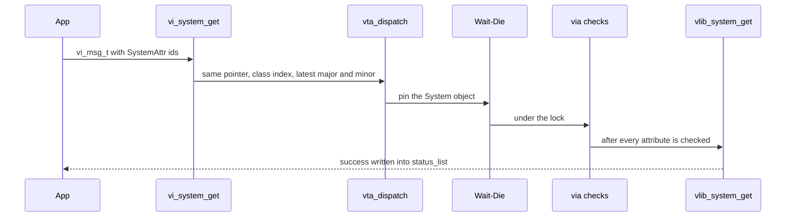
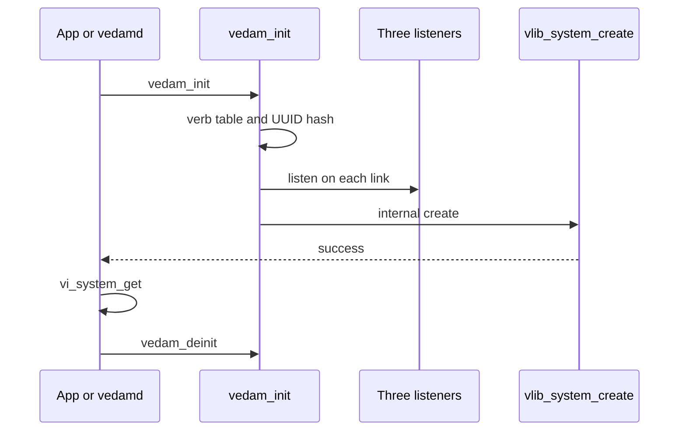

# 8. System class

System is the first vertical. It is the process-wide object for the node. Other verticals become useful after this object exists. Several of them have no public create, because starting the node already brought them up.

Public header: `include/vi/class/system.h`.  
Internal header: `include/vii/class/system.h`.  
Library body: `src/lib/system.c`.  
YAML: `tools/codegen/src/classes/system.yaml`.  
Messages: `proto/vedam/system.proto`.

An application calls `vedam_init` and `vedam_deinit`, then the public System verbs. It does not call create itself.

---

## 8.1 Purpose

One System object exists per process. `key` is empty and `key_len` is 0.

`vedam_init` chooses the three links, starts their listeners, and runs an internal create. That create returns success. It does not yet store node class or version. Get therefore must not be treated as proof of a stored version until the library body is written. Delete is internal and, today, returns success without tearing the listeners down by itself. `vedam_deinit` stops the listeners.

System does not enrol the device in a training swarm, does not turn on a ranking service, and does not make sharing the default.

---

## 8.2 Types

### Node class

`vi_system_node_class_t` in C, and `SystemNodeClass` in the message file, name the role of this process.

| Value | Name | Meaning |
|-------|------|---------|
| 0 | Unspecified | No role has been chosen. |
| 1 | A | Archive. Keeps a full copy of agreed history. |
| 2 | B | Full check of agreed history. |
| 3 | C | Light operator. Default for this process. |
| 4 | D | Small gateway. |
| 5 | E | Thin client. |

### Operational state

`vi_system_state_e` names the operational state. `vi_system_state_t` holds that value plus reserved room. A C get of `SYSTEM_STATE` requires the caller to set `value.ptr` to storage they own. On the wire the same attribute is `Attr.value.blob`. A caller in another language treats those bytes as opaque until a named field replaces them.

| Value | Name | Meaning |
|-------|------|---------|
| 0 | Unspecified | State has not been set. |
| 1 | Starting | Create has started. Get is not ready. |
| 2 | Ready | The doors are up. Get and subscribe are allowed. |
| 3 | Degraded | The process is up with a reduced set of doors. |
| 4 | Draining | The process is finishing work and will stop. |
| 5 | Dead | The process has stopped. Get returns uninitialized. |

---

## 8.3 Attributes

The enum `SystemAttr` is the contract. C headers use the same numbers with the prefix `VI_SYSTEM_ATTR_`.

| Id | Enum | Type | Flags | Meaning |
|----|------|------|-------|---------|
| 1 | `SYSTEM_ATTR_NODE_CLASS` | Node class, as `value.s32` | Read only | Role of this process. |
| 2 | `SYSTEM_ATTR_PROTOCOL_VERSION` | `value.version` | Read only, subscribable | Agreed message version. This era reports major 0 and minor 1 when a body stores it. |
| 3 | `SYSTEM_ATTR_SYSTEM_STATE` | Caller pointer in C; `value.blob` on the wire | Read only, subscribable | Starting, ready, degraded, draining, or dead. |
| 4 | `SYSTEM_ATTR_RELEASE_COMMIT` | `value.text` | Read only | Commit of the running build, for a person to read. Not part of the vertical id. |

The three doors are not System attributes. The node keeps them by link index: in-process, same machine, and network.

An external get of an id that is not public fails. The failure is written in that attribute’s status slot. The walk continues.

---

## 8.4 Verbs

| Verb | Public C header | Message file | What happens now |
|------|-----------------|--------------|------------------|
| **create** | No | No | Internal. `vedam_init` calls it. The body returns success. |
| **get** | Yes | Yes, one reply | Fills the listed ids when a body exists. Today the body returns success and does not write values. |
| **set** | No | No | Internal. External set is rejected when the attribute is read only. |
| **delete** | No | No | Internal. |
| **subscribe** | Yes | Yes, one reply | Registers a watch for subscribable ids. Returns once. |
| **unsubscribe** | Yes | Yes, one reply | Stops those watches. An empty list stops every watch for that caller. Returns once. |
| **notify** | No | Yes, a stream | Later changes for a registered watch. The node does not push the stream yet. |

---

## 8.5 Layer walk

### Public surface

`vi_system_get`, `vi_system_subscribe`, and `vi_system_unsubscribe` take `vi_msg_t *`. They set `key` to empty because System has one object. They do not pack.

### Thin forward

`src/va/system.c` builds a small call record: class, external origin, verb, latest major and minor, and the caller’s `vi_msg_t`. It calls `vta_dispatch`. There is no second hop through a local transport helper.

### Contract

`src/via/system.c` requires `attr_list` and `status_list` together when the count is not zero. It checks every attribute, writes `status_list[i]`, and remembers the first failure. Checks cover unknown ids, attributes hidden from external callers, read-only on set or create, create-only, set-only, and subscribe on an id that is not subscribable. A get of the state attribute requires `value.ptr`. Then it calls `vlib_system_*`.

### Library

`vlib_system_*` returns success. It does not store node class, version, state, or the release commit yet. It does not keep a subscriber list. Those bodies are the next slice, not a hidden behaviour of this one.

### Init

`vedam_init` allocates the node, fills the verb table, builds the UUID hash, selects the three operations tables, listens, and runs internal create. `vedam_deinit` runs internal delete and closes the listeners. Defaults:

| Variable | When unset |
|----------|------------|
| `VEDAM_TRANSPORT_LOCAL` | `inproc` |
| `VEDAM_TRANSPORT_IPC` | `mq`, queue name `/vedam.<pid>` |
| `VEDAM_TRANSPORT_IPC` as `grpc_uds` | `/tmp/vedamd.<pid>.sock` |
| `VEDAM_TRANSPORT_REMOTE` | temporary HTTP, `127.0.0.1:0` |

The process id and the ephemeral port keep two nodes on one machine from sharing a name.

### Locks

The dispatch takes a Wait-Die lock on the System object for the duration of the library call. A hit does not allocate. The lock is not held across a queue write or a network wait. Attribute locks are a dense array by id after the catalog check.

### Wire

The queue and the temporary HTTP path share one codec. It encodes `vi_msg_t` into a buffer owned by the connection, and decodes into a `vi_msg_t` the peer owns. The five-byte length prefix sits at the front of that buffer. It is not a second copy of the body.

---

## 8.6 Bring-up

A second process may attach over the queue or over HTTP without calling create. The phone app and **vedamd** call `vedam_init` in their own process.

---

## 8.7 Mission-hardening defaults on System

| Concern | Default in this slice |
|---------|------------------------|
| Ranking | Absent. There is no such attribute. |
| Compute swarm | Off. Create does not enrol the device. |
| Sharing | Not turned on by create. |
| Remote listen | Loopback, not every network interface. |
| Encryption, quiet hours, upgrade consent | Later attributes. Not on System yet. |
| Offline | Local get does not need the public internet. |

---

## 8.8 References

[High-level architecture](../architecture/high-level-architecture.md) · [Proto layout and codegen](./proto-codegen.md) · [Transport and datastore](./transport-datastore.md) · [Mission-hardening](../foundations/mission.md#mission-hardening-on-the-platform)
