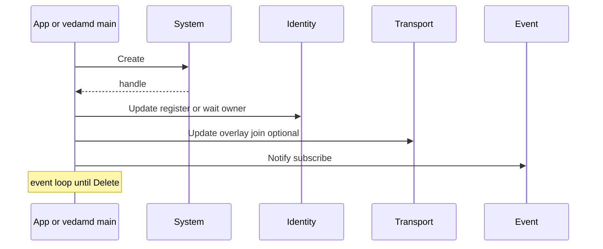

# 8. System class

Header: `include/vedam/api/system.h`. Generated from `system.proto`. **System is the first API class.** Other classes bring the node into useful running; several have no Create because System Create implied them.

---

## 8.1 Create

**Create(system)** is the only ordinary way to start an instance.

Inputs (attrs): defconfig path or in-memory profile, node class A–E, data directory, bind list (UDS / MQ / shm / gRPC / libp2p), plugin policy (mandatory set vs allow-optional).

Effects:

1. Construct the Event bus; register Event class.
2. Open datastore (git dirs, default repos).
3. Bind transport listeners from defconfig.
4. `dlopen` **mandatory** plugins; fail Create if a mandatory plugin is missing.
5. Probe capability profile (CPU, RAM class, thermal, optional GPU).
6. Device key material if none — **or** wait-for-owner (open).
7. Stubs: empty profile, wallet stub, public-content root, Locate index so later Read/Update succeed.
8. Return a system key / handle.

Does **not**: enrol compute collectives; enable ranking (there is no ranking class); share content; auto-apply upgrades (policy attr, default consent on personal devices).

Local-first: Create succeeds **offline**. Overlay join is a later Update on transport / network plugins.

---

## 8.2 Read, Update, Delete, Notify

| Verb | Returns / does |
|------|----------------|
| **Read** | Health, node class, capability profile, plugin list, quiet-hours, upgrade policy, bind addresses |
| **Update** | Defconfig hot fields, quiet-hours, upgrade-consent, and optional plugins by **registered identifier** (`load_plugin_id` / `unload_plugin_id`). The string is a name such as `overlay`, never a filesystem path. Only the process that called Create, or a caller with a grant from the account owner, may load plugins. |
| **Delete** | Unload plugins, close listeners, flush WAL policy, tear down the instance |
| **Notify** | Lifecycle (starting, ready, draining, dead), capability-change, thermal shed, plugin load/fail — as **events** |

---

## 8.3 Implied objects

| Object | After Create | Create on its class? |
|--------|----------------|----------------------|
| Event bus | Exists | No |
| Transport endpoints | Bound | No |
| Datastore / default git repos | Open | No |
| Capability profile | Probed | No |
| Plugin loader | Running | Plugin Create is for **install**, not the loader |
| Device key | If policy says so | Identity Create for new chapters / extra subjects |
| Profile / wallet stubs | Empty | No |
| Locate index | Empty | No |

Identity **registration** (nullifier, root Subject) is an Identity **Update** (or a rare Create of a new chapter), not implied as “already a person on the network.”

---

## 8.4 Bring-up after Create

Typical **embed** after Create (`vedamd` or a native app in another repository — same calls):

A web page or other **attach** client does **not** call Create: it binds to an instance that already exists and then Read/Update/Notify on other classes. Native mobile **does** call Create.

---

## 8.5 Mission-hardening defaults on System

| Attr | Default |
|------|---------|
| Encryption at rest / E2E | On |
| Quiet-hours | On (account owner may tighten) |
| Ranking | Absent (no API) |
| Compute swarm | Off |
| Upgrade | Consent required on personal / Class C–E; operator may set auto-apply on A/B builders |
| Sharing | Not a Create default |

---

## 8.6 References

[High-level architecture](../architecture/high-level-architecture.md) · [Proto layout and codegen](./proto-codegen.md) · [Mission-hardening](../foundations/mission.md#mission-hardening-on-the-platform)
