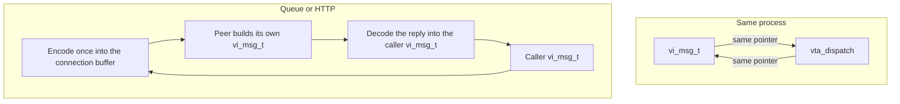
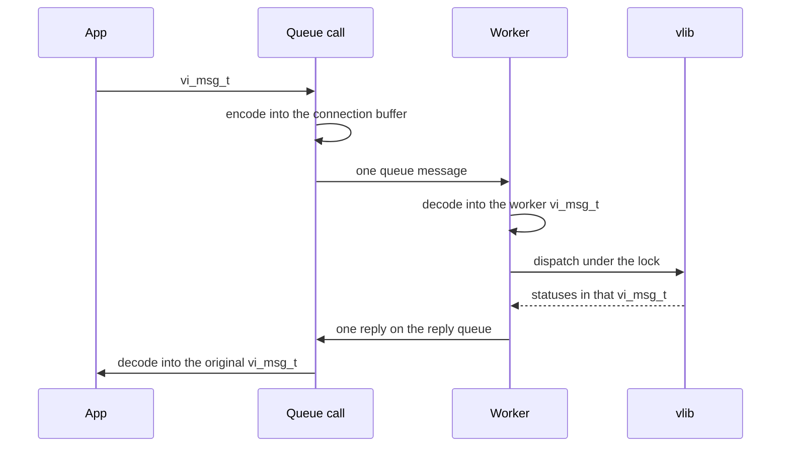

# 9. Transport and datastore

Transport, datastore, and offload sit **under** the generated class API. Application-facing headers do not mention them. A node starts three receivers. A class opens a sender only when it must reach another address.

---

## 9.1 Three links, one call

A **link** is one of three places a message can travel: inside the process, to another process on the same machine, or across a network. The node keeps one receiver and one operations table for each link. After start-up, code selects a link by index. It does not branch on the name.

A **descriptor** is a small socket. It holds a pointer to one operations table and a private area that table owns. The operations are open, listen, accept, connect, call, and close. Open makes an empty descriptor. Listen binds a receiver. Accept takes one caller. Connect dials once. Call carries one verb. Close drops the descriptor.

The verbs inside a call are create, get, set, delete, subscribe, unsubscribe, and notify. They are not extra operations on the descriptor.

**In-process.** There is no accept thread and no encode. `vi_*` stores the caller’s `vi_msg_t` on the call and dispatches. The function return is the reply.

**POSIX message queue.** Connect opens the peer queue for send and one private reply queue. Each call encodes into a buffer owned by that connection and names the reply queue. A worker, using memory allocated when it started, decodes into its own `vi_msg_t`, runs the verb, and writes one reply on the reply queue it already holds. It does not open a queue per call. The caller’s `vi_msg_t` is filled from the reply. The caller closes the descriptor when it is finished.

**Temporary HTTP.** This is not the gRPC C++ library. It is HTTP/1.1 on TCP, with a five-byte length prefix and a protobuf `Message`. Connect opens one TCP socket. Further calls on that descriptor reuse it. The listen side reads the next request on the same accepted socket. Encode writes the body at offset 5 and the length prefix in front of it. The reply is decoded from the buffer that was just read. A Unix-socket variant of the same bytes is the other same-machine choice. Connect over QUIC is a stub and does not open a socket.

**Forwarding.** A connected remote descriptor can carry the same `vi_msg_t` to another node: one encode, one write, one read, one decode. The object lock is not held across that wait. A peer overlay and a shared-memory ring are later. They use the same descriptor shape. They are not a second application interface.

Environment variables choose the adapter and the address (`VEDAM_TRANSPORT_LOCAL`, `VEDAM_TRANSPORT_IPC`, `VEDAM_TRANSPORT_REMOTE`, and the `_ADDR` forms). When they are unset, the in-process door is `inproc`, the same-machine door is a message queue named `/vedam.<pid>`, and the network door listens on `127.0.0.1:0`.

---

## 9.2 Datastore vtable (git)

Git provides **integrity**. Consensus chooses which commits are **final**. Git alone does not order transactions or tolerate Byzantine writers. This vertical is designed; it is not part of the System-only shipping slice.

| Op (conceptual) | Git meaning |
|-----------------|-------------|
| Put blob / tree / commit | libgit2 write |
| Read object by id | ODB read; verify hash |
| Pack / fetch | Replication unit (not per-message `git push` on the hot path) |
| Ref update | After finality or pending/`WAL` policy |

**Class E:** libgit2-in-WASM behind the same ops ([wasm-git](https://github.com/petersalomonsen/wasm-git) as a precedent, not a required dependency).

Storage **adapters** (local disk, peer, ciphertext-only cloud) plug under the ODB. Own-credentials invariant: a node never uses another subject’s storage credentials. Detail: [Module inventory](../modules/inventory.md).

---

## 9.3 Offload vtable (skeleton)

This generation specifies the **vtable only**: buffer, stream, completion Event. No DPDK, no RoCE, no production CUDA requirement. When a GPU is present, capability profile advertises it; Compute class may later bind an offload plugin. CPU-only remains mandatory.

---

## 9.4 Overlay versus local

Local transports never become a second API. Overlay join is a later update on network plugins, not a login gate for System get.

---

## 9.5 References

[System class](./system.md) · [Proto layout and codegen](./proto-codegen.md) · [High-level architecture](../architecture/high-level-architecture.md)
