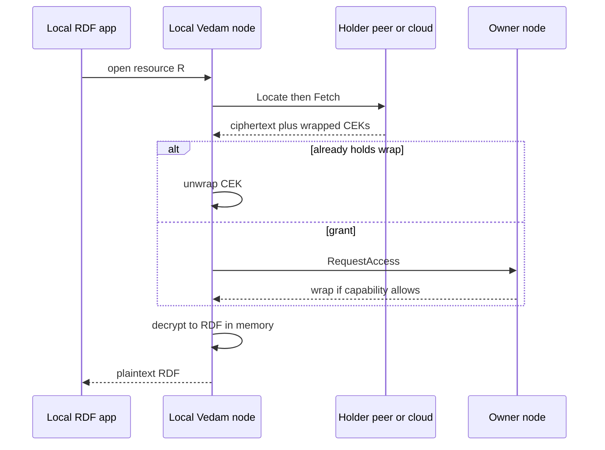
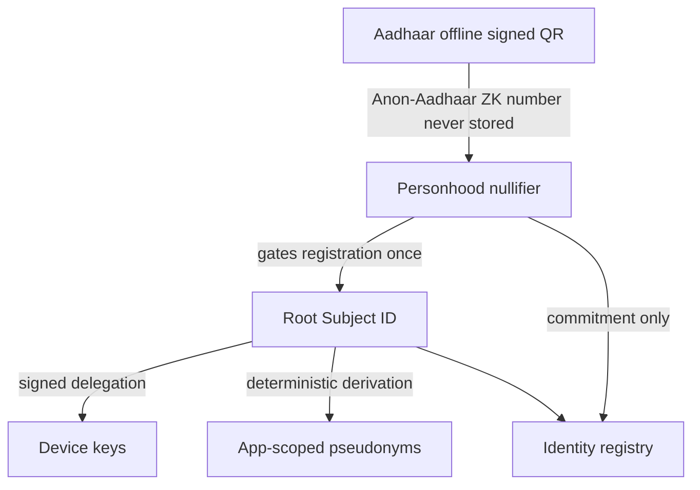
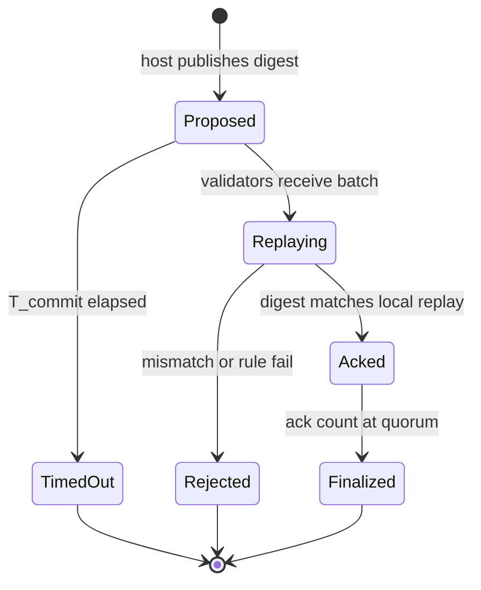
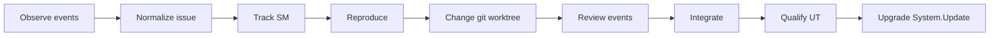

# 11. Module inventory

This part is the interior of the libraries. **vedamd** stays a small C daemon. Clusters match the high-level architecture blocks. Former numbered chapters on storage, network, consensus, execution, and data model live here.

NN generate / train / infer / distribute are **platform libraries**. Account-owner apps that *use* them come later; they are not a later phase of the daemon.

---

## 11.A Process and codegen

| Module | Owns |
|--------|------|
| **libvedam-core** | Process init, plugin table, capability probe, quiet-hours clock source |
| **event lib** | POSIX MQ + threads; register / post / subscribe (implementation of the Event class) |
| **dlopen loader** | Mandatory vs optional plugins; signature check hook |
| **thermal governor** | Advertise/shed; Events not files |
| **vedamd** | C daemon: optional daemonise, then `vedam_init`, wait, `vedam_deinit` |
| **codegen** | YAML and Jinja write the headers and `proto/vedam/` ([Proto layout and codegen](../interfaces/proto-codegen.md)) |

Mandatory plugin set is small so Class C–E stay first-class. Optional plugins (NN, cloud adapter, Ops adapters, GPU offload) load on capability and account-owner Update.

---

## 11.B Events (log)

The Event API class **is** the log. Persistence is optional git batches of envelopes. Notify subscribers. Feed Ops.

No `fopen` log file as the architecture. An early debug sink plugin may print events for humans; it consumes the bus.

Audience attrs are mandatory on events that leave an app boundary (summary-collapse mitigation). Unranked: no dwell or like fields.

---

## 11.C Transport, git datastore, adapters, offload

### Two storage planes

| Plane | Git repos | Holds | After finality |
|-------|-----------|-------|----------------|
| **Message** | Chapter / DM / Group per `app_id` | Encrypted RDF / blobs | Durable on host + A/B |
| **Ledger** | Protocol ledger | `finality_digest`, refs, tx metadata, nullifier-commitments, identity registry — **no plaintext** | Durable; validator authority |

Optional mirrors (GitHub, GitLab, Drive, OneDrive): **ciphertext only**; never truth.

### Object model

| Git object | Use |
|------------|-----|
| Blob | Ciphertext, public bytes, protobuf tx, plugin artifacts |
| Tree | Snapshot |
| Commit | **One message per commit (MVP)** on message plane; ledger commits anchor digests |
| Tag | Release / plugin versions (optional) |

**Definition (`finality_digest`).** Primary quorum value:

$$d = \text{SHA-256}(\text{canonical\_bytes}(\text{round\_hint}, \text{parent\_ref}, \text{tx\_canonical}))$$

Stored in ledger commit metadata. Peers compare $d$.

**Parent + nonce:** for nonce $N$ on repo $R$, parent must be the last **finalized** commit on $R$ with nonce $N-1$. Else reject before durable write.

### Encryption and envelopes

Any byte that may reach a third party is E2E encrypted. Per-resource **CEK**, wrapped once per authorized app-scoped pseudonym:

$$\{\, \text{enc}_{\text{CEK}}(\text{RDF}),\; \text{wrap}_{P_1}(\text{CEK}),\; \ldots,\; \text{wrap}_{P_k}(\text{CEK}) \,\}$$

No central key server. DM/group sessions: Double Ratchet / epoch keys.

### Storage adapters

| Adapter | Trust |
|---------|--------|
| local | Account-owner disk |
| peer | Replication |
| cloud | Untrusted ciphertext convenience |

**Own-credentials invariant.** A node uses only its own storage credentials, for only its own subject's data.

### Retrieve / decrypt

### Durability and WAL

Ledger persists **after quorum ack**. Live ledger in RAM/tmpfs; finalized objects on enough independent A/B peers. Mirrors are never durability authority.

| WAL state | Storage | Transition |
|-----------|---------|------------|
| pending | WAL | Accept from API |
| proposed | WAL + provisional git | Local commit |
| finalized | Durable git + ledger | Quorum ack |
| rejected | WAL + reason Event | Validation / quorum fail |

Clients learn **rejected** and **timed-out** via Event/Notify — not only success by observation.

### Replication

libp2p **batched** packs, not per-message push. Class A promisory pin.

### Per-class retention (summary)

| Class | Local store |
|-------|-------------|
| A | Broad pin / promisor |
| B | Full validation set |
| C | Partial clone |
| D | Recent refs / L3 anchors |
| E | No full git required; helper node or WASM libgit2 |

### Offload

Vtable skeleton only this generation.

Generated IPC adapters: [Transport and datastore](../interfaces/transport-datastore.md).

---

## 11.D Identity internals

Layers that must not be conflated:

| Layer | Identifier | Purpose |
|-------|------------|---------|
| Network | Node ID | libp2p peer |
| Personhood | Nullifier | One-time uniqueness; **not** a usable id |
| Subject | Root Subject ID (DID) | Accountable identity |
| Device | Device key | Delegated signing |
| Application | App-scoped pseudonym | Unlinkable per app |
| Ledger | Address / commitment / tx ref | Agreed metadata |

One subject may operate many nodes; one node may serve many subjects. **Account owner** holds the grant root for those keys ([Part V](../identity-security/external.md)).

**Personhood (India MVP):** Anon-Aadhaar-style ZK over offline RSA-signed QR. Number and biometrics never stored. Nullifier commitment rejects a second human registration. Pluggable non-India verifiers: open.

**SIOPv2:** self-issued login; DPoP-style PoP; no federated issuer fallback; no `id.vedam.net`.

**Registry:** Subject → `{root_pubkey, nullifier_commitment, device_delegations, revocations}`. Commitments and public keys only.

**Capabilities:** UCAN-style at the owner node; `acl:` vocabulary for description (SOLID interop); private **read** is key possession, not server willingness.

**Machines:** hardware attestation default. Software-resident agents: open uniqueness anchor.

Selective loss: CRAB on readable ciphertext; commitments remain hashes. Short note only — [Mission](../foundations/mission.md#memory-dignity-and-selective-loss).

---

## 11.E Tim-line data (RDF / HDT / Locate)

Data is **account-owner-owned and app-independent**. RDF triples + shared vocabularies. Not a clone of SOLID: no hosted issuer, no server-trust read.

| Payload | Encoding |
|---------|----------|
| Small / mutable | Turtle or RDF/CBOR |
| Large / static | HDT |
| Bulk binaries | Encrypted blob, IRI from RDF |

Pipeline: app content → RDF graph → encode → encrypt envelope → git via adapter → replicate ciphertext.

Query only over the **decrypted authorized set**. No global SPARQL over ciphertext.

Vocabularies: FOAF / vCard / schema.org; ActivityStreams + `chant:`; `acl:`; DID / WebID-**compatible** profile terms. Class D may expose an LDP/SOLID **gateway** without making Vedam depend on SOLID's centralizing pieces.

---

## 11.F Programmable rules (Tier A / B, wallet)

| Tier | What runs | Typical use |
|------|-----------|-------------|
| **A Native** | Host validators on envelope bytes | Chanting, ACL, identity, built-in transfers |
| **B WASM** | Sandboxed `.wasm` | Tokens, swaps, lending-style rules, composable calls between strangers |

Wallet sign/display is **client library**, not a contract.

On-chain code exists only when **strangers must trust rules, not a company server**. Layman cases (token, AMM, lending, atomic composability) inherit the former execution chapter: fixed rules can be Tier A; custom and composable rules are Tier B.

`vedam-tx` envelope fields: `tx_version`, `tx_kind` (`data` \| `native` \| `contract_call`), app/repo ids, sender, nonce, signature, `payload_hash`, optional `contract_id` / method / args, optional time / attestation hints.

Determinism = agreed order + identical replay. WASM runtime (Wasmtime vs WAMR) and composability ABI remain open.

Account-owner neural applications are **not** Tier B contracts; they are apps using cluster H libraries, optionally anchoring hashes.

---

## 11.G Network and consensus

**libp2p** transports bytes (QUIC/TCP, Noise, DHT, gossipsub). **gRPC** over those streams for API and validator control. libp2p does not finalize history.

Eclipse mitigation: Penrose / $\mathbb{Z}[\varphi]$ neighbour tables, epoch rotation, Fibonacci backoff. Kleinberg $r$ for compute placement is **distinct** from $\varphi$.

Batch gossip: proposal batches, ack batches, individual or batched reject.

**BFT finality** on `finality_digest` in ledger git. Validator set $V$, $f = \lfloor (n-1)/3 \rfloor$.

**Safety:** no two honest validators finalize conflicting digests for the same `(app_id, repo_id, nonce)` slot.

**Liveness:** under partial synchrony, honest txs finalize or **rejected** within bound.

**Client visibility:** every submit reaches finalized or rejected — Event/Notify.

**Quorum:** $|Q| \ge \lceil 2n/3 \rceil$. Host is sequencer only; security is quorum. **No self-route.**

Narwhal/Bullshark-class DAG may ingest batches; per-commit replay remains the client-visible step. Merge detail is implementation; safety forbids finalizing $d$ without replay match.

| Layer | Role |
|-------|------|
| L0 | Merkle-of-Merkles across ledger roots |
| L1 | Shard / validator-set logs |
| L2 | Chapter / DM / group (message plane) |
| L3 | IoT batched anchors |

**Tiered finality** (self → participant/DM → full BFT for public commitments; DMs anchored on request) is the data-sovereignty direction; reconciling the single BFT path with that tiering remains an [open question](../governance/open-questions.md).

Validator selection MVP: capability + willingness + reputation + proof-of-personhood — **not** stake. No fee/token.

---

## 11.H NN and vedam-ccl

Platform libraries: **generate, train, infer, distribute**. Shards across many nodes. One phone is not a 1B-parameter box. Class E **uses** NN; it does not run training.

**vedam-ccl:** hood over NVLink / UEC / libfabric / IB / CUDA when present; else overlay Send/Recv + multicast-like fanout. CPU-only mandatory.

The **app** (distributed) is the brain. Overlay collective spec is still open.

Duty-cycle and thermal **events**; System create does not enrol a swarm.

---

## 11.I Chanting (not in this tree)

Chanting is the first account-owner-facing **application**, in a **separate repository**, once the node is usable. It is not a `libvedam-*` plugin. High-intention, low-frequency messaging; not a companion, not a feed, no likes at the substrate.

---

## 11.J Security and geometry

**Do not hand-roll crypto. Do not hand-roll consensus.**

| Topic | Direction |
|-------|-----------|
| Crypto | libsodium, Noise; Ed25519/X25519; ChaCha20-Poly1305; Argon2id; HKDF |
| PQ | liboqs hybrid later; cutover open |
| Host | namespaces, seccomp, rlimits, no SUID, drop capabilities; no full-VM mandate at MVP |
| Secrets | never in repo; OS keychain; CRAB for readable content |
| Geometry | $\varphi$ / Penrose neighbourhoods; Fibonacci backoff; fivefold identity as design grammar — [Mission](../foundations/mission.md#geometry-and-proportion) |

Plugin signing: Part V.

---

## 11.K Build of libraries and vedamd

Implementation SoT: `vedam/` (C libraries, plugins, proto, codegen, `vedamd`, tests, defconfig). CMake **must parse** `defconfig.class-a`…`e` and gate `add_subdirectory`. Presets: host debug, sanitizer, Class C default, cross ARM, Class E WASM. `CMAKE_EXPORT_COMPILE_COMMANDS` on.

Packaging: source + recipes + OTA; no shipped fat-binary requirement. Cross: `tools/cross/`; deb/tarball/AAR/IPA/WASM.

Proto codegen is a CMake custom command.

Narrative detail: [Engineering](../engineering/engineering.md).

---

## 11.L Ops / self-heal library

First-class module (`ops.proto`), event-driven, same CRUD as everything else. Not “install Jenkins.”

Optional adapters: GitHub, JIRA, CI, chat. Early: humans on that spine. Later: policy engines and test oracles. Grants for applying upgrades on **this** instance still root in the account owner.

Erlang OTP is a research metaphor (restart from events), not a BEAM requirement.

---

## 11.M References

libgit2; libp2p; HotStuff (Yin et al.); Narwhal/Bullshark; SOLID CG specs vs W3C RDF/Turtle/SPARQL/LDP; UCAN; SIOPv2; Anon-Aadhaar-style offline QR; wasm-git; ggml / Petals / DiLoCo as NN-distribution research (not product names).
