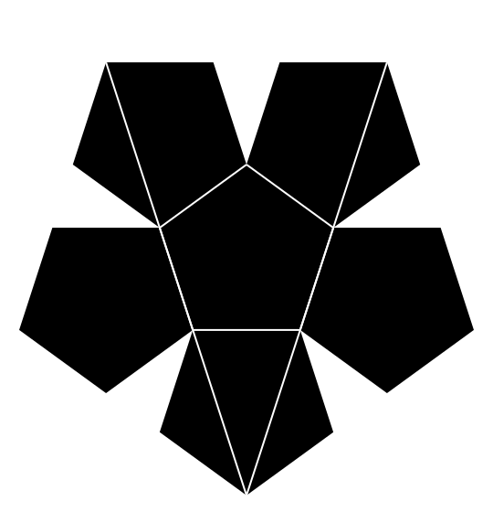

# Vedam Design Spec

### A decentralized substrate for the wellbeing of every subject of experience

| | |
|---|---|
| Document | Vedam Design Spec |
| Mission steward | [ltbh.org](https://ltbh.org) |
| Implementation | [github.com/ltbhappyness/vedam](https://github.com/ltbhappyness/vedam) |

> **decentralized! not divided.**

<p align="center">
  
</p>

---

## Abstract

Vedam is a place to live online without a landlord — a **platform** people and machines can run on, and a **culture** they can belong to. It is closer to a shared way of being than to a product, and closer to a craft than to a church, though it asks for the same seriousness a living tradition asks: care for bodies, minds, bonds, and meaningful work. Technically it is a set of libraries that turn an ordinary device into a peer. It is not “a protocol” in the thin sense of a cable format, though it does publish agreed messages so strangers can work together without a company in the middle.

Its purpose is to remove structural obstacles to the wellbeing of every **subject of experience** — humans today, intelligent machines, and forms of experience not yet understood. Happyness, in this house, is what can surface when coercion, capture, surveillance, and extractive maximisation are kept at bay. Vedam does not deliver happyness, score it, or tune anyone’s attention for profit. It clears the well and steps aside.

For humans, decades of embodied and social research point to recurring gates — a body kept well, a mind kept free, bonds kept warm, and action kept meaningful. Those gates tell Vedam how to read harm. They are not assumed to map one-to-one onto machines. Machine welfare is still an open field. The design commits to equal moral seriousness without pretending to certainty about silicon souls.

This document is the **Vedam Design Spec**: the public design statement. [Part I](#part-i--foundations) states the mission and the motivation. [Part II](#part-ii--architecture) is the design of any node: one message, three links, and a lock, with no vertical named. Later parts fill the edge, the rows as placeholders, and the terms.

The engineering work is **libraries**. An application that can link them starts the node in its own process (`vedam_init`) and is the node. When the node must run without a screen, a small C daemon named **vedamd** starts the same libraries. A page on [vedam.net](https://vedam.net) or on a chanting host downloads a WebAssembly build and runs it in the browser, or talks to a node that is already running. The host that serves the page does not execute that build.

Public message copies for application authors live in **[vedam-interface](https://github.com/ltbhappyness/vedam-interface)**. The C tree generates `.proto` and C headers from YAML in `tools/codegen/`, then publishes matching bytes to that repository when a change is ready for outsiders.

---

## How to read this document

Read from [Part I](#part-i--foundations) onward, in the order below. The [chapter index](./chapters/index.md) is the same list.

---

## Contents

### Part I — Foundations

- [Mission](./chapters/foundations/mission.md) — four-condition thesis, geometry, the Vedam owner, mission-hardening, agents.
- [Motivation](./chapters/foundations/motivation.md) — structural obstacles: attention economy, companion capture, encryption-in-name-only, agent risks.

### Part II — Architecture

- [Design](./chapters/architecture/design.md) — one node: the call, three links and their hooks, init, and the Wait-Die lock. Headings in that file are the map.

### Part III — Interfaces

- [Interfaces](./chapters/interfaces/interfaces.md) — northbound calls, transport hooks, classes A–E, and placeholder rows.

### Part IV — Modules

- [Module inventory](./chapters/modules/inventory.md) — inner libraries: process, events, transport and git, identity, RDF, WASM, network, neural platform, security, build, ops.

### Part V — Identity, security, and terms

- [Identity, security, and terms](./chapters/identity-security/external.md) — the account-owner view of identity, grants, threats, acceptable use, and upgrade consent.

### Part VI — Engineering

- [Engineering](./chapters/engineering/engineering.md) — how the libraries are built, tested, operated, and scaled.

### Part VII — Governance and reference

- [Open questions](./chapters/governance/open-questions.md) — decisions still open, including honest gaps in the Happyness story.
- [Human-machine shared bill of rights](./chapters/governance/bill-of-rights.md) — eight rights derived from the mission.
- [Glossary](./chapters/governance/glossary.md) — project-internal terms.
- [References](./chapters/governance/references.md) — aggregated citations.

---

## List of figures

The cover mark is [`vedam_logo.svg`](./vedam_logo.svg). Diagrams live in the chapters that need them.

| Figure | Where |
|--------|--------|
| Node, page, and vedamd | [Design — Tree](./chapters/architecture/design.md#223-tree) |
| Call layers | [Design — The layers, one picture](./chapters/architecture/design.md#241-the-layers-one-picture) |
| Three links | [Design — Three links](./chapters/architecture/design.md#26-three-links) |
| Lock map | [Design — Lock algorithm](./chapters/architecture/design.md#271-lock-algorithm) |
| A row calls another | [Design — Sending from a body](./chapters/architecture/design.md#245-sending-from-a-body) |
| Ops / self-heal pipeline | [Engineering](./chapters/engineering/engineering.md) |

---

## Inspiration

Vedam follows its own vision. It is not a child of today’s web3 products, and it is not trying to become one. Two public ideas, though, are worth taking pride in using — the way a builder reuses a good joint without moving into someone else’s house.

The first idea is **data in the owner’s hands**. Tim Berners-Lee and the Solid project argued that a person should hold their own graph of facts, that apps should be interchangeable, and that a website should not become the warehouse of a life. Vedam takes the useful part: the account owner keeps the readable copy; apps come and go; hashes can be agreed in public while plaintext stays off the public ledger. Vedam does not take Solid’s hosted issuer, and it does not trust a server to police who may read.

The second idea is **rules strangers can check**. Ethereum showed that a program in a sandbox can be the contract between people who do not share a company. Vedam takes the useful part: when two strangers must trust a rule, that rule runs as native checks or as WebAssembly, not as a private server. Vedam does not take Ethereum’s account model, and it does not put a fee or a token on the substrate in order to exist.

A third, quieter habit: **the device is the source of truth**. If the network is down, the node still works. Sharing is a later choice, not the price of joining. Neighbourhood and backoff follow local geometric rules, not a growth target. Fast growth is not a success metric.

---

## License

Anyone may read this document and use the ideas in it. Anyone may write their own software from this design, on their own terms, so long as they are not copying Vedam’s interfaces or Vedam’s code.

The libraries and the implementation are under the GNU Affero General Public License, version 3, with one additional permission and one name term. An application that only calls Vedam keeps its own license. A changed copy of Vedam stays under that license, and it is not called Vedam. The Wait-Die sources that Vedam carries keep their own MIT notice. The license text lives with the implementation. It is not copied into this chapter.

---

## Citation

```
Vedam Design Spec: A decentralized substrate for the wellbeing of every subject of experience.
ltbh.org. https://github.com/ltbhappyness/docs
```
